# Brecon Guide

This guide follows the development checkout: [release notes](CHANGELOG.md) and
[artifact validation/publication checklist](RELEASE.md). Installation from a
wheel is tested separately from this repository's editable, locked environment.
`brecon --version` reports installed metadata without initializing Qt; the
desktop application and MCP server use the same version.

Brecon was formerly named PyniteGUI. The `brecon` command and Python entry module
are canonical; `pynitegui` remains a compatible command/import namespace. Existing
`.pynite.json`, mesh/plate recipes, preferences and recovery storage keep their
identifiers. Existing MCP clients may continue using the
`pynitegui://automation/reference` resource. Repository/documentation URLs and
historical release artifacts retain the previous name. The first Brecon release
candidate is **1.0.0rc4**; see [publication and validation status](RELEASE.md).
Install Brecon in a fresh environment. If reusing an
environment, uninstall the old `pynitegui` distribution first: both provide the
compatibility import namespace and launch command. With uv tools, remove the old
tool before installing Brecon so its `pynitegui` compatibility command can be
created. Keep project files; uninstalling the tool does not delete them.

The stable 1.0 scope is elastic 2D/3D frames and bilateral axial-only trusses,
with frame-only P-Delta within the documented restrictions. Surface/plate tools
retain their experimental status; nonlinear plastic, modal and reinforced-concrete
workflows are outside the stable scope. See **Engineering Scope** for limits.

The searchable Zensical manual is built from this GUIDE and the project records.
See **Documentation Site** below for local preview and publication instructions.

A Python desktop editor for 2D/3D frames and axial-only trusses with PyNite.

For an audited comparison of PyNite engine capabilities with features actually
exposed here, see [PyNite Capability Coverage](TODO.md#pynite-capability-coverage).

## Run

Install uv, then run from the repository. uv installs and manages Python as well
as the project dependencies; Conda and a separately installed system Python are
not needed:

```sh
uv python install 3.12
uv sync --managed-python
uv run brecon
```

The project sets uv's `python-preference` to `only-managed`, so normal launches
also use uv-managed Python instead of discovering a Conda or system interpreter.

The application uses PySide6 / Qt Widgets and PyNite for structural analysis.

The compact toolbar uses icon-only file, view, edit, load, analysis and result
groups separated by vertical dividers. Hover an icon for its command and shortcut. Select/Member/Pan
show the active mode; the properties menu opens model tables, materials,
sections, cases/combinations and self-weight. Diagrams and deformation stay
disabled until a valid snapshot exists. The same commands remain accessible
through the menus and existing keyboard shortcuts.

### Experimental Surface Meshing

Post-1.0.0rc1 development adds **Tools > Surface Meshing (Experimental)**.
It exposes all seven concrete generators in the locked PyNite Mesh module,
without another solver or meshing dependency. Recipes can be stored in spatial
projects as uncoupled geometry, alongside frames. The published rc1 wheel does
not contain this workspace or the main-model surface integration.

| Generator | Shape-specific options | Element families |
| --- | --- | --- |
| Rectangle | Width, height, XY/XZ/YZ plane, local x/y control lines, named rectangular openings | Quad, Rect |
| Annulus | Inner/outer radii, X/Y/Z axis, target size; automatic radial/circumferential refinement | Quad |
| Annular ring | Inner/outer radii, axis, circumferential divisions; one radial course | Quad |
| Annular transition ring | Inner/outer radii, axis, inner divisions; transitions to three times as many outer divisions | Quad |
| Cylinder | Radius, height, axis, target size; automatic or explicit circumferential divisions | Quad, Rect |
| Cylinder ring | Radius, height, axis, explicit divisions; one axial course | Quad, Rect |
| Conical frustum | Large/small radii, height, axis, target size | Quad |

All recipes expose mesh/material names, thickness, E/nu/weight density,
local stiffness modifiers `kx_mod`/`ky_mod`, XYZ origin and starting node/element
numbers. Modifiers retain the selected upstream element formulation's semantics;
do not assume they modify only bending or only membrane stiffness identically
for Quad and Rect. Target size is disabled for direct ring generators, which
use explicit counts. Quad is DKMQ; Rect is the rectangular polynomial element.

Use the Geometry and Mesh/Material tabs to edit the definition, then
**Apply / Generate Mesh**. Rectangle's Control Lines tab uses typed axis/coordinate
rows; Openings uses name/left/bottom/width/height rows in local rectangle units.
Openings may meet an exterior edge but cannot cut completely across the rectangle,
overlap or touch another opening. Opening boundaries become control lines automatically.
The displayed face edges are the actual four-node element connectivity. Orbit,
orientation gizmo, Faces/Nodes toggles and Fit use the offline Three.js viewport.
Existing application software/hardware rendering settings also apply here.

Save/Open uses a strict, versioned `.pynitemesh` recipe. Undo/redo covers applied
definitions and generator changes. Changing generator starts its shape parameters
and target size from defaults and clears rectangle-only options; undo restores
the previous recipe. Units affect inputs without changing physical dimensions.
**Export generated mesh** writes neutral JSON containing canonical inch-kip node
coordinates, named four-node connectivity, element family/properties and the
recipe. It is not a frame project or an analyzed result file.

The single-mesh workspace has a 1,024-element budget, checked before allocation
(before removing rectangle openings). Generated meshes are checked for finite
coordinates, nondegenerate/coplanar faces, positive Gauss-point Jacobians and
edge-length ratios up to 20; these are basic safeguards, not a mesh-quality
certificate. Very coarse annular meshes that would divide by zero in the locked
engine are rejected. Inner/small radii must remain positive: no full disk or cone
apex is implied. PyNite's frustum places the large-radius rim at the origin and
the small rim in the negative axis direction. This is preserved, not flipped.

The adapter generates at zero and translates all nodes afterward to avoid the
locked cylinder generator dropping transverse offsets or treating axial origin
as its terminal height. It also preserves requested per-element stiffness modifiers
and uniformly numbers generated nodes/elements from the selected starts. These
behaviours are regression-tested for every generator, both available families and
all axes. The source engine and user definitions are not modified.

**Analyze rectangular plate** transfers Rectangle recipes into the separate
plate workspace below. Curved/annular meshes currently offer geometry, recipes
and export only: boundary conditions, surface-normal pressure, membrane/shell
analysis and curved result recovery need separate benchmarks. The planar pilot's
in-plane restraints must not be applied to curved shells. Shear-wall and mat
foundation workflows are specialized model builders, not additional mesh choices
in this catalog, and remain pending. Rectangular Quad meshes can now participate
in the experimental coupled main-model workflow below; atomic MCP surface edits
are supported through the main project server.

### Surfaces in the Main 3D Model

Surfaces start as **geometry only**; rectangular Quad slabs offer explicit
experimental coupled analysis. In a
**New 3D Frame** or an existing spatial project, choose **Tools > Surface Meshing
(Experimental)**, or **Add Surface** in the unselected model inspector. Generate
the mesh and choose **Apply to 3D Model**. All seven generators are supported.
In a 2D project the tool remains a separate recipe workspace; it does not silently
convert the model to 3D.

The main viewport displays surface faces and element edges beside frame members,
with orbit, orientation gizmo, Fit and PNG export. Click a face or select its
entry under **Surfaces**. The inspector's **Edit Surface**
reopens the full recipe editor; apply commits one undo step. Renaming requires
a unique name distinct from frame nodes, members and loads. Delete removes the
selected recipe, with undo/redo; mixed selections and Select All include surfaces.
**View > Surface Geometry** hides/shows meshes without changing the project.
In 3D Select mode, Box Selection or Shift-drag includes whole surface recipes.
Left-to-right selects meshes wholly enclosed by the rectangle; right-to-left
selects any mesh whose projected faces intersect it, including a box wholly inside
a face. Ctrl/Command adds to the existing selection; Escape cancels. Openings are
empty space, hidden surfaces are excluded, and no mesh elements or generated
solver nodes become editable entities. Boxes use undeformed geometry and projected
faces rather than depth/occlusion, so several storeys can be selected together.
Use the tree for an exact floor selection when projected slabs overlap.

**Placement without typing XYZ:** a new Rectangle mesh first uses a valid selected
boundary, otherwise the highest complete horizontal frame level. The geometry
preview includes the reference frame (toggle **Frame** to hide it). Under
**Fit rectangle to**, choose **Frame level** and select the desired elevation,
or **Selected boundary** after selecting four rectangular corner nodes or all
perimeter members in the main model. Split perimeter segments are supported;
their intermediate stations become control lines. Node selection also supports
global XY and YZ rectangles, not just horizontal XZ slabs. The fit tool updates
origin, plane, width and height together, with preview undo/redo.

Existing surfaces are never moved automatically when edited. Select the desired
fit source to reposition one; use **Manual coordinates** for independent numeric
editing. Only complete axis-aligned rectangles are inferred. Open perimeters,
tilted/irregular outlines, diagonal selections and L-shaped extents are not filled
as bounding boxes. Levels with interior beams may use their complete outer
perimeter; select a specific bay's corners/perimeter to fit just that bay. Fitting
preserves material, thickness, target size and openings/control lines. Incompatible
openings/control lines or excessive mesh density reject the fit without changing
the recipe. Coordinates and dimensions use the selected input units.

Placement is a one-time geometric fit, not a live constraint: subsequent frame
edits do not move the surface. Refit explicitly if the frame changes. Touching
geometry does not merge nodes or enable coupled analysis.

The project owns mesh recipes, not additional frame joints. Generated nodes and
four-node connectivity are regenerated deterministically and retained in a bounded
geometry cache. With coupled analysis disabled, coincident nodes are not connected
and different meshes may overlap for geometry exploration. Editing/remeshing/deleting a surface does not alter
frame nodes, members, loads or supports. Surface material definitions remain
recipe-local rather than references into the frame material library.

Version 20 spatial project files include recipes, coupled-analysis opt-in and
surface pressures by load case. Version 19 geometry projects migrate with analysis
disabled and no pressures. Normal save/open,
autosave/recovery, unit changes, model-table edits, undo/redo and MCP frame edits
retain them. Projects are limited to 16 surface recipes and 4,096 pre-opening
elements in total, in addition to the existing 1,024-element per-mesh limit and
generation checks. The separate `.pynitemesh` recipe files remain available.

**Coupled rectangular slabs (experimental):** select a surface and check
**Coupled analysis (experimental)** in Properties. This project-wide option
includes every surface; all must be Rectangle/Quad. Choose **Pressure case**,
enter the signed uniform pressure and **Apply Pressure**. Zero removes that
case's pressure. Positive pressure follows the displayed local normal: +Z for
XY, -Y for XZ and +X for YZ. Pressure uses force per geometry-length squared
(for example kN/m2), not the independent material stress units.

Try **File > Examples > Slabs > 3D Frame and Slab - Coupled Pressure (Experimental)**,
then Analyze. The 240 by 180 inch slab carries 0.001 kip/in2 downward, giving
43.2 kip total and 10.8 kip vertical reaction at each base in the Gravity
combination. This example replaces the frame-only gravity line loads, rather
than double-counting the same slab load. Uplift is a separate negative-pressure case.

At each solve, the adapter shares coincident surface/frame and conforming
mesh-to-mesh vertices within **1e-8 inches**. No nearest-face ties, rigid offsets
or proximity links are created. Frame centreline geometry must agree with the
slab mid-surface. PyNite physical members subdivide at shell nodes along their
axes, preserving the user member ID and load stations. Beam-axis collinearity
also must satisfy the locked engine's stricter `1e-12*(1+L)` tolerance; near misses
are rejected, not assumed connected. Original model nodes inside unsplit user
members still require **Connect Intersections**.
Axial-only truss members touching intermediate surface nodes must be split
explicitly there; solver-only truss subdivision is rejected to preserve releases.
Member diagrams and left/right station inspection retain the force jumps at
mesh-to-beam connections instead of smoothing across them.

Mesh vertices must match all frame joints touching a face. Use rectangle control
lines at intermediate supports or beam lines; an opening cannot retain support
where the surface has been removed. Hanging/nonmatching mesh nodes, overlapping
coplanar faces, beams cutting faces without grid intersections, ambiguous joints
and disconnected components block the solve. There is no automatic remeshing or
node-to-face constraint. Refit/remesh after moving the frame, then analyze again.

Slab supports come from existing shared model joints and their six-DOF restraints
or springs, plus explicit **Edge Supports…** in the selected slab's Properties.
The editor previews four outer edges with global DX/DY/DZ/RX/RY/RZ checkboxes and
Free, Normal roller, Bending clamp, Translations fixed and Fixed presets.
Left/right follow the rectangle's width direction, bottom/top its height direction;
the preview names the global axes. Normal roller restrains only the transverse
translation; Bending clamp additionally fixes the two tangential rotations.
In-plane stability must be provided explicitly. Opening rims are not selected.
At corners and coincident frame/adjacent-slab nodes, restraints are the union of
all owners. A spring on a fixed DOF causes analysis to fail rather than disappearing.
Assignments belong to geometry, so moving/resizing/remeshing reapplies them to the
current outer material boundary. Renaming transfers them, deletion removes them,
and Accept creates one undoable edit; Cancel leaves the model unchanged.
Supported outer segments are marked in the 3D viewport and frame reports when
Supports is enabled, and listed in report definitions. These assignments are
inactive while the project is geometry-only; such projects cannot be analyzed.
There are no hidden plate-pilot constraints. Quad membrane/bending stiffness and
the engine's drilling approximation are retained. The weak drilling approximation can produce global moment
imbalance under lateral/membrane loading. **Every combination must pass independent
force/moment equilibrium before any coupled snapshot is accepted.** Tolerances
are not relaxed to accommodate drilling imbalance; failing models return an error,
not apparently valid results. General lateral/membrane behaviour needs further
validation. Material weight density contributes slab weight in global
-Y when project self-weight is enabled, using the same case/factor as frame
self-weight. Do not separately enter that weight as pressure unless intentional.

Results include original and generated solver-node translations/rotations and
support reactions in the tables/CSV, member forces, independently integrated
force/moment equilibrium, and amplified slab mesh deformation. Generated
`__S...` nodes are result-only, not editable project joints. The inspector shows
the selected surface's peak nodal translation magnitude. Reports include surface
pressure/edge-support definitions and mesh outlines. Select a solved slab and use
**Inspect Slab Results**, or open **Results > Slabs** in the existing Results dock.
Choose the slab, Mx/My/Mxy bending moment per unit width, or Sx/Sy/Txy membrane
stress (tension positive). Local x runs i→j, local y runs i→n, and z=x×y;
each probe prints the three global unit vectors. Moment labels use moment/length
(for example kN-m/m), while membrane stress follows material stress units (MPa).
Colours use a symmetric signed scale for the **selected combination**, with one
unsmoothed value per element centre. Opening holes remain blank; no nodal averaging
or artificial smoothing crosses a material boundary.

Click a face to probe its natural coordinates, choose an element from the table,
or enter xi/eta in [-1,1]; zero is its centre and ±1 its edges. At an interface,
choose the element explicitly to inspect either side. The plot is a centre-value
contour even when the numerical probe is elsewhere. The existing combination
selector and unit controls refresh the view without changing the snapshot.
Engineering edits clear the tab and data. Export Slab CSV writes all element
centres with units, local axes, surface, combination, snapshot/time and model
signature; the plot toolbar saves the contour with its snapshot title.
MCP `read_results(kind="surface_elements", surface_id="Floor", ...)` exposes the
same centre table, with ordinary pagination, combination and snapshot guards.

**Quad transverse shear is unavailable:** raw PyNite 3.0/3.2 Qx/Qy recovery fails
an independent simply supported thin-plate Navier check under refinement. Neither
this tab nor its CSV/MCP output presents those numbers. Quad plate-pilot shear
plots are disabled and `analyze_plate` returns `shears=None` for Quad; corrected
Rect shear remains separate. A validated recovery method is still pending.

Constant-strain/constant-curvature manufactured recovery checks cover all three
planes, origins and natural-coordinate probes. A coupled edge-supported 120-inch
square plate with a negligible-stiffness perimeter beam uses 30/15/7.5-inch meshes
against an independent Navier series: fine interior Mx/My/Mxy relative L2 errors
are below 0.6%, and peak deflection error is below 0.5%; support forces balance.
The beam stiffness is retained, not subtracted. These checks do not validate
general membrane/drilling response or sharp corner peaks. Every combination still
must pass global equilibrium, including after changing edge restraints; even a
pressure-loaded asymmetrically clamped frame/slab can be rejected for drilling
moment imbalance. Shear connectors, eccentric/composite offsets, combined face
stresses and design checks remain pending. Reproduce this bounded comparison,
including diagnostic raw-shear errors (not production result data), with:

```sh
uv run python -B scripts/benchmark_coupled_surfaces.py --output /tmp/coupled-plate.json
```

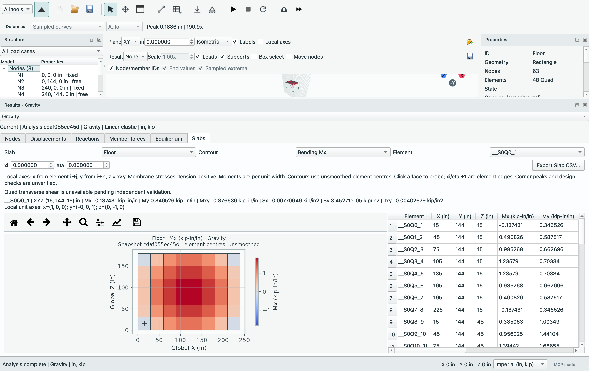

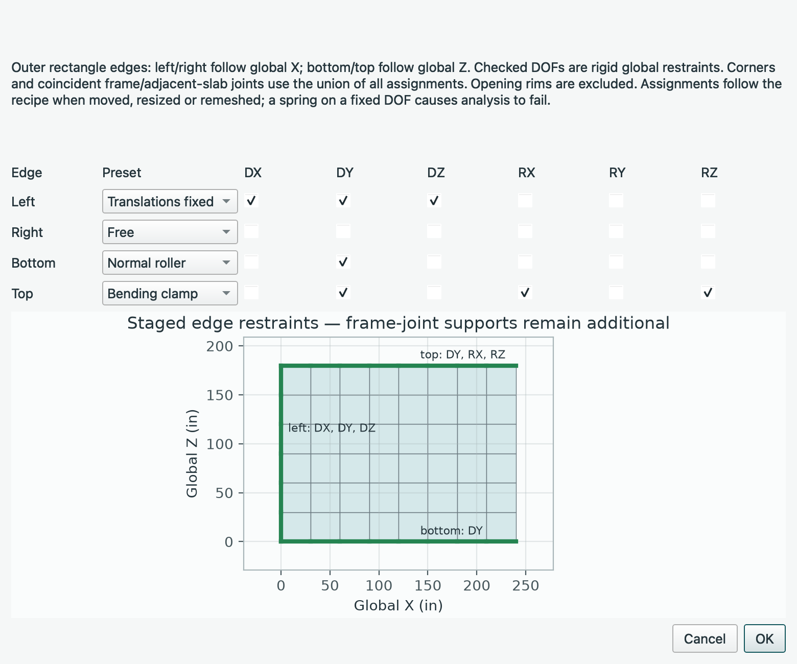

Manual, live, MCP and direct solver analysis use the same opt-in and element-family
guards. With analysis disabled, any surface (even hidden) blocks a frame-only
solve; MCP reports `surface_geometry_only`. With it enabled, the worker validates
connectivity, solves the combined stiffness and checks finite results/stability
and independent force/moment equilibrium for every combination.
MCP reads and atomic batch edits support recipes, pressure maps and coupling
opt-in. A coupled candidate reuses the production interface/conformity checks once
after the entire batch; invalid edits preserve the model, results and undo history.
Editing does not solve or certify stability/equilibrium; those remain analysis gates.
Nonrectangular generators and Rect elements remain geometry-only in the main
model. The separate plate workspace below retains its independent Quad/Rect
bending workflow. Initial regressions cover slab-to-column load transfer,
combinations, self-weight, invalid interfaces and classical square-plate deflection;
independently verify mesh convergence and engineering results before relying on them.

### Experimental Rectangular Plates

Post-1.0.0rc1 development adds **Tools > Rectangular Plate (Experimental)**.
This is a separate, modal transverse-bending workspace, not a conversion of the
open frame project. No additional dependencies are needed. The published rc1
wheel does not include this pilot.

Define width, height, thickness, material E/Poisson ratio and target mesh size.
Choose XY, XZ or YZ and assign each boundary as Free, Simply supported or Clamped.
**Apply / Preview Mesh** uses PyNite's RectangleMesh. **Mesh Options** exposes
Quad/Rect family, XYZ origin, names/numbering, control lines, openings and modifiers
using the same recipe editor. Supported
edges are green: dashed for simply supported, solid for clamped. Width follows
global X in XY/XZ and Z in YZ; height follows Y in XY/YZ and Z in XZ.

Pressure is force per geometry-length squared, with its positive global direction
shown beside the controls (+Z in XY, -Y in XZ, -X in YZ). Negative pressure acts
oppositely. The primary case and factor define the Plate baseline; **Load Cases /
Combinations…** adds further uniform cases and named combinations. Pressure and
edge assignments belong to the surface definition,
not generated node IDs, and are reapplied when the mesh is refined.

**Analyze** runs in a cancellable isolated process. Results include nodal normal
displacement, normal-force reaction sum and unsmoothed element-centre Mx/My/Mxy
contours, plus Qx/Qy for Rect only. Quad shear is withheld pending validation.
Moments are force-length per unit length (for example kN-m/m);
shears are force per unit length. Displacement colouring interpolates nodal values
over display triangles; it is not a higher-order displacement recovery or a
deformed 3D shell view. Export CSV contains local node coordinates, signed normal
displacements/reactions, selected-combination factors and snapshot identity. The plot toolbar exports images.

Save/Open uses separate `.pyniteplate` files with canonical inch-kip values and
strict format/version validation. Version 3 adds named loading and self-weight;
version 2 stores advanced mesh options. Existing version 1/2 plate files migrate
without adding pressures or gravity. Undo/redo covers applied definitions, not
individual keystrokes. Engineering changes clear results; Apply validates before
changing the definition. Display-unit changes convert inputs/plots/CSV while
retaining the current solved combination and snapshot, including unit undo/redo.
This workspace has its own unsaved-change prompt, not frame autosave/recovery.

Pilot limits: one axis-aligned rectangular surface at a specified origin, up to
1,024 elements, aspect ratios up to 20, linear small-displacement elastic bending,
up to 32 uniform pressure cases and 32 combinations (including the primary
**Plate** combination). In-plane translations and the
drilling rotation are explicitly restrained everywhere; this is **not** general
membrane/shell analysis. A simply supported edge restrains normal translation;
a clamped edge additionally restrains both bending rotations. Rigid transverse
mechanisms are rejected; every combination must pass independent global force
and moment equilibrium before any result is published. Large deflection
relative to thickness is flagged but does not enable geometric nonlinearity.
Opening edges are free; outer edge supports and pressure are reapplied after
refinement. Pressure resultant uses net area after openings, and result coordinates
remain local to the origin. Arbitrary outlines, curved surface analysis, frame/surface coupling, nodal loads,
general membrane loading, varying pressure, MCP, PDF and recovery integration
remain separate milestones. Do not substitute this pilot for verified engineering
design or assume the listed limits certify element quality.

**Cases, combinations and self-weight:** the main pressure, case name and Plate
factor retain the original quick workflow: `Plate = factor × primary case`.
Open **Load Cases / Combinations…** to add uniform pressure cases, edit their
pressures, rename them and create named combinations using per-case factors.
The built-in Plate combination remains a primary-case baseline; edit its factor
in the main controls. Rename propagates through combination and self-weight
references. Delete an additional case only after removing those references.
The dialog stages its edits: OK creates one undoable change, Cancel preserves
the plate definition. It can use negative pressures/factors and zero-result
combinations. An additional case can have zero manual pressure and carry weight.

Set **Weight density** in the main controls (force per volume, not mass density).
In the loading dialog select a **Self-weight case** and positive multiplier.
The complete weight acts in global -Y, so this transverse tool permits self-weight
only for horizontal **XZ** plates. Positive local pressure on XZ is downward;
weight contributes `rho × thickness × multiplier` to its selected case, then
that case's combination factor applies once. Do not include the same weight in
manual pressure unless intentional. Disable self-weight before changing to a
vertical plane. XY/YZ transverse pressure remains supported with self-weight off;
the tool rejects in-plane gravity instead of silently discarding it.
Openings remove both manual pressure and weight from their missing area.

Analyze solves all combinations and checks finite results plus six-component
force/moment equilibrium about the recipe origin. One failed combination rejects
the entire snapshot. Choose a solved combination above the contour without
solving again. Plot titles name the combination and snapshot; the status shows
its actual factors and normal reaction sum. Nodal CSV uses the chosen combination
and includes case factors, snapshot ID/time/signature, global normal and weight
case. Quad shear remains unavailable; corrected Rect shear remains separate.
The separate plate tool still has no general membrane or combined face-stress
inspection and is not connected to the main-model MCP server.

For example, a horizontal plate can use Dead pressure plus self-weight, a Live
pressure case, and Service = 1.0 Dead + 1.0 Live or Ultimate = 1.2 Dead + 1.6 Live.
The primary Plate baseline still uses Dead and its main factor alone.

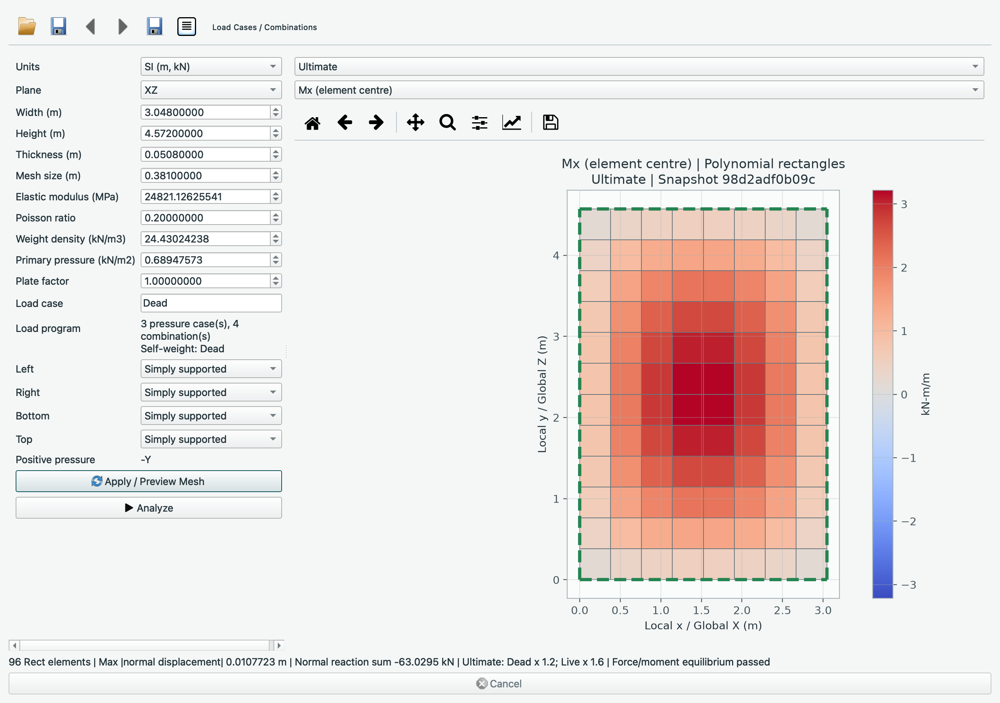

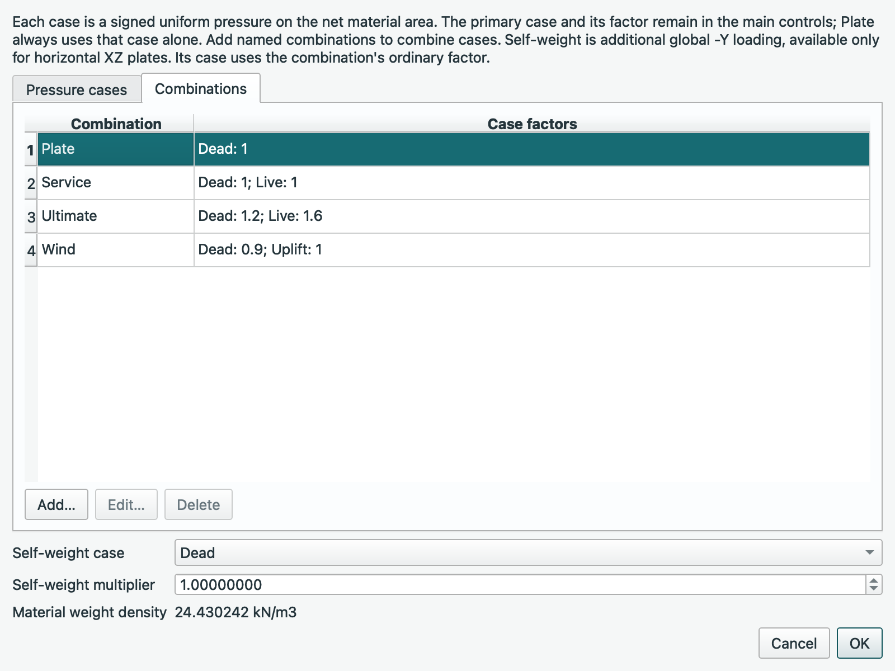

Version 3 retains `pressure`, `load_case` and `load_factor` as the primary-case
inputs. `additional_pressures` maps other case names to signed canonical kip/in2;
`combinations` maps additional combination names to case-factor maps (`Plate` is
reserved). `self_weight_case` is an existing case or null and
`self_weight_factor` is a positive multiplier. All four new fields are required
in version 3; extra fields in legacy versions are rejected. Solved arrays are
not saved in `.pyniteplate` files.

Regression coverage includes independent Navier square-plate deflection and mesh
refinement, a zero-Poisson cantilever strip's closed-form deflection/moment,
equilibrium/sign and plane invariance, clamped/cantilever support
cases, mesh regeneration, persistence, units, undo, stale results and cancellation.
Multi-case checks cover signed/zero superposition in all three planes for both
families, self-weight against an independent Navier reference, off-centre opening
first moments, old-file migrations, reference-preserving renames, cached combination
selection, unit/snapshot preservation and whole-snapshot rejection after a force,
moment or nonfinite failure in any combination.

**Rect recovery correction after RC4:** the published RC4 wheel uses PyNite's raw
Rect resultants. Checks against independent mechanics found opposite bending
signs and excessive twisting coefficients in PyNite 3.0/3.2 recovery. Do not rely
on RC4 Rect moment/shear contours. Quad moments are preferable in that release,
but Quad transverse shear also remains unverified and must not be relied on. Development
1.0.0rc5.dev0 reconstructs the Rect displacement polynomial from its solved local
nodal translations/rotations and differentiates it with isotropic plate laws.
This postprocessing correction does not alter stiffness, pressure loads, nodal
displacements or reactions. Non-unit Rect bending modifiers are rejected during
analysis: the supported engine ignores them in its bending stiffness. Such
recipes can still be opened/previewed/edited; unmodified Rect remains supported.

The common local convention is `Mx=-D(w,xx+nu*w,yy)`,
`My=-D(w,yy+nu*w,xx)`, `Mxy=-D(1-nu)*w,xy` and
`Q=-D*grad(laplacian(w))` in the thin-plate limit, with
`D=E*t^3/(12*(1-nu^2))`. Rect centre recovery follows this polynomial law;
Quad retains the DKMQ bending stiffness with transverse shear flexibility; its
moment output is exposed, while raw Qx/Qy recovery is withheld.
Non-square Navier checks exercise all three moment and both shear components;
manufactured twist/cubic/rigid fields and two-direction zero-Poisson strip checks
verify signs, units and mixed derivatives. XY/XZ/YZ, origins and signed pressure
factors preserve the local resultants.

**Opening benchmark:** a 120 × 120 in plate, thickness 0.6 in, E=3600 ksi,
nu=0.2, simply supported outer edges and a centred 40 × 40 in free opening,
under -1e-7 kip/in². A separate Rayleigh–Ritz reference integrates the Kirchhoff
bending energy over the outer rectangle minus the opening, using odd double-sine
functions and analytic integrals. It imports neither Brecon nor PyNite. The
intact-domain limit reproduces Navier. Increasing the reference from 11 × 11 to
13 × 13 modes changes the chosen deflections and patch means by less than 0.2%;
conditioning and residuals are checked separately from FE comparisons.
The energy formulation follows [the plate-energy derivation, equations 5.9–5.11](https://dspace.lib.cranfield.ac.uk/bitstream/1826/125/2/sherarphd.pdf);
[Li et al.](https://doi.org/10.32604/cmes.2022.021340) describe cutout-domain energy subtraction.
The implementation here is a static reference, not that paper's vibration solver.

Both Quad and corrected Rect meshes use sizes 20, 10 and 5 in (32, 128 and 512
elements). Fine-mesh deflections at (40,60) and (20,60) are within 0.5% of the
reference; area-weighted mean Mx/My/Mxy on the material patch `[0,40] × [0,40]`
are within 1.5%. Successive deflection changes shrink, patch-moment error reduces,
and net pressure/reaction equilibrium is checked. These are test tolerances for
this thin symmetric case, not universal accuracy guarantees. No pointwise
opening-corner stress, general/off-centre/multiple opening, orthotropic,
thick-plate or curved-shell certification is implied.

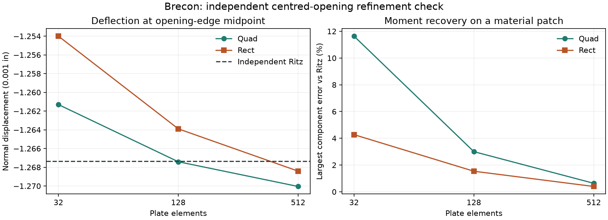

Reproduce the numerical record and figure with:

```sh
uv run --locked python -B scripts/benchmark_plate_recovery.py --output /tmp/brecon-plate-benchmarks
uv run --locked python -B scripts/test.py test_plate_recovery
```

Mesh-specific checks:

```sh
uv run --locked --extra mcp python -B -m unittest discover -s tests -p '*mesh*.py' -v
uv run --locked --extra mcp python -B -m unittest discover -s tests -p '*plate*.py' -v
node tests/mesh_viewport.spec.cjs
```

The optional browser check uses an installed Playwright (`PLAYWRIGHT_MODULE` can
point to it) and writes screenshots under `/tmp/pynite-mesh-qa`. It checks real
generator geometry, nonblank desktop pixels, fit/orbit and bounded rebuilds.

### Optional MCP Automation

MCP `settings/set` accepts `analysis_method: "linear" | "p_delta"`. Read the schema
before editing. `run_analysis` uses this saved choice and returns
`unsupported_analysis` for P-Delta models containing unsupported entities.
`analysis_status.snapshot` and `read_results` include `analysis_method` and
`method_label`, alongside the snapshot identity. Poll normally until the job stops.

Install the optional extra and launch with it from the repository:

```sh
uv sync --extra mcp
uv run --extra mcp brecon
```

A normal installation needs no MCP/server packages. **Tools > Automation Server**
opens a native panel for this project window. The server starts off; choose a
port (default 8765), then **Start**. It binds only `127.0.0.1` and uses the official
MCP Python SDK's Streamable HTTP transport at `http://127.0.0.1:8765/mcp`.
Missing dependencies and occupied ports appear in the panel without installing
anything automatically. Use a separate port for each project window.

Use **Copy configuration** for clients accepting the common `mcpServers` format,
or copy the endpoint into a client's Streamable HTTP settings. **Require token**
starts checked. With it checked, clients need an `Authorization: Bearer <token>`
header; copy the token after Start. For example (replace the placeholder with the
copied token; use the actual port):

```json
{
  "mcpServers": {
    "Brecon": {
      "url": "http://127.0.0.1:8765/mcp",
      "headers": {"Authorization": "Bearer <copied-token>"}
    }
  }
}
```

For a connection that needs no token updates, stop the server, uncheck **Require
token**, then Start again. This preference is remembered in the app settings across
GUI restarts. The checkbox can only change while the listener is stopped. In this
mode no token is generated, Copy token is disabled and Copy configuration includes
only the URL. An LM Studio entry can then remain:

```json
"pynite": {
  "url": "http://127.0.0.1:8765/mcp"
}
```

Recheck **Require token** while stopped to restore authentication. When required,
every start generates a new token; tokens are never persisted. The panel masks the
token and logs only fixed request names/status codes, omitting arguments, model
values, paths and credentials. Status shows the last accepted
request and its count, rather than claiming a persistent client connection.
Closing the panel leaves the server running; **Stop** or closing the project
window stops access. Stop invalidates queued commands immediately. A solve already
started continues under the normal GUI controls; cancel it separately.

**MCP mode** gives the server exclusive control of this project while it runs.
Use the button in the status bar or Automation Server panel; it stays disabled
until the server is running. Entering switches to Select, cancels drawing and
discards unapplied inspector inputs without changing committed model data.
Finish any open modal editing dialog before entering. Menus, toolbars, canvas,
model/results panels and manual shortcuts are locked, while model updates and
solver progress still appear. MCP commands can edit/analyze without the normal
editor-busy check in this mode; tool permissions and session/revision guards still
apply. `read_model` reports `mcp_mode` so clients can see who controls the editor.

Click **Leave MCP mode** in the status bar or panel to return to manual control.
The Automation Server panel remains available for permissions, cancellation via
the client, and Stop. Stopping the server or losing its listener automatically
unlocks the editor. Closing the panel leaves MCP mode active, with the status-bar
release button available. Closing the project window releases the lock before
the normal cancellation and unsaved-change prompt. This mode is per-window,
starts off and is not saved in project files. Ordinary manual controls return
with their current result/analysis availability intact.

Both a permission group and its individual tool switch must be enabled. Model
and result reads start enabled; edits and analysis start disabled. Switches take
effect during discovery, on every call and again before GUI-thread dispatch.
The server always rejects non-loopback peers and invalid Host/Origin headers.
When Require token is checked, it also rejects missing, incorrect or duplicate
authorization headers. Token-free mode retains tool permissions, MCP mode and
revision/session checks. Requests are limited to 1 MiB,
batches to 512 KiB/500 operations, and the GUI queue to 64 commands. Queued
commands time out after 30 seconds; read the current model before retrying a
mutation whose response was lost.

| Tool | Behavior |
| --- | --- |
| `read_model` | Canonical project JSON, session ID and revisions. Exact schema included by default, even for empty collections; use `include_schema: false` to omit it after learning the fields. |
| `read_schema` | Current 2D/3D field types/defaults, support semantics, units, validation rules and valid batch examples. Requires the current session. |
| `read_units` | Display unit definitions and conversion factors. Requires the current session. |
| `apply_batch` | Validate the complete batch, update the GUI and create one undo step. Requires session and expected automation revision. |
| `run_analysis` | Start the existing background solver and immediately return its job ID. Poll `analysis_status` until `running: false`, then check state/error before reading results. Requires session and expected revision. |
| `analysis_status` | Read running state, free-form progress phase, failure, job identity, snapshot metadata and `available_combinations` (names solved in the active snapshot; empty when none). Optional job ID rejects replaced jobs. |
| `cancel_analysis` | Cancel the identified running job through the existing cancellation workflow. |
| `read_results` | Read node/member report rows with snapshot ID, units and current/stale analysis state. Supports solved combination, offset and limit (1–1000). |

The MCP reference resource `brecon://automation/reference` also documents both
dimensions. Tool descriptions name the exact support/member/load fields and direct
clients to the schema before editing. Since clients may not pass resources into a
model's context automatically, `read_model` includes the schema directly and
`read_schema` exposes it as a normal model-callable tool.

The GUI owns one project session per open window; it is not a chat/client session.
There are no create/list-session tools. Call `read_model` without a session ID,
inspect its `schema`, and use `read_schema` for examples. Later model reads may use
`include_schema: false` to reduce response size. Use the returned `session_id` for
subsequent calls and its `revision`
as `expected_revision` for edits/analysis. Opening another project changes the
session; unknown or old IDs return `stale_session`. Discover the new ID with
`read_model` instead of inventing one. Intervening GUI edits, undo/redo and display-unit changes invalidate the
expected revision. Engineering edits clear the active result; display-unit changes
preserve its snapshot identity and convert its report values. Failed or cancelled
reruns can retain previous results, so inspect `analysis_state` before treating a
snapshot as current. Supply `snapshot_id` to reject a replaced snapshot. Responses use
`{"ok": true, "data": ...}` or `{"ok": false, "error": {"code": ..., "message": ...}}`;
MCP tool errors also set `isError`. Remote analysis failures populate Model Findings
and job status without opening a warning popup.

Analysis starts asynchronously. Retain the returned `job_id` and poll
`analysis_status(session_id, job_id)` until `running` is false. Inspect `state` and
`error`; read results after a successful Current state. `phase` is human-readable
progress text, not a fixed enumeration. A replaced job returns `unknown_job`.
Select a result combination from `available_combinations` in status; omit the
combination to use the snapshot default. Model-defined combination names/factors
are also available in `read_model.model.combinations`. Only one active result
snapshot is retained; there is no historical snapshot store or enumeration.

Batch inputs use canonical inch-kip units, degrees for angles and member fractions
for load positions. Ordinary supports are fields on nodes. Spatial `surface_supports` is a separate
geometry-owned outer-edge map; `put` replaces the whole map for that surface,
and surface deletion requires removing its dependent support/pressure maps in
the same batch. `put` merges existing entity
fields or creates an entity using its normal defaults; `delete` requires explicit
dependent-reference updates in the same batch. Numeric material/section edits clear
preset/catalog provenance unless explicitly supplied. Project validation runs once
after all operations, so a rejected batch creates no partial changes or undo step.
Operation-local failures include `error.operation_index`, a zero-based position
in the submitted operations list (including SDK argument validation when an item
has the wrong type). Whole-batch size/reference/constraint failures omit the index
because several cooperating operations may cause or resolve them. Every failure
leaves the model and undo history unchanged; correct the batch and resubmit it.

For example, after obtaining the current session and revision:

```json
{
  "session_id": "<read_model.session_id>",
  "expected_revision": 7,
  "operations": [
    {"op": "put", "collection": "nodes", "key": "N2", "value": {"x": 480}},
    {"op": "put", "collection": "load_cases", "key": "Wind"},
    {"op": "put", "collection": "combinations", "key": "Service", "value": {"Wind": 1}}
  ]
}
```

Entity collections are `nodes`, `members`, `loads`, `materials`, `sections` and
`combinations`; cases use `load_cases` with no value. For `settings`, use `op: "set"`
and a value containing only `unit_system`, `grid`, `default_material`,
`default_section`, `default_load_case`, `self_weight_case` or `self_weight_factor`.
Spatial projects also support `surfaces` and `surface_pressures` collections and
`settings.surface_analysis_enabled`. Surface `put` merges recipe fields and nested
recipe-local material fields; generator `parameters`, control lists and openings
replace whole values. Copying a full `read_model` recipe is supported; its fixed
format/version/unit metadata must remain valid. The schema describes all seven
generators, exact defaults, fields, pressure normals and mesh budgets.

Pressure-map `put` uses a surface ID as key and replaces its complete
`{case: pressure}` map, in canonical **kip/in2** regardless of display units.
Deleting a surface or load case requires explicit pressure-map cleanup and other
reference updates in the same batch. No dependent assignment is silently dropped.
For example, in an existing matching 3D frame (with a `Gravity` case):

```json
[
  {"op":"put","collection":"surfaces","key":"Floor1","value":{
    "plane":"XZ","origin":[0,144,0],"parameters":{"width":240,"height":180},
    "mesh_size":60,"thickness":6}},
  {"op":"put","collection":"surface_pressures","key":"Floor1","value":{"Gravity":0.001}},
  {"op":"set","collection":"settings","value":{"surface_analysis_enabled":true}}
]
```

This is the `operations` array for `apply_batch`; include the current session and
expected revision. Positive XZ pressure acts in -Y. Coupled batches require only
rectangular Quad surfaces and a conforming connected interface. Edit frame nodes,
mesh placement/controls, cases and assignments together when they depend on each
other. Alternatively stage geometry with coupling disabled, then enable it in a
complete valid batch. Existing geometry-only analysis guards remain in force.
Surface editing uses the same Model edits group/tool switch, revision/session
checks, GUI dispatch and one-step undo as other batch edits. Native MCP mode also
applies. Multistorey regressions check two slabs at separate levels, symmetric
base load transfer, combinations, refinement and frame/slab self-weight.

Model reads expose the entity fields for each project's 2D/3D dimension. Active
input drafts, gestures and editing dialogs block remote edits/analysis. Drawing
mode also blocks them: switch to Select mode first. `editor_busy` identifies the
blocker and how to finish/cancel it. The automation panel, read-only fields and
inputs in another project window do not count as unfinished model input. Accepted
edits follow the existing live-recalculation preference, including automatic solves
when live mode is enabled. Analysis progress/cancellation uses the existing isolated
worker and preserves previous results on failure/cancellation.

There are no arbitrary Python/shell execution, project file-management or separate
REST tools. The user opens and saves files normally. Optional viewport capture
remains a follow-up. The server controller and command bridge use only base desktop
imports; optional SDK/HTTP imports occur on Start. The HTTP thread queues commands
onto Qt's main thread, where permissions, session and revision are checked before
using the existing undo/analysis/report workflows.

Automation tests cover base imports without optional packages, missing-extra
messages, lifecycle/port conflicts, token rotation, HTTP authentication/Host/Origin
validation, request limits, permission revocation, queued cancellation, GUI-thread
dispatch, atomic edits/undo, stale revisions/sessions, result pagination and live
wire analysis success/cancellation. Install the extra to include SDK wire tests:

```sh
uv run --extra mcp python -B -m unittest discover -s tests -p 'test_qt_automation*.py'
```

### Optional Live Recalculation

Manual **Analyze (F5)** is the default in every window. Enable **Live
recalculation** in the Analysis toolbar or Edit menu to solve 750 ms after the
last completed engineering edit, including undo/redo. Unapplied inspector/table
drafts, selection and unit changes do not schedule new solves. Enabling it with
an unsolved nonempty model schedules that model; a valid snapshot is not rerun.
Live mode waits while a dialog, drawing mode, pointer gesture or modified numeric
editor is active. A completed automatic snapshot also waits before refreshing
the canvas; intervening engineering edits discard that deferred snapshot.

Automatic solves use the same isolated worker and cloned model as manual
analysis. An edit during an automatic solve cancels it and queues the latest
revision after cleanup and debounce. A manual solve is allowed to finish, but
its outdated reply is rejected before the queued solve starts. Pending, current,
failed and cancelled states are shown in Results. Automatic failures populate
Model Findings without opening a warning popup or retrying until another edit.

The stop button cancels a pending or running solve and waits for a new edit or
explicit Analyze. Switching live mode off cancels an automatic solve and clears
its queue; it leaves a manual solve running. Closing clears pending work before
the normal worker cleanup and unsaved-change prompt. Live mode is a per-window
editing preference and is not stored in project files. For large models, leave
it off and use Analyze when ready.

### Platform Checks

- macOS: the user reported successful operation on 2026-10-09. This is a smoke
  test, not an independently reproduced installation or full regression run.
  The supplied diagnostics show Qt 6.11.2 / Cocoa, a MetalSurface, and a ready
  WebGL 2.0 viewport using ANGLE's Apple M4 Max Metal renderer. Startup and
  next-launch preferences are auto, with platform defaults and no requested
  backend overrides. This records a working hardware-rendering path on that Mac;
  the macOS version, installation steps and individual workflows remain unrecorded.
- Linux: native NVIDIA/Wayland rendering and desktop interactions have been
  checked on the development host; backend-specific recovery is documented below.
- Windows: installation and native rendering checks remain pending.

## Spatial Frames

Use **File > New 3D Frame** for a new spatial project. **File > Examples > 3D Frames**
includes **3D Cantilever - Biaxial Bending and Torsion** and
**3D Space Frame - Gravity and Wind**. **Examples > Trusses > 3D Truss Tripod - Joint Load**
provides a pin-jointed spatial benchmark. **Examples > Slabs** contains the single-floor
and three-storey coupled slab examples.
The existing New command still creates a 2D project. Dimensions never change
implicitly. Use **File > Create 3D Copy** to convert an existing 2D definition into
an independent, unsaved 3D window; the original geometry, undo history, file and
result snapshot remain untouched. Save the copy to its own file and analyze it
again. Closing the source window does not close the copy.

- Conversion places the original XY geometry at the entered global Z offset.
  **Preserve planar constraints** (default) explicitly fixes DZ/RX/RY at every
  node and preserves the original global DX/DY/RZ restraints and springs. These
  are real, editable custom supports, not hidden solver stabilization, and retain
  the original in-plane linear response.
- **Use spatial supports** removes the planar adapter constraints: free nodes
  have six free directions, pins restrain XYZ translations, fixed supports
  restrain all six directions, rollers remain global Y-only, and custom supports
  keep only their explicitly defined in-plane restraints/springs. Review supports
  before analysis; a planar truss or Y-only-supported frame may be unstable out
  of plane. No missing stiffness is silently restrained.
- IDs, assignments, material/section provenance, units, grid, cases/combinations,
  load fractions/intensities and self-weight settings are copied. Angled and
  member-local planar forces become global spatial azimuth/elevation forces with
  the same actual XY components, including on reversed/vertical members. Generated
  self-weight is regenerated, not duplicated; member roll starts at zero.
- Unreleased frames and axial-only trusses can be converted. Frame members with
  any DX/DY/RZ end release are rejected by name until general spatial end releases
  are supported; conversion never drops their releases. Redundant planar truss
  moment flags become the spatial axial-only type. Conversion copies definitions,
  not analytical results, and does not infer new joints at crossings.

- The central viewport uses bundled Three.js and Qt WebEngine, offline. Drag to
  orbit in Select mode, use Pan for translation, and wheel to zoom. Fit and the
  isometric/front/top/right/back/bottom/left camera presets reframe the model.
- The lower-right orientation gizmo rotates with the camera. Click a signed axis
  to animate to that view while preserving the current zoom and orbit center;
  **ISO** restores the isometric fitted view. The native view selector follows
  gizmo choices and shows **Orbit** during free navigation. With the gizmo focused,
  X/Y/Z select positive axes, Shift+X/Y/Z select negative axes, and Home restores
  isometric. This uses the bundled Three.js r180 `ViewHelper`, under its MIT license.
- In Member mode choose an XY, XZ or YZ work plane and its perpendicular offset.
  Two clicks draw a snapped member. Existing picked nodes take priority over the
  work plane, allowing connections between different planes. Escape cancels a
  pending member. Add Node opens exact XYZ entry; Model Tables can define complete
  node/member connectivity numerically. All engineering edits support undo/redo.
- In Select mode, enable **Move nodes**, choose **XY**, **XZ** or **YZ**, then drag
  a node sphere. Only the two in-plane coordinates move; the perpendicular
  coordinate stays at that node's original value, independently of the drawing
  offset. The preview grid temporarily follows this plane through the node.
  In-plane coordinates snap to the canonical model grid in every unit preset.
  Clicks still select; dragging empty space still orbits. Box select takes priority
  and the two explicit toggles are mutually exclusive; Shift-drag still starts a box.
  Escape, lost pointer capture, camera/viewport changes or an incoming model redraw
  cancel the preview without changing the project. An edge-on work plane shows
  feedback instead of guessing coordinates; choose its matching front/top/right view.
  Preview hides analytical overlays, loads and local-axis arrows until release or
  cancellation. Release validates one atomic move and one undo command; duplicate
  node positions and zero-length members are rejected without dropping results.
  Stale revisions/coordinates, disabled tools and out-of-plane/off-grid requests
  are rejected. A successful move selects the node and invalidates results.
  Supports, IDs, assignments, roll and manual load fractions are retained;
  self-weight is regenerated using the new lengths. Moving does not merge nodes
  or connect crossings; use the explicit topology commands and reanalyze.
- Select a member and choose **Split...** in its inspector or **Edit > Split
  Selected Member**. Enter a fraction measured from its start. The first segment
  retains the original member ID; new segments preserve material, section and roll.
  Existing coincident joints retain their supports, springs and nodal loads.
  Point loads keep their physical XYZ stations and reference directions; a 3D
  point force/moment at a cut remains a member-end load on the preceding segment,
  preserving its ID and rolled local axes instead of resolving it into nodal loads.
  Partial uniform/varying distributed loads are clipped and interpolated onto
  the segments; new pieces get new load IDs and retain cases/angles. Self-weight
  is regenerated from segment lengths without double counting.
- **Edit > Connect Intersections** explicitly connects actual XYZ crossings,
  T-junctions and existing interior nodes by creating shared endpoints and segments.
  Skew lines and crossings seen only in projection do not connect. Collinear
  overlaps are rejected before any changes. Both topology commands are atomic,
  undo in one step and invalidate results; repeat analysis after editing.
  Drawing or analysis never silently connects a crossing, and solver-only
  physical-member segmentation remains outside this workflow.
- **Edit > Subdivide Selected Members** divides each selected frame into 2–100
  equal segments. It uses the same load/roll-preserving split rules, retains
  coincident nodes and applies the entire selection as one undoable edit.
  Axial-only trusses are rejected because subdivision introduces unbraced joints.
- In Select mode, enable **Box select** or hold Shift while dragging a rectangle.
  Left-to-right selects enclosed nodes and complete members; right-to-left also
  selects members crossing the box. Ctrl/Command adds to the current selection;
  an empty replacement box clears it. Escape cancels without changing selection.
  Selection uses projected undeformed nodes and straight member centerlines,
  including geometry behind other members, not visible diagram/deformation curves
  or load arrows. Geometry behind the camera/near-far clip is excluded. Ordinary
  clicks still pick individual entities; orbit resumes when box mode is off.
- With multiple entities selected, the inspector offers explicit **Keep existing**
  choices. Assign member materials/sections and optional roll, node support presets
  or custom global restraints, all six support-spring stiffnesses, and load cases
  or a signed magnitude multiplier. A custom support starts from each node's
  current effective restraints; untouched checkboxes retain those values. Scaling
  changes both intensities of varying loads and preserves their angles/stations.
  All chosen changes are validated together and applied as one undoable edit.
  Invalid combinations, such as a spring on a rigidly restrained DOF, reject the
  entire batch. Geometry and unselected properties remain unchanged.
- XYZ coordinates, grid and plane offset use the selected project length units.
  SI/imperial selection preserves the physical model and valid results. Y is
  vertical; automatic self-weight acts in global -Y using full 3D member length.
- Nodes have DX, DY, DZ, RX, RY, RZ global degrees of freedom. Fixed restrains all
  six; Pin restrains XYZ translations only; Roller restrains global Y only.
  Custom exposes all six restraints. Positive bilateral springs are available
  on each DOF; a spring and rigid restraint on the same DOF are rejected.
- Members use per-member materials/sections and a roll angle about their local
  x axis. Local x runs from start to end; local y/z follow PyNite's transformation
  including roll. The inspector gives local-axis vectors in global XYZ, and the
  Local axes toggle displays the selected member's triad. A/Iy/Iz/J remain section
  properties; changing roll rotates the section without swapping stored values.
- Loads accept global FX/FY/FZ/MX/MY/MZ and member-local Fx/Fy/Fz/Mx/My/Mz.
  Load dialogs label the reference explicitly. In Model Tables, uppercase means
  global and mixed case means local. Nodal loads use global directions only.
  Uniform/varying distributed forces support partial spans; magnitudes are force
  per full member length, not projected length. Distributed moments are excluded.
- **Global angle** enters nodal/member point forces or distributed member forces
  by signed magnitude, azimuth and elevation. Azimuth is measured in global XZ
  from +X toward +Z (0 = +X, 90 = +Z); elevation tilts toward global +Y
  (+90 = upward, -90 = downward). The preview lists global FX/FY/FZ, including
  both end intensities for varying distributions. Negative magnitudes reverse
  the chosen direction. One saved load retains its angles; resolution into
  solver components is automatic. Angles are also editable in Model Tables
  and included in model-definition reports. Angular moments and local-axis
  azimuth/elevation input are not offered.
- Background analysis solves all six DOFs without planar stabilizing restraints.
  Insufficient restraints report affected global directions. Named cases,
  combination factors, progress/cancellation and stale-result rejection are shared
  with the 2D workflow. Reactions and nodal motions are global; rotations are radians.
- Choose **Type = truss** in the spatial member inspector, bulk inspector or Model
  Tables for a bilateral axial-only element. PyNite releases both bending planes
  and torsion at one end; the element transfers axial force only. E and A determine
  stiffness; Iy/Iz/J and roll do not add bending/torsion stiffness. Truss members
  use thinner spring/axial-colored lines and a `[truss]` label. This is not a
  tension-only or compression-only element.
  Manual member loads are rejected; apply forces at braced/restraint-compatible
  joints. Conversion to truss never silently removes existing member loads.
  Self-weight is lumped half to each end joint; frame self-weight remains distributed.
  At a truss-only joint, unsprung/unrestrained rotations are inactive and reported
  as **n/a**. Numerical elimination of these unused rotations cannot restrain
  translations or transfer moments through trusses. Explicit rotational supports
  and springs can react joint moments; moments on an inactive rotation are rejected.
  A joint shared with a frame retains its frame rotation DOFs. Shear, torsion and
  bending truss results are zero; deformed truss lines interpolate joint translations
  linearly, without a bending curve. Splitting a truss introduces a joint that must
  be appropriately braced; an unbraced intermediate joint is a real mechanism.
- The viewport **Supports** toggle controls global rigid-restraint and bilateral
  spring symbols without changing the model or results. Each constrained DOF has
  its own symbol: translational rigid stems end at grounded pads, rotational rigid
  restraints use stopped rings, translational springs use coils and rotational
  springs use spirals. Rotation symbols sit farther along the same negative global
  axis to distinguish them from translation symbols. Symbol sizes are illustrative,
  not physical dimensions or stiffness magnitudes. Rigid restraints use the support
  color; springs use the spring/axial color in both themes.
  Hover a symbol to highlight its DOF in a six-row global support tooltip, or hover
  a node to inspect all DX/DY/DZ/RX/RY/RZ states. Spring stiffnesses use the selected
  force/length or moment/radian units. Clicking a symbol selects its node for editing.
  Hover details remain available on nodes when symbols or labels are hidden.
  Tooltips disappear during navigation/drawing and are not part of PNG exports;
  visible support symbols are included in the exported viewport image.
- Deformed shows all three translational components, sampled in rolled local axes
  and transformed to global XYZ. Auto uses 15% of the largest coordinate extent;
  True Scale uses 1x; Custom uses the chosen factor. Peak is the actual sampled
  translational displacement magnitude, not an exact optimization or twist angle.
  Fit includes displayed deformed paths. Torsional rotation is reported numerically;
  this line-member viewport does not render cross-section twisting.
  **Straight preview (approx.)** joins globally displaced member ends and omits
  interior bending. Its peak and Auto factor use nodal translations only. It
  avoids member span sampling when no force/moment overlay is active; an active
  diagram retains its full sampled numerical ordinates. Surface meshes retain
  their existing nodal deformation display. Return to **Sampled curves** for
  member bending shapes; probes, tables, reports and exports retain solver results.
- Diagrams opens a retained member snapshot with N, Vy, Vz, T, My, Mz, dy and dz.
  Curves use local solver signs, with N positive in compression, and sample both
  sides of point-load boundaries. Combination and member selectors are independent
  of subsequent model edits. Enter **Distance** or click a member plot to inspect
  all eight values at that station. **Left side / Right side** queries the solver
  immediately before/after interior load boundaries, rather than interpolating
  screen curves. End stations query the member endpoint. Units change without
  changing the physical station; changing members resets the station to zero.
  CSV includes all six global node responses and member end values/extrema.
  Printable numerical reports split wide results into readable tables.
- The retained diagram window's **Combination Envelopes** tab compares checked
  analyzed combinations independently of the single-combination selector. Node
  bounds cover all six global motions and reactions; member summaries use exact
  solver extrema of N, Vy, Vz, T, My, Mz, dy and dz over each entire member.
  **Member Curves** shows sampled lower/upper bounds and solver-based one-sided
  station values with their governing combinations. First checked combination
  wins ties. These are independent bounds, not one simultaneous load state.
  Export envelope summaries as CSV or select them in **Print Results**; both
  retain snapshot identity, selected combination factors and project units.
  Whole-structure report diagrams are single-combination views; the envelope
  sections remain numerical summaries, not ribbons depicting one governing state.
- The viewport **Result** selector overlays N, Vy, Vz, T, My or Mz across the
  entire undeformed frame for the currently selected result combination. **Scale**
  multiplies automatic diagram height: 1x maps the largest absolute sampled value
  to 15% of the largest model coordinate extent (at least one grid spacing).
  This is a display scale, not a change to forces or stiffness. **End values**
  and **Sampled extrema** independently control ordinate labels. An extremum can
  be at a member end; turn off both to hide all ordinate labels. **Node/member
  IDs** controls names on the model and ordinate labels. The existing **Labels**
  switch remains the master for context text (including model IDs, load descriptions
  and local-axis labels); numerical diagram labels use their own controls.
  **Loads** and **Supports** independently control their geometry. Hiding IDs
  does not remove load descriptions or the quantity/unit/sign legend. Fit includes
  diagram extents, and deformed shape can be
  displayed alongside them. Changing geometry clears stale result overlays.
- Diagram ordinates follow PyNite's local solver signs, with N positive in
  compression. Positive values offset toward local y for N, Vy, T and Mz, or
  local z for Vz and My, including member roll. The N/T offset direction is a
  plotting convention, not their force/moment vector direction. Point-load
  discontinuities retain both one-sided values. Legend ranges and value labels
  are sampled, not exact optimized extrema; use the member detail/CSV for
  solver-reported extrema. Units follow the current SI/imperial display choice.
- The save icon on the viewport result toolbar exports the current camera view
  as PNG, including visible geometry, diagram labels, signed-axis gizmo and the
  combination/unit/sign legend. The native controls and editing sidebars are
  excluded. For printable diagrams use **File > Export Results > Print Results**
  or the retained diagram window's export menu. Select N, Vy, Vz, T, My and/or Mz
  and check **Isometric**, **Front XY**, **Top XZ** and/or **Right YZ** views.
  Each component/view pair gets a page with snapshot ID, combination and units.
  Preview offers native printing/save-to-PDF. These are deterministic orthographic
  diagrams from the analyzed snapshot, not captures of the live orbit camera;
  they work without WebGL and always use a light, print-friendly palette.
  Report options also offer **Diagram node/member IDs**, **Diagram end values**
  and **Diagram sampled extrema**, alongside supports and factored loads. When
  printing from the main 3D view, these initialize from the visible choices;
  changing report checkboxes does not change the viewport. Direct report calls
  default to all labels on. Each report page records which label groups are shown.
  These choices affect annotations only; sampled ranges, shared scale, rolled
  local axes and numerical result tables stay intact.

  Diagram amplitude maps the largest absolute sampled ordinate across the whole
  model to the chosen percent of model extent (at least one grid spacing).
  Side/sign controls change only printed geometry and display labels, not solver
  tables, CSV or envelope bounds. Supports/springs and factored combination loads
  have separate visibility controls. Triangles identify rigid supports, squares
  bilateral springs, and labels identify global DOFs. Moment double arrows follow
  their global/rolled axes; normal-to-view forces/moments use a circle toward the
  viewer or cross away. Projected members and offsets can overlap or be edge-on;
  choose additional views. Dense labels are omitted instead of overlapped; use
  numerical model/results tables for exact definitions and solver extrema.

[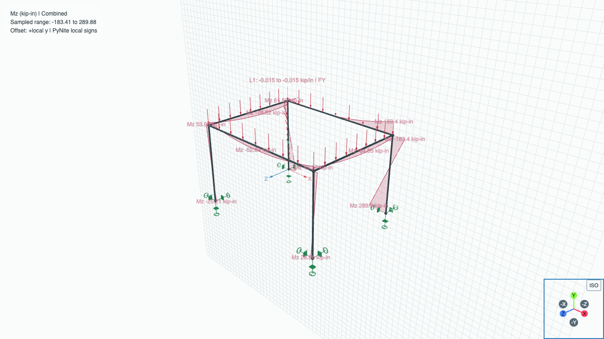](docs/assets/screenshots/spatial-diagram-readability.png)

*The offline viewport retains the local-axis, combination and unit legend when
labels are reduced. Its curves and force values are unchanged.*

Current spatial scope includes linear elastic frames/trusses and opt-in
experimental rectangular Quad slabs, plus P-Delta elastic analysis of frame-only
models. General curved-shell analysis, solids, material plasticity and manual
spatial frame member releases are not implemented. Coupled slabs use solver-only frame segmentation at mesh nodes;
user-defined frame intersections still require explicit shared endpoints.
Multi-selection supports bulk assignments and
deletion; use Model Tables for coordinated geometry editing. Geometry requires explicit shared endpoints;
overlaps, interior nodes, crossings without a shared joint and disconnected groups
are rejected before analysis. Skew lines are not mistaken for intersecting members.
Dedicated support/spring symbols and hover details show global DOFs and selected-unit
stiffnesses; the inspector and model tables provide exact editing controls.

Qt WebEngine is included with the full PySide6 dependency. Three.js 0.180.0 and
OrbitControls are bundled unmodified under their MIT license in
`src/pynitegui/qt/viewport3d/vendor/`; no CDN is used. The Chromium sandbox is not
disabled by the application. On Linux Conda hosts with a mismatched Brotli common
library, a narrowly scoped loader retries the system library only for the known
missing-symbol import failure. Other import failures are displayed explicitly;
numeric model editing remains available but rendering is unavailable.

### Graphics Recovery

To close a terminal-launched session, use the window close button or press
Ctrl+C once. Terminal interrupts request normal Qt shutdown, including unsaved
changes prompts and analysis/server cleanup. Finish or cancel an open modal
editor first, then press Ctrl+C again. Repeated interrupts do not bypass a save
prompt. This requires a responsive Qt event loop; it cannot resolve a native
driver deadlock.

If the entire application is unresponsive, identify that session's process and
terminate only that process as a last resort. Forced termination can lose unsaved
work and does not run normal cleanup. On relaunch, check for autosave recovery;
recovery is not a substitute for saving. An EGL warning alone does not establish
that the application is frozen.

When a Linux graphics driver/EGL/Vulkan mismatch prevents WebGL2 from starting,
close Brecon after saving and launch with:

```sh
uv run brecon --software-rendering
```

This requests Chromium's CPU-based ANGLE/SwiftShader driver before Qt initializes,
disables GPU compositing, and requests software OpenGL for Qt. Qt can select its
platform-specific WebGL driver instead; the tested NVIDIA/Wayland configuration
uses Mesa llvmpipe, while offscreen Qt selects the NVIDIA driver with CPU compositing.
This is a compatibility mode, not a guarantee that every GPU operation is disabled.
No `QT_QUICK_BACKEND` override is applied because
Qt WebEngine's software GL driver is incompatible with that override on some hosts.
This mode does not install drivers, alter the operating
system, disable Chromium sandboxing, or enable the unsafe-WebGL fallback flag.
The view uses only bundled local content. Some EGL/driver warnings may remain even
when the viewport renders successfully. CPU rendering can be slower for large
models. Qt's `--disable-gpu` workaround alone is insufficient for this WebGL2
viewport; it may disable the context Three.js needs.

**View > 3D Rendering > Software (CPU Compositing)** saves this preference for normal future
launches; rendering changes require an application restart. A failed viewport
also offers **Use Software Rendering on Restart**, keeping model data and unsaved
work intact. **Automatic (GPU)** restores the normal backend on subsequent starts.
The command-line options `--graphics=software` / `--graphics=auto` override saved
preferences for one launch. Existing unrelated Chromium flags are retained;
explicit software mode replaces conflicting graphics-disable/backend flags.

Backend references: [Chromium SwiftShader driver documentation](https://chromium.googlesource.com/chromium/src/+/main/docs/gpu/swiftshader.md)
and [Qt WebEngine hardware acceleration](https://doc.qt.io/qt-6.10/qtwebengine-features.html#hardware-acceleration).
Terminal warning/output lines are not shell commands; paste only the command above.

### NVIDIA Hardware Rendering on Linux

Automatic rendering now applies the verified NVIDIA/Wayland configuration before
Qt starts when exactly one GPU drives connected displays, that GPU is NVIDIA,
both driver manifests exist, and no explicit graphics overrides are present.
On that setup, launch normally with `uv run brecon`; New 3D Frame needs no
additional terminal settings. A saved software preference remains respected:
select View > 3D Rendering > Automatic (GPU) and restart to use hardware rendering.
Connected hybrid/multiple-GPU displays, non-Wayland sessions, and explicit backend
settings are left untouched rather than guessed.

`nvidia-smi` confirms the NVIDIA driver is running, but Qt and its embedded browser
must also select compatible graphics backends. On the tested Ubuntu Wayland host
with a Quadro RTX 4000 and driver 580.178.04, automatic EGL selection chose Mesa
llvmpipe, causing WebGL2 to be blocklisted. Selecting NVIDIA EGL alone enabled
WebGL but left Qt unable to create its OpenGL context. Selecting NVIDIA EGL and
Vulkan together rendered the frame with GPU compositing enabled:

```sh
env -u QT_OPENGL -u QT_QUICK_BACKEND -u QTWEBENGINE_CHROMIUM_FLAGS \
  QSG_RHI_BACKEND=vulkan \
  __EGL_VENDOR_LIBRARY_FILENAMES=/usr/share/glvnd/egl_vendor.d/10_nvidia.json \
  VK_DRIVER_FILES=/usr/share/vulkan/icd.d/nvidia_icd.json \
  VK_LOADER_LAYERS_DISABLE='*MESA*' \
  uv run brecon --graphics=auto
```

Run from the project directory after saving and closing the existing app. These
environment settings apply only to this process; no system graphics configuration
or browser blocklist/sandbox is changed. `--graphics=auto` overrides a saved
software preference for this launch. The driver JSON paths must exist on your
distribution. Use the uv-managed environment from the setup instructions above;
the stale Conda-based environment on the test host has been replaced.
On this host, the managed-Python launch also required disabling Mesa Vulkan
layers: without that setting, the native Vulkan loader crashed during
`vkCreateInstance`. The layer setting is launch-scoped, not a system-wide change,
preserves unrelated layers, and does not disable the Chromium sandbox or GPU blocklist.

For diagnostics, add `QT_LOGGING_RULES='qt.webenginecontext=true;qt.webengine.compositor=true'`
to the command. Successful hardware rendering should report the Quadro as the
`QSG RHI Device`, NVIDIA in `GL Renderer`, and `GPU Compositing: Enabled`; viewing
the model must also succeed. A working context alone does not prove Qt can display it.
Use software rendering if this configuration does not work on another machine.

On GNOME Wayland, Qt currently omits its own client-side decorations for Vulkan
windows. Brecon supplies a compact title bar for affected main windows and
its own box/form-layout dialogs, with close, minimize/maximize where applicable,
title dragging and double-click maximize. Closing still uses the existing
unsaved-work confirmation. Other platforms/backends retain their native controls.
See [Qt's Vulkan decoration limitation](https://codebrowser.dev/qt6/qtbase/src/plugins/platforms/wayland/qwaylandwindow.cpp.html).

References: [Qt NVIDIA graphics integration](https://doc.qt.io/qt-6.10/qtwebengine-features.html#nvidia-on-linux),
[NVIDIA EGL vendor selection](https://github.com/NVIDIA/libglvnd/blob/master/src/EGL/icd_enumeration.md),
and [Vulkan driver selection](https://github.com/KhronosGroup/Vulkan-Loader/blob/main/docs/LoaderDriverInterface.md).
See also [Vulkan layer filtering](https://github.com/KhronosGroup/Vulkan-Loader/blob/main/docs/LoaderLayerInterface.md).

**View > 3D Rendering > Diagnostics** shows the observed WebGL renderer,
vendor, WebGL/shader versions and information source. Driver details may be
masked by the platform; unavailable values stay explicit. Startup preference,
next-launch preference and requested environment overrides are listed separately
from the observed Qt window surface and WebGL driver. Selecting Automatic is
not proof of hardware rendering, and Software describes requested compositing,
not a guarantee about the platform's chosen WebGL driver. Refresh rechecks the
active 3D viewport; a missing/failed viewport does not invent GPU details.
This panel does not query the compositor's physical GPU or a driver package version.

## Workflow

### Help and Workspace

The main menus follow **File, Edit, View, Tools, Help**. **Help > Documentation**
(or **F1**) opens the [Brecon website](https://praksharma.github.io/PyniteGUI/)
in your default browser. **Getting Started** opens its first-model walkthrough.
These links open only when requested; the editor does not require an online
connection. If your system cannot launch the browser, a dialog provides the
address to open manually.

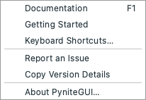

*Help commands in the current checkout. Native menu placement and shortcut symbols
vary by platform; the screenshots below use example projects and disposable settings.*

**Help > Keyboard Shortcuts** opens a searchable native reference built from the
current editor commands. It displays the platform's shortcut notation, includes
both redo bindings, and keeps Undo/Redo labels stable after edits. Single-letter
tools apply when the model view has focus; Escape cancels the current gesture.
The reference is available offline.

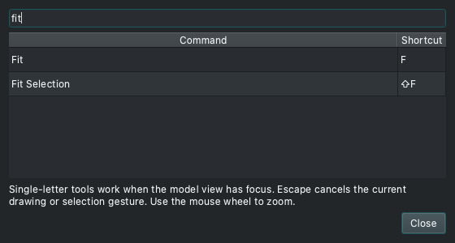

*Search for `fit` to compare whole-model **F** and selection-only **Shift+F**.
The reference follows the application's light or dark appearance.*

**Help > About Brecon** shows the installed application version and
license, with buttons for documentation, the repository and issue reports.
About uses the repository link rather than personal author credits.
On macOS, the native menu may place About in the application menu.
**Copy Version Details**, available in Help and About, copies the application,
Python, Qt, PySide6, PyNite, NumPy/SciPy and operating-system versions for a bug
report. It does not submit an issue; **Report an Issue** opens the project's
issue page for you to review and write a report. About and Shortcuts windows
can stay beside the editor and reuse the same window when reopened.

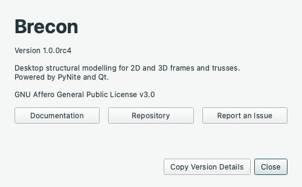

*About links directly to the repository. Copy Version Details prepares text for
your report; it does not send anything.*

The compact **Workspace** selector starts at **All tools**, preserving the full
command layout. Choose **Model** to show editing/loading commands and the
Structure/Properties docks, or **Results** to show result/deformation commands
and the resizable Results dock. File, view and analysis commands remain in both
focused layouts. The same choices are available under **View > Workspace**.
Results can be opened before solving; its existing empty/outdated state still
applies. Solving in **All tools** or **Model** preserves the Results dock's
current visibility: a hidden dock stays hidden, while an open dock updates in
place. Open it explicitly through **View > Results**, or choose the **Results**
workspace. Solving in that workspace shows Results. Workspace choice does not
change the analysis lifecycle or automatically switch profiles.

The adjacent checked button, also **View > Workspace > Show Command Toolbars**,
collapses or restores the command toolbars. The workspace selector remains
accessible. Collapse state follows workspace changes, so you can keep more room
for the model and restore the chosen profile's commands when needed.

Switching changes visibility only: it does not rebuild Properties, apply drafts,
change the active select/member/pan tool, edit the model, alter selection/undo,
fit the view or replace retained result windows. Planar zoom/centre are retained
through dock resizing; the spatial renderer receives no camera/scene request.
Existing 3D result controls and separate diagram windows remain available; the
workspaces do not add new result types. Profiles and collapse state are per-window
presentation choices, not saved model definitions or persistent preferences.

[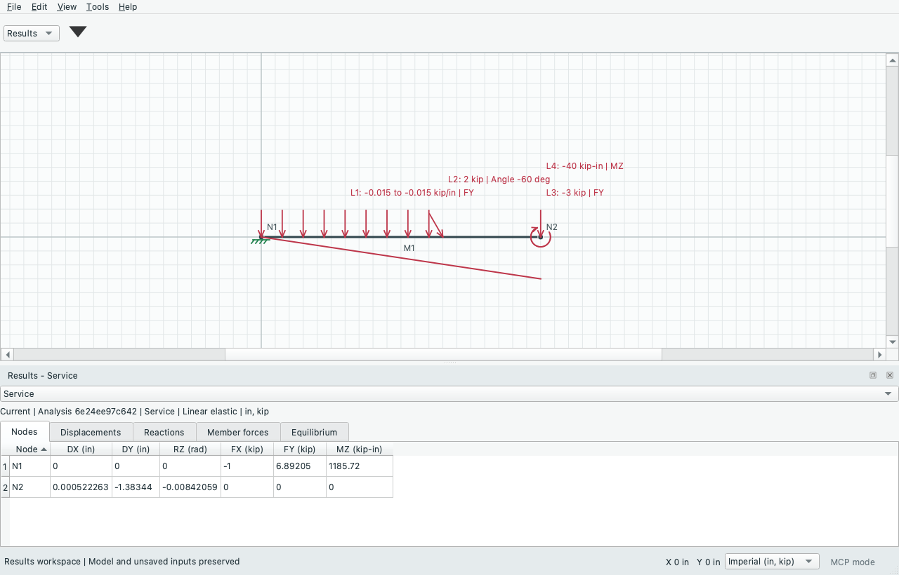](docs/assets/screenshots/results-workspace.png)

Use **View > Restore Default Layout** if a dock or toolbar has been hidden,
floated or moved. It restores the Structure and Properties panels and the
normal toolbar arrangement, selects All tools and shows the command rows; Results remains accessible when a result exists,
and Model Findings when there are findings. It does not change the project,
selection, undo history, result snapshot, display units or unapplied Properties
values. Model-view zoom remains under your control; **Fit (F)** is separate.
Layout recovery is a per-window presentation action, not an engineering edit.

**View > Fit Selection (Shift+F)** frames the currently selected nodes, members,
load application points/loaded spans or whole surface recipes. It uses undeformed
geometry with padding, preserves the current 3D viewing direction and does not
edit the project or replace a result snapshot. For a single node, a useful local
context remains visible. Fitting a selected hidden surface shows Surface Geometry;
fitting selected spatial loads shows their load arrows. **Fit (F)** remains the
whole-model command. Empty selections disable Fit Selection. Its shortcut also
appears in the searchable Help reference.

### Examples and Appearance

Use **File > Browse Examples** for a searchable native catalog. Filter by
category or type words from a title, description or expected check. Selecting a
row shows an undeformed geometry sketch, model size/method, loading summary and
combinations. Loads follow the editor's current display units; reference checks
state their own units explicitly. The sketch omits load arrows and uses a fixed
axonometric view for spatial models; inspect full supports/loads in the editor
after opening. It is not a solved result or an interactive analysis viewport.
Surface meshes and moment-release rings are included in the geometry preview.

[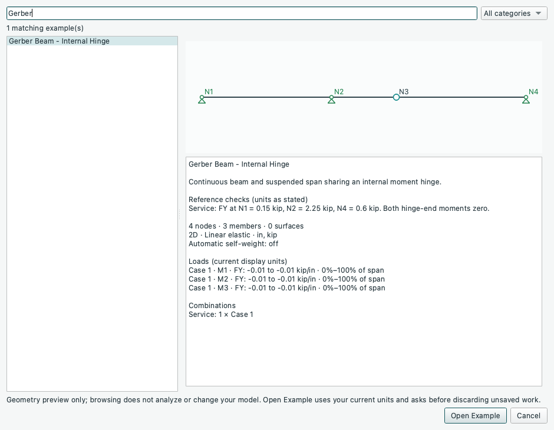](docs/assets/screenshots/example-browser.png)

*Open the image for full-size text. Search `Gerber` to review its internal hinge
and the three support reactions before opening the model.*

Browsing does not run analysis, edit the current project, replace its results or
discard unapplied Properties input. **Open Example** (or a double-click) loads a
fresh example in the current units after the normal unsaved-work prompt; Cancel
leaves the current model intact. A search with no matches clears the preview and
disables Open Example. The browser follows Light/Dark appearance and is unavailable
while MCP mode locks manual controls. The categorized **File > Examples** menus
remain available for direct loading.

- The unit selector also offers SI (mm, N) and Imperial (ft, kip). The mm/N
  preset uses N-mm moments, N/mm line loads, MPa stresses, and mm2/mm4 sections.
  The ft/kip preset uses kip-ft moments and kip/ft line loads, while keeping
  section properties in in2/in4 and material stiffness in kip/in2. Weight
  density follows the geometry volume units (N/mm3 or kip/ft3).
- File > Examples organizes fresh, editable models in **2D Frames**, **3D Frames**,
  **Trusses**, **Slabs** and **P-Delta** submenus. The beam, portal, continuous/pitched/
  two-storey frames, self-weight, elastic-base and release examples are in 2D Frames;
  cantilever/space frames are in 3D Frames. Both planar and spatial trusses share
  Trusses. Examples retain the current unit system and prompt before replacing
  unsaved work. They start as unsaved projects, not as files to overwrite.
- **Slabs > Three-Storey Frame and Slabs (Experimental)** has three 12-foot storeys,
  four fixed-base steel columns, a 20 by 15 foot perimeter frame at every level,
  and three 6-inch elastic concrete Quad slabs with a 60-inch mesh. The frame
  centrelines and slab midsurfaces share conforming joints. All floors carry
  0.001 kip/in2 Dead pressure; Floors 1/2 carry 0.0005 kip/in2 Live, and Floor 3
  carries 0.00025 kip/in2 Live. Positive XZ pressure acts downward. The default
  **Gravity** combination is Dead + Live: 183.6 kip total, **45.9 kip vertical
  reaction per base**. **Dead** gives 32.4 kip per base; **Factored** (1.2 Dead +
  1.6 Live) gives **60.48 kip per base**. These are illustrative factors. Only
  prescribed pressure loads are applied; automatic self-weight is off. Coupling
  is already enabled and the analysis method is Linear elastic. Use the Surfaces
  tree to select each floor and Deformed to see its displacement.
- **P-Delta > Slender Column - Gravity and Lateral Load** opens a 480-inch planar
  fixed-base column with eight 60-inch frame segments, a 60-kip downward Gravity
  tip load and a 1-kip horizontal Lateral tip load. **P-Delta elastic** is already
  selected. The default **Combined** result has approximately **3.9919 in** tip DX;
  **Lateral** alone gives **2.4925 in**. Choosing Linear elastic in Edit > Analysis
  Method gives 2.4925 in for Combined too. This demonstrates axial-load-dependent
  amplification without material yielding. Gravity alone has zero lateral sway.
  See Analysis and Force Diagrams for the second-order force-recovery/equilibrium
  limits; the strict force-residual check is not relaxed for this example.
- **2D Frames > Official PyNite - Beam with Point Loads / Uniform Load /
  Factored Envelope** adapts the three corresponding
  [official beam scripts](https://github.com/JWock82/Pynite/tree/e3a0bbd912b6cf13140f01ca0ed3a2ee55069f45/Examples)
  from source revision `e3a0bbd912b6cf13140f01ca0ed3a2ee55069f45`.
  Each has a 168-inch span, custom Steel material (E = 29000 ksi, nu = 0.3,
  density = 0.0002836 kip/in3) and MySection (A = 20 in2, Iy = 100 in4,
  Iz = 150 in4, J = 250 in4). Both ends restrain X/Y with free in-plane
  rotations, matching the source's in-plane supports; automatic self-weight is off.
  The original 420-inch Simply Supported Beam remains a separate starter model.
- **Official point loads:** D = -5 kip and L = -8 kip at midspan. Choose
  **1.2D+1.6L** after analysis: both vertical reactions are **9.4 kip**, midspan
  local Mz is **-789.6 kip-in** and midspan dy is **-0.42692855 in**.
  **1.4D** gives 3.5 kip reactions and -0.15896276 in midspan dy.
- **Official uniform load:** -200 lb/ft over the whole beam, retained as
  -0.01666667 kip/in. **Combo 1** gives **1.4 kip** at each support, midspan
  Mz **-58.8 kip-in** and dy **-0.03974069 in**.
- **Official factored envelope:** preserve the executable source's positive
  D = +5 kip at 48 in and S = +8 kip at 108 in, plus L = -8 kip at 144 in.
  These signs intentionally follow the code rather than its misleading downward
  load comment. Analyze, open **Diagrams > Envelopes** and keep all three
  combinations checked. The Members summary gives minimum Mz
  **-222.17142857 kip-in** governed by **1.2D+1.6L**, and maximum Mz
  **+596.57142857 kip-in** governed by **1.2D+1.6S**.

The official beam adaptations use the existing planar, linear-elastic workflow.
The source scripts call the general iterative solver, but these bilateral elastic
models need no active-set iteration. Out-of-plane/torsional DOFs and renderer/PDF
calls are replaced by the GUI's existing planar editor, diagrams and print tools.
These earlier planar adaptations retain derived G = E/[2(1+nu)] (11153.846 ksi), whereas the scripts also specify
G = 11200 ksi; this does not affect their in-plane Euler-Bernoulli bending/axial
responses. Upstream `strength` combination tags are represented by explicitly
checking the same three combinations in Envelopes. Plot sampling/amplification
remain GUI controls. The upstream MIT notice is distributed in
`src/pynitegui/qt/licenses/pynite-examples.txt`; the application license is unchanged.

Three further official adaptations use the same pinned source revision and MIT
notice:

- **2D Frames > Official PyNite - Moment Frame with Lateral Load** retains the
  180 by 144 inch frame, W10x33 column and W8x24 beam properties, fixed bases,
  prescribed member-local D weights and 10-kip global-X wind at N2. Its method is
  **P-Delta elastic**, as in the executable upstream script. For **1.2D+1.0W**,
  N2 DX is **0.48084117 in**; N1 FY is **-2.10031058 kip** (uplift). For
  **0.9D+1.0W**, those values are **0.48079378 in** and **-2.27287188 kip**.
  Self-weight is represented by the source's explicit distributed loads, so
  automatic self-weight remains off. Original member IDs and the unsplit
  three-member layout are retained. The beam-example planar/G adaptation above
  also applies. A frozen reference from the pinned script and locked engine is
  stored in `tests/fixtures/official_moment_frame.json`; it is an adapter parity
  check, supplemented by separate load-resultant checks.
- **P-Delta > Official PyNite - P-Delta Column** converts the source's 20-foot
  column to 240 inches, with E = 29000 ksi, A = 10 in2, Iy/Iz = 100 in4,
  J = 200 in4 and a fixed base. **Combo 1** applies 100 kip downward and 5 kip
  laterally at N6. The source's six nodes become five explicit 48-inch members,
  replacing automatic physical-member subdivision. Tip DX is approximately
  **40.2722 in**; the analytical tangent reference is **40.2740 in**, approached
  by refinement. The base Mz is approximately **5227.21 kip-in**. This is the
  original elastic benchmark, distinct from the milder Slender Column example.
  Both official second-order examples keep the existing strict force-residual
  check: PyNite's approximate recovery can flag small residuals. An analytical
  comparison does not override the Equilibrium tab or imply plasticity.
- **Trusses > Official PyNite - Space Truss with Nodal Load** converts the
  source's metre/kilonewton geometry, loads and section/material quantities to
  canonical inches/kips. Select SI (m, kN) for comparison. The original A–E
  joints and AB/AC/AD/BC/BD/BE member IDs are retained. Loads at A are
  (10, 60, 20) kN in global X/Y/Z; C/D/E remain fixed. In the member axial
  results, **BC = -32.65333 kN**, **BD = -45.23538 kN** (tension) and
  **BE = +112.05467 kN** (compression). All six members use bilateral axial-only
  elements, replacing the source's released frame members (including its
  unreleased AB). This reproduces the statically determined bar forces; it is
  not a torsional/released-frame displacement benchmark. Original EA is kept,
  giving negligible elastic displacement; unused free-joint rotations are n/a.
  Source G is not used by axial-only bars. The isotropic GUI G therefore has no
  effect on these bar responses. Automatic self-weight is off.

- **Plates (Experimental) > Official PyNite - Clamped Rectangular Quad Plate**
  adapts `Rectangular Plate Bending - Qauds.py` (upstream spelling) at the same
  pinned source revision. It opens the existing separate plate workspace, also
  available through Browse Examples, without discarding or changing the frame
  editor. The undeformed preview does not solve. Inputs are editable and save to
  `.pyniteplate`, retaining your current display units.
  The XY plate is 10 × 20 ft, 1 ft thick, with a 1 ft mesh (200 Quads, 231 nodes),
  nu = 0.17, E = 57000 sqrt(4000) psi and density 150 pcf. All four edges are
  clamped. W applies +250 psf along global +Z, with self-weight off: total applied
  load **+50 kip**, normal support reactions **-50 kip**, and peak normal
  displacement **+0.00191955 in**. The source's thin-plate reference is
  **+0.00171054 in**; DKMQ retains transverse shear deformation. Do not interpret
  that difference as a failed convergence check or a cracked-concrete model.
  This example's primary combination is **Plate = 1.0W**, equivalent
  to the source's **1.0W**. Its existing transverse-only constraints additionally
  restrain interior membrane translations and drilling rotation. For this flat
  uniform-pressure benchmark they leave transverse nodal displacements,
  reactions and element-centre moments equal to the original full shell model;
  this is not a general membrane/shell equivalence. PyNite Quad uses E/nu rather
  than the supplied independent material G, so the source's G = 0.4E does not
  block this adaptation. Plate contours show element-centre values rather than
  the upstream renderer's smoothed corner extrema. Full upstream contour extrema
  and the source's renderer are not reproduced.

[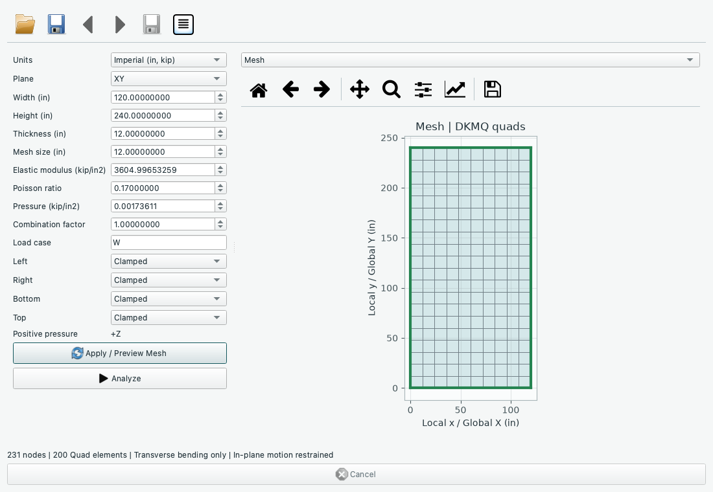](docs/assets/screenshots/official-quad-plate.png)

The official plate opens as an unsolved mesh preview. Use Analyze for its
transverse displacement and element-centre moment/shear contours, or Save plate
for an editable copy.

The official catalog audit covers all 20 scripts: nine are adapted; eleven
still depend on capabilities outside the current app. No substitute model is
presented as a completed official adaptation.

| Remaining official example | Required capability before adaptation |
| --- | --- |
| Beam on Elastic Foundation | Compression-only support springs and lift-off iteration. |
| Braced Frame - Spring Supported | Unilateral axial spring elements and their instability handling. |
| Braced Frame - Tension Only | Tension-only braces and active-set analysis. |
| Rectangular Wall - Linear Varying Load | Depth-varying pressure and validated shell boundary assignment; current pilot pressure is uniform. |
| Shear Wall - Basic | Validated in-plane membrane/drilling supports, loads and wall result recovery. |
| Shear Wall - Advanced | Shear-wall/story/pier/coupling-beam APIs and modifiers, plus validated membrane/drilling response. |
| Mat Foundation | Mat/soil contact API, compression-only soil springs, foundation point force/moment assignment. |
| Circular Bin with Conical Hopper | Curved-shell assembly, merged interfaces, varying pressure and shell support/results. |
| Modal Analysis | Mass/modal solve and mode-result workflow. |
| Moment Frame - Pushover / Pushover Analysis | Plastic section definitions, incremental pushover controls, hinge-state results. |

**3D Frames > Official PyNite - Space Frame with Nodal Loads 1 / 2** now
preserves both original models at the same pinned revision, including independent
G = 10000 ksi with E = 30000 ksi and nu = 0.3. Both use the existing linear-elastic
spatial workflow with **Combo 1**, unchanged member directions/zero roll, nodal
forces/moments and automatic self-weight off. They open as editable, unsolved
projects from the menu or Browse Examples.

- [Space Frame 1](https://github.com/JWock82/Pynite/blob/e3a0bbd912b6cf13140f01ca0ed3a2ee55069f45/Examples/Space%20Frame%20-%20Nodal%20Loads%201.py)
  retains three 100-inch orthogonal arms, fixed nodes N2/N3/N4, A = 10 in2,
  Iy = Iz = 100 in4, J = 50 in4 and N1 FY = -50 kip / MX = -1000 kip-in.
  N1 translations are (+0.00007098258, -0.01399513491, -0.00235188934) in;
  rotations are (-0.00399609044, +0.00001780069, -0.00010334290) rad.
- [Space Frame 2](https://github.com/JWock82/Pynite/blob/e3a0bbd912b6cf13140f01ca0ed3a2ee55069f45/Examples/Space%20Frame%20-%20Nodal%20Loads%202.py)
  retains the 120/120/240-inch spatial bent frame, fixed N1/N4, A = 100 in2,
  Iy = 200 in4, Iz = 1000 in4, J = 100 in4 and N2 FY = -5 kip,
  N2 MX = -1200 kip-in, N3 FZ = +40 kip. Computed N2 DY is -0.06223193794 in
  and N3 DZ is +1.82176235817 in. The script's printed textbook targets
  (-0.063, +1.825) differ slightly from its executable model; they are not exact
  acceptance values for the current engine.

Regression checks compare all nodal translations/rotations/reactions and member
end forces against both hash-checked upstream-source results and a separately
assembled Euler-Bernoulli stiffness calculation. Reference capture is repeatable
with `scripts/capture_official_space_frames.py`; the committed fixture includes
source revision, SHA256 and engine version, and tests run offline. This adds
material input and examples, without adding a solver method.

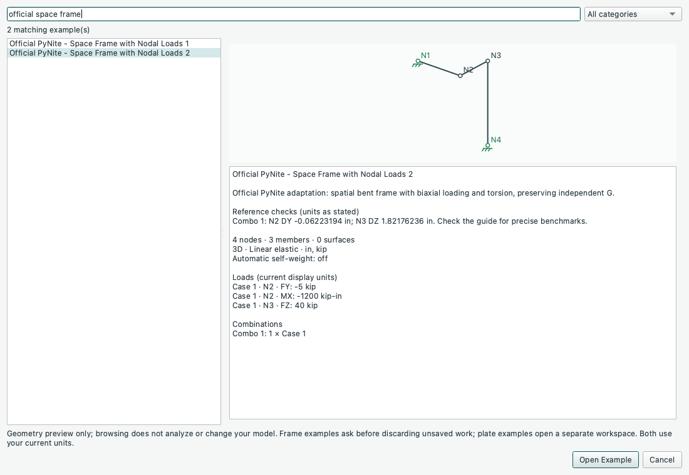

- View > Appearance selects Light or Dark. The preference is saved between app
  sessions, separately from project files. It updates all open editor/diagram
  windows, including the grid, engineering symbols, labels, tables, and plots,
  without changing units, undo history, results, inspection positions, or plot
  zoom/navigation history. Printed reports remain light for paper/PDF output.
  Properties scroll when the dock is too short for all fields.
- Choose Imperial or SI from the unit selector at the bottom-right, or use
  Edit > Units. All dimensional inputs, inspectors, coordinate readouts, load
  labels, property tables, results, and open diagrams use the selected system.
  Switching is undoable, preserves the physical model and valid results, and is
  saved with the project. New projects keep the currently selected system.

**2D Frames > Gerber Beam - Internal Hinge** has nodes at x = 0, 120, 180 and
300 in, with a pin at N1, rollers at N2/N4 and a shared internal hinge at N3.
Three members carry -0.01 kip/in global-Y distributed load. The suspended
120-inch right span supplies 0.6 kip at the hinge and 0.6 kip at N4. On the
left assembly, equilibrium gives N2 FY = **2.25 kip** and N1 FY = **0.15 kip**.
Local end moments at the shared hinge are zero; local Mz over N2 is +54 kip-in.

**2D Frames > Three-Hinged Polygonal Arch** has nodes (0,0), (60,60),
(120,96), (180,60), (240,0) inches, pinned bases and a shared crown moment hinge.
Each of the three upper joints carries -5 kip FY. Vertical base reactions are
**7.5 kip** each; horizontal thrust is **+6.25 kip** at N1 and **-6.25 kip** at
N5. Crown-end moments are zero. Both examples use Linear elastic, default steel
and W18x35 properties, and no automatic self-weight. The hinge releases both
adjacent member-end moments while retaining shared translations; its unused
joint RZ is n/a. These are straight-segment frame examples, not curved elements.
They remain planar: **Create 3D Copy** rejects their released frame members
until general spatial frame releases are implemented.

See the [illustrated first-model walkthrough](https://praksharma.github.io/PyniteGUI/start/first-model/)
for views of the three-storey slab and P-Delta examples, including the expected
reactions and tip displacement to check after analysis.

### Drawing and Selection

- Choose Member (M), then click two points. Coordinates snap to the project grid
  or an existing node. Escape or right-click cancels an unfinished member.
- Choose Select (V) and click a node or member, or select it in the structure
  tree. Edit properties in the inspector and press Apply.
- In Select mode, Ctrl/Shift-click toggles nodes/members on the canvas. Drag an
  empty area to box-select nodes and any members that cross the rectangle;
  Ctrl/Shift adds that box to the current selection. Escape/right-click cancels
  the box without changing the selection. A plain empty click clears it. The
  tree supports Ctrl-click toggles and Shift-click ranges, including manual
  loads. Edit > Select All (Ctrl+A) selects all geometry and visible manual loads;
  generated self-weight remains read-only. Selected geometry and load arrows
  are highlighted, and selections stay synchronized with the tree.
  Multiple items show a bulk inspector: assign member materials/sections and
  end hinges, node supports/custom restraints, or load cases and a signed
  magnitude multiplier. The multiplier scales both distributed-load intensities,
  preserving fractions, angles, and directions. Keep existing and partially
  checked boxes leave properties unchanged; checked sets on and unchecked sets
  off. Choose custom before editing restraint boxes; unmodified restraints retain
  each node's effective previous support. Apply validates all selected edits in
  one transaction; Delete Selection removes selected items and their dependents
  in one undo step. Selection alone never invalidates results; actual bulk edits
  do. Single-node dragging and single-entity commands still require one target.
  Hiding a load case removes its loads from the selection without clearing
  selected geometry. Opening another project clears the selection.
**Named groups and levels (development after RC2)**

Open **Edit > Groups and Levels**. On Groups, select nodes/members in the model,
enter a name, then **Save current selection**. Saving an existing name replaces
its contents; Rename and Delete are undoable. Groups store explicit node/member
IDs. Splitting/subdividing a grouped member replaces its membership with all
segments. Geometry deletion removes obsolete references, leaving an empty group
available for reuse. Creating a 3D copy preserves groups and levels.

**Select** restores the saved selection. **Isolate** shows its members and nodes,
including member endpoints as visible context, and hides other geometry/loads
in the canvas and tree. The window title identifies isolation; use **View > Show
All Geometry** or the dialog's **Show all** to restore visibility. Entering drawing
mode also clears isolation so new geometry cannot be created invisibly. Surface
meshes are hidden during frame-group isolation. Isolation does not remove any
entities from analysis or from numerical result tables, exports or retained
result windows. Hidden members connected to a moved joint still move with it.

On Levels, save named **global Y** elevations in the current display units.
**Select at level** selects coincident nodes and members whose two ends are at
that elevation, without selecting vertical columns that merely cross it.
In 3D, **Use as XZ plane** sets the drawing plane/offset to that level.
Optional **Snap drawing and node drags to named levels** chooses the nearest
elevation within 20% of grid spacing before grid snapping; ties choose the lower
level. Existing-node snaps take precedence, and the fixed coordinate of a 3D
work plane remains fixed. Typed coordinates are explicit and are not snapped.
Changing a level does not move existing nodes. Snapping is off by default.

Groups, elevations and the snap flag save with the project, survive undo/redo
and display-unit changes, and preserve a valid analysis snapshot. They are
editing metadata: they add no diaphragm, rigid-floor assumption, restraint,
load or solver constraint. MCP reads expose this metadata but do not edit it;
MCP geometry deletions prune group references atomically.

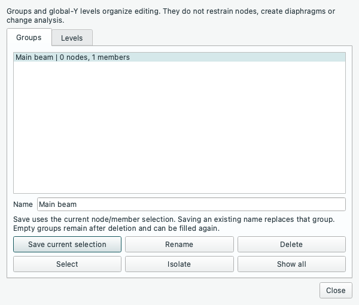

### Model Tables

- Edit > Model Tables opens draft Nodes, Members, and Loads tables. Enter signed
  coordinates and load values directly (scientific notation is accepted), choose
  endpoints/materials/sections/cases, and set custom restraints or end hinges.
  Add rows or remove selected rows to build/edit the model numerically. IDs are
  generated and read-only; references to newly added rows are available immediately.
  OK validates all three tables and applies one undoable edit; Cancel discards
  the draft. Removing a referenced row requires explicitly removing or reassigning
  its dependent members/loads before OK. Invalid input never partially changes
  the active model. Untouched numbers preserve their full stored precision.
  Coordinates use the selected length unit; each load row shows its magnitude
  units, and the end-intensity header identifies distributed-load units. Changing
  load type/direction reinterprets the entered magnitude in those units. Positions
  are member fractions, angles are degrees, and end intensity/fraction apply to
  distributed loads only. Preset restraint checkboxes show the effective supports
  but are editable only for custom supports. Generated self-weight is not listed
  as a manual load; configure it separately in Edit > Self-Weight.
### Topology and Model Checks

- Select a member and choose Split in its inspector, or Edit > Split Selected
  Member, to divide it at a fraction measured from its start node. The first
  segment keeps the original member ID. Point loads and moments retain their
  physical locations; a load at the split becomes a nodal load at the new joint.
- Edit > Connect Intersections splits crossing members and T-junctions into
  explicit segments sharing one node. Existing interior nodes are also connected.
  Splitting and connecting are each a single undoable edit.
- Edit > Check Model reports overlapping members, interior-node connections that
  need splitting, and disconnected groups in the **Model Findings** dock.
  Select a finding and press **Select affected geometry** to highlight its
  referenced entities in the canvas and tree. **Zoom to affected geometry**, or
  double-clicking a finding, also frames the affected area in 2D/3D. Analysis failures
  also populate this dock, including recognized node/DOF instability references.
  General failures without a specific reference remain readable with selection
  and zoom disabled. Referenced loads are revealed when navigating to them.
  Navigation does not edit the model. Engineering edits clear findings;
  unit changes preserve them. Analysis also runs the model checks.

[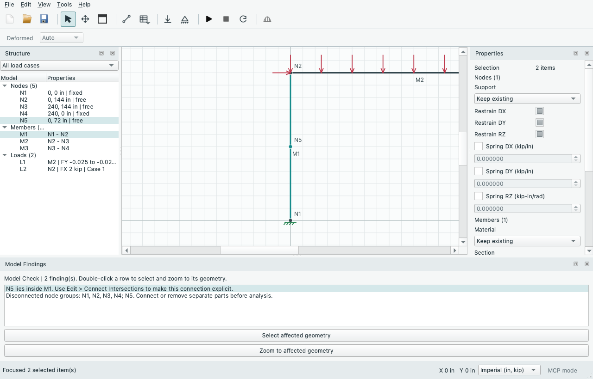](docs/assets/screenshots/model-findings.png)

*Open the image for full-size text. To reproduce this connectivity finding,
open **File > Examples > 2D Frames > Portal Frame - Distributed Load** and add
a node at (0, 72 in), inside M1. Run **Edit > Check Model**, then double-click the
first finding. N5 and M1 are selected and framed together. Use **Edit > Connect
Intersections** to make the joint explicit, then check again before analysis.*

- **Edit > Subdivide Selected Members** divides selected frame members into
  2–100 equal segments in one undoable edit. The first segment retains the member
  ID; outer-end releases, assignments, load locations/cases and distributed
  intensity profiles are preserved. Existing coincident nodes retain their
  engineering properties. New internal frame connections are rigid. Axial-only
  trusses are rejected because subdivision creates unbraced intermediate joints;
  use explicit split/connect operations with appropriate bracing instead.
### Member End Releases

- Select a member and check Released for its Start or End moment RZ in
  the inspector, then press Apply. Hollow circles mark released member ends.
  These releases disconnect in-plane moment transfer at the member connection;
  they do not change node supports or disconnect axial/shear translations.
  Splitting and connecting preserve releases at original outer ends only;
  newly created internal connections stay rigid.
- Member properties also offer axial DX and transverse shear DY releases at
  either end, in member-local axes. Two crossbars mark an axial release; a hollow
  square marks a shear release. Hover for the released directions. The editor
  rejects internally unstable combinations: DX at both ends, DY at both ends,
  or more than two DY/RZ releases on one member. Joint mechanisms are still checked
  during analysis. Clear axial/shear releases before converting a frame to truss.
- Assign a node support using Support, or select a node/member and use Load (L).
### Autosave and Recovery

- The desktop app keeps a separate autosave snapshot of unsaved changes every
  30 seconds in Qt's per-user application-data recovery directory. These files
  never overwrite your project. After an interrupted session, startup offers
  Recover/Discard; File > Recover Autosave reopens that list. Snapshots owned by
  another running process are excluded. Saving or intentionally closing clears
  this window's snapshot; a cancelled close retains it. Unsaved recovered work
  stays marked dirty. File > Recent Projects remembers the latest ten files.
### Supports and Springs

- Choose custom in the node Support inspector for independent global horizontal
  (DX), vertical (DY), and rotational (RZ) restraint checkboxes. Checked means
  restrained. Existing free/pin/roller/fixed presets remain available. Custom
  support symbols show horizontal/vertical restraint lines and a square for
  rotational restraint; hovering identifies the restrained degrees of freedom.
- Node properties include Spring DX, DY, and RZ stiffness. Zero means absent;
  positive values create bilateral springs along global X/Y or about global Z.
  Translational stiffness uses force/length; rotational stiffness uses moment/rad
  in the selected unit system. A rigid restraint and a spring cannot occupy the
  same direction: explicitly free that direction or set its spring to zero.
  Springs and releases are also editable atomically through bulk properties and
  Model Tables, with normal undo/redo and result invalidation.
### Moving Nodes

- In Select mode, drag a node to move it with snapping. Dashed connected members
  preview the move; releasing creates one undoable edit. Escape/right-click
  cancels. Coincident nodes and collapsed members are rejected without changing
  the model. Moving geometry invalidates analysis results.
### Point and Distributed Loads

- The selector above the structure tree shows all load cases, one case, or hides
  loads. It filters load arrows and tree entries only; analysis still includes
  all loads according to the selected combination.
- For an angled point force on a node or member, choose Direction > Angle,
  then enter a signed magnitude and an angle in degrees. Angles are global,
  counterclockwise from +X: 0 points right, 90 up, -90 down, and 180 left for
  positive magnitudes. A negative magnitude reverses the chosen direction.
  The live FX/FY preview shows each component on its own line in the selected
  force units. One angled load is saved
  and edited as a single object; its components are resolved automatically for
  analysis. Negative combination factors reverse the force normally.
- Member loads can be Point or Distributed. Distributed loads use start/end
  intensities in kip/in or kN/m and start/end fractions along the member. Equal intensities
  give a uniform load; different intensities give a linear ramp, including
  triangular or sign-changing loads. Choose FX/FY for global axis loading or
  Angle for a global angled distribution; one angle applies to both endpoint
  intensities. Negative intensities reverse that direction. Intensities remain
  force per unit member length, not projected length. Select a load in the tree
  to edit it in the inspector.
  Splitting clips each loaded region and interpolates its endpoint intensities,
  preserving the original distribution without creating artificial nodal forces.
- Member forces also offer Local x, Local y, and Local angle for both point and
  distributed loads. +local x runs from the member start node to its end node;
  +local y is 90 degrees counterclockwise from that direction in the XY plane.
  Local angle is counterclockwise from +local x. These definitions are resolved
  to global FX/FY at the solver boundary, independently of PyNite's internal
  3D axis orientation. The preview always shows global components. Local loads
  rotate with member geometry, including when its endpoints are reversed.
  Split segments retain the local reference. A point force at a split becomes
  a global angled nodal load with the same vector, since a node has no unique
  member-local axes. Reassigning a local point load to a node in the inspector
  also preserves its current global vector.
### Load Cases and Combinations

- Edit > Load Cases and Combinations manages named load cases and linear
  combinations. Assign each load a Case in its creation dialog or inspector.
  Set Default chooses the case for new loads without reassigning existing loads.
  Renaming a case updates all references; a case used by loads, combinations,
  or the default cannot be deleted until those references are removed.
  Add or edit a combination by checking its included cases and entering factors.
  At least one combination is required; zero and negative factors are supported.
### Materials and Sections

- Edit > Materials opens reusable material definitions. Add or edit a name, E,
  Poisson ratio, and density. G defaults to E/[2(1+nu)]; enable **Specify independent G**
  to enter a positive finite frame/truss shear modulus in the displayed stress units.
  The effective value and Derived/Independent mode are shown in material tables
  and reports. Disable the checkbox to restore derived G. Select
  a member, choose Material in its inspector, and press Apply to assign it.
  Set Default controls newly drawn members without changing existing assignments.
  Renaming a definition updates its references; assigned/default materials cannot
  be deleted until members are reassigned and a different default is chosen.
  Library provides five reference presets: US/EU typical steel, generic aluminum,
  and C30/37 concrete with plain or reinforced-concrete weight. Search, preview
  E/Poisson ratio/G/weight density, and Add to Project. Imports do not reassign
  members or change the default. Source distinguishes Library from Custom;
  renaming retains the preset, while numerical edits make it custom.
- Edit > Sections manages reusable area, Iy, Iz, and J definitions. Choose
  Section in a selected member inspector and press Apply. Section defaults,
  renaming, deletion protection, and undo work like material definitions.
  Library opens a searchable, family-filtered AISC starter catalog. Choose the
  in-plane strong or weak bending axis and Add to Project, then assign the
  definition to members or Set Default. Imports never replace existing sections;
  duplicate names receive a suggested suffix. The Source column distinguishes
  catalog definitions from custom properties. Renaming preserves provenance;
  changing any numerical property makes the definition custom.
  Edit > Grid changes the drawing grid spacing.
### Analysis and Force Diagrams

**Edit > Analysis Method** (also in the Properties menu) selects **Linear elastic**
(default) or **P-Delta elastic** for the project. This is saved, undoable and shared
by manual, live and MCP analysis. Changing the method invalidates results. The
Analyze tooltip, result snapshot, diagram windows, CSV and printable result reports
identify the solved method; changing combinations preserves it.

P-Delta is available for 2D/3D **frame-only** models, including bilateral support
springs and supported planar moment releases. Coupled/uncoupled surfaces, truss
members and released member translations are rejected for this method. The
[PyNite procedure](https://pynite.readthedocs.io/en/latest/PDelta.html) preloads
**each complete combination independently**, then adds its geometric stiffness;
nonlinear combinations are never made by superposing solved cases. Progress names
the combination and geometric-stiffness/second-order phases. This adapter exposes
no artificial convergence percentage or displacement tolerance: the locked engine
uses an elastic preload and a geometric-stiffness solve for bilateral frames.
Failure, nonfinite values or nonpositive effective stiffness reject the snapshot.
The usual worker cancellation and stale-reply checks apply throughout.

Use explicit intermediate joints along slender members and compare refinements to
resolve member curvature. Loads retain their defined directions. This is elastic
second-order frame analysis, not a general large-rotation solver, a buckling-load
finder or material plasticity. Concrete frames use only the assigned elastic
stiffness; no concrete cracking, reinforcement yielding or plastic slab effects
are introduced. The equilibrium tab retains the usual force residual/tolerance
checks but omits undeformed-geometry moment balance for P-Delta and explains why.
PyNite's approximate second-order force recovery can leave force residuals above
those strict numerical tolerances; these remain visible rather than being hidden
by relaxed tolerances. Inspect them and refine the model. Numerical envelopes
compare independently solved combinations, never combine their responses.

**Plastic behaviour remains a separate pending workflow.** The locked engine has
`add_steel_section` and `analyze_pushover`, requiring yield strength and plastic
section moduli for its steel interaction surface. A usable GUI must also define
preload/push patterns, load increments, displacement stop conditions, accepted-step
histories and capacity curves with benchmarks. Its public pushover uses first-order
preload and push steps; combining it with P-Delta is not supported. Plasticity acts
at member nodes and its interaction equation targets steel I sections. It is not
a reinforced-concrete constitutive model. Nonlinear plate/Quad behaviour is excluded
by [upstream pushover limitations](https://pynite.readthedocs.io/en/latest/pushover.html).
Concrete cracking, reinforcement layouts, yielding and slab plasticity need a
separate validated formulation/solver; concrete material presets alone do not
supply these capabilities.

- Use Pan (P) to drag the view, the mouse wheel to zoom, and Fit (F) to frame it.
- Analyze (F5) runs PyNite in an isolated worker process supervised off the GUI
  thread. The status bar shows a busy indicator and actual phases: checking the
  model/supports, building the model, solving combinations, checking stiffness,
  and collecting the snapshot. It does not invent a percentage or completion
  time. The stop icon cancels even during numerical solves or diagnostics and
  waits for worker cleanup; editing remains available while analysis runs.
  A rerun retains the last valid results until a new snapshot succeeds. Cancelled
  or failed reruns do not remove them; engineering edits still invalidate results
  normally, and stale worker replies are rejected. Unit-only changes can be made
  during a solve without changing the physical model. Closing while analysis
  runs cancels the worker first, then uses the normal unsaved-change prompt.
  Reactions and nodal displacements
  appear in Results. Choose a combination above the result table to update
  reactions, displacements, deformation, and factored load annotations without
  another analysis. Deformed overlays the displaced members. Its toolbar offers
  Auto (maximum displayed displacement is 15% of the model extent), True Scale
  (1x), and Custom amplification. The current factor and actual maximum sampled
  displacement are shown separately; scaling never changes analysis results.
  The maximum is sampled at 41 positions per member, not an exact extremum search.
  **Straight preview (approx.)** instead joins displaced member ends without
  sampling interior bending, reducing display work for large frames. Its labelled
  nodal maximum and Auto factor describe only those end translations. A loaded
  beam whose end positions stay fixed can therefore look undeformed in this
  approximate mode. **Sampled curves** restores the existing bending shape.
  Switching changes no model definitions, solved values, numerical probes or
  reports. The choice survives combination, unit and theme changes and is disabled
  while deformation/results are unavailable.

  [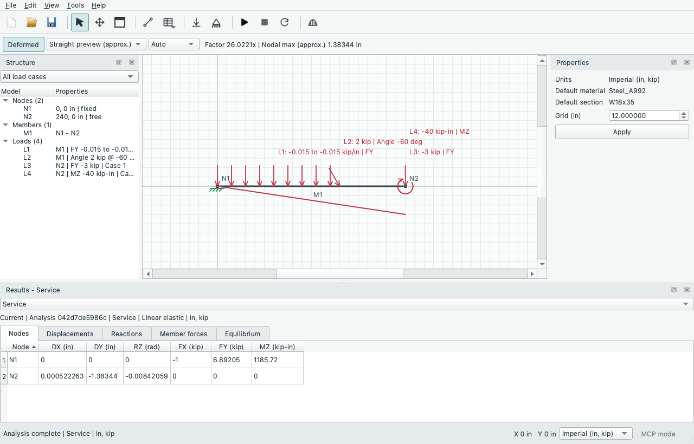](docs/assets/screenshots/straight-deformation-preview.png)

  The straight red preview connects displaced ends; the original member remains
  visible as a reference. Switch back to Sampled curves to inspect bending.
  Fit (F) includes the visible deformed shape. Diagrams opens whole-structure axial, shear, and bending moment
  diagrams with one common amplitude scale for every member.
  Whole Structure also offers Default/Opposite side and Reverse display signs.
  Side changes placement only; sign reversal changes plotted values and labels
  the convention in the title (+ tension for reversed axial diagrams).
  These per-window controls survive unit/combination/theme changes but do not
  change Member Detail, numerical tables, CSV, analysis results, or saved models.
  Whole-structure labels use screen-space collision checks, prioritize member
  IDs, and add leader lines when moved away from their values. If no readable
  placement exists, a crowded label is omitted; zooming/resizing retries it.
  Labels stay within the plot and use the same placement logic in print images.
  Numerical tables and Member Detail remain the authoritative way to inspect
  every value; label placement never changes geometry or computed results.
  New diagram windows start with the standard convention. Member Detail
  provides axial force, local shear, bending moment, and transverse deflection
  plots for any member, sharing one distance axis.
  Supports and Loads toggles show/hide rigid restraints, spring symbols/stiffness,
  and combination-factored manual/generated loads on Whole Structure. Moment
  arrows respect the global clockwise/counterclockwise sign. Symbols share their
  geometry with the editor; spring/load labels avoid other text and symbols.
  Member Detail shows end support/spring and local-release context plus loads on
  that member and its end joints; longer load summaries are available by hovering.
  Joint loads in this context describe applied loads, not the member's share.
  Printed diagram choices inherit these toggles. Envelopes do not depict a single
  load state because their bounds can come from different combinations.
  In Member Detail, enter a distance or click a plot to inspect N, Fy, Mz, and dy.
  Left/Right side selects one-sided values at point-load jumps. Dashed cursors
  align all four plots. Member Results lists start/end values and solver minimum/
  maximum values for each member in local axes and current units; each extrema
  column is independent, not a set of forces at one common station.
  Diagram windows have their own combination selector and retain the analyzed
  snapshot even when the editor changes. The inspector always edits original
  case values, not the factored values displayed after analysis.
**2D Whole Structure** also has independent **Node/member IDs**, **End values**
and **Sampled extrema** checkboxes beside the existing Supports/Loads controls.
IDs affects node/member names; load descriptions follow Loads. End values shows
ordinates at member endpoints. Sampled extrema shows the minimum/maximum among
plotted samples, which can occur at endpoints too. Turn off both numerical
controls for a curve-only drawing. Coincident labels are deduplicated and dense
labels still use collision handling. These are display settings: Member Detail,
tables, CSV and solver results remain unchanged. Controls
survive combination/unit/theme changes. Use result tables for solver extrema;
sampled labels are not an independent exact-extremum search. Whole-structure 3D
overlays and orthographic print projections now have matching independent
ID/end-value/sampled-extrema choices. The 3D view retains its context Labels master.

[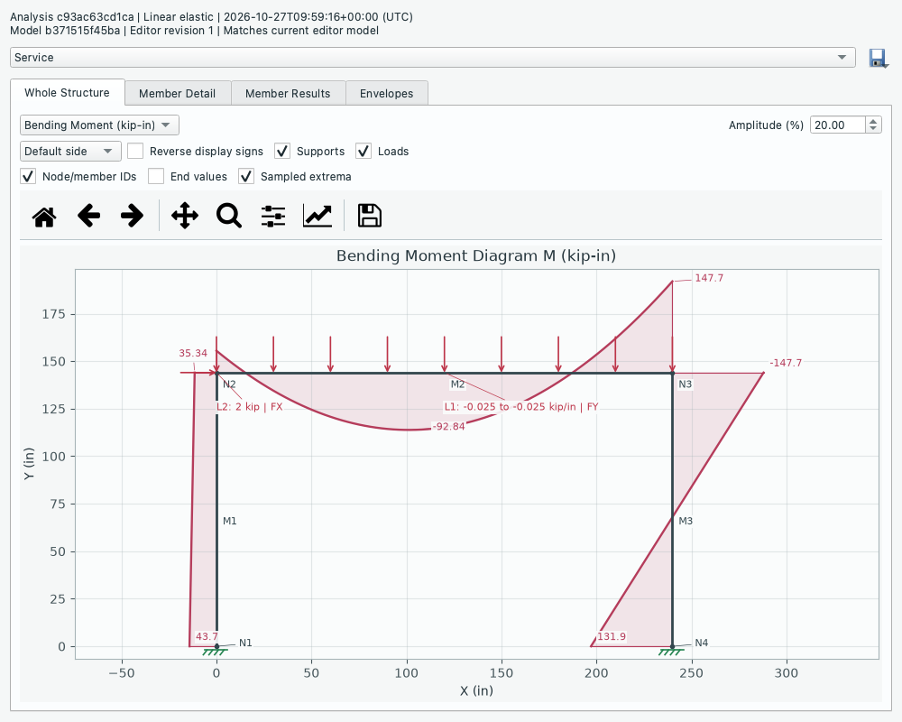](docs/assets/screenshots/diagram-controls.png)

*End values is off here; Sampled extrema remains on, so an endpoint that is also
a plotted extremum can still have a numerical label.*

**Main-canvas member results**

After analysis, the resizable **Results** dock provides a compact **Canvas**
selector: Model, Deformation, Axial N, Shear Fy and Moment Mz in 2D; spatial
frames offer N, Vy, Vz, T, My and Mz. Use the existing combination selector above
it. These controls change the main view without opening a diagram window or
rebuilding unapplied Properties inputs. Separate Member Detail/diagram windows
retain their own analyzed snapshot and selections. Model hides force overlays;
Deformation uses the existing amplification/shape toolbar. The legacy Deformed
control can still add a deformed reference beside a force overlay.

**Offset diagrams** use local solver signs and the indicated positive local
axis for placement, with one automatic geometric scale across members; Diagram
scale multiplies that display amplitude. N is positive in compression. This
local-axis convention is independent of Whole Structure's canonical placement
and optional sign reversal in the separate 2D diagram window.

**Signed colour map** colours the undeformed member spans instead of offsetting
them. Negative values are blue/dashed, positive values orange/solid and zero
values grey/dotted. The numerical legend shows units, the current sampled range
and a symmetric negative/zero/positive colour scale. That scale uses the largest
absolute member sample over **all analyzed combinations in the same snapshot**;
changing combination therefore preserves colour meaning. Diagram amplitude is
disabled for colour maps. Sign crossings split at zero and coincident one-sided
samples at load jumps do not create a false connecting span. The range describes
samples, not a replacement for solver-extrema tables. Unit/theme changes retain
the selection and canonical scale. These are member-force/moment maps, not slab
stress contours. The existing 3D PNG export includes the rendered map/legend;
printed reports retain their existing diagram options.

Select a member or click its undeformed reference geometry to inspect it. The
**From start** field sets a precise distance along that member; **Left side** and
**Right side** choose the one-sided solver value at load/segment boundaries.
The dock lists signed local force/moment/displacement values with units, and a
probe marks the undeformed station in 2D/3D. Spatial clicks project the picked
reference point onto the member axis. Additive selection preserves the current
probe; the member selector can choose a different inspected member. Probe
stations remain at the same physical distance through combination/unit changes.

The existing analysis-status label identifies current, outdated and retained
results. Engineering edits invalidate the main-canvas results and probe as
usual; no stale field is presented as current. Canvas controls never analyze,
change model definitions or replace the numerical result snapshot. Surface-only
stress inspection remains a separate engineering milestone.

[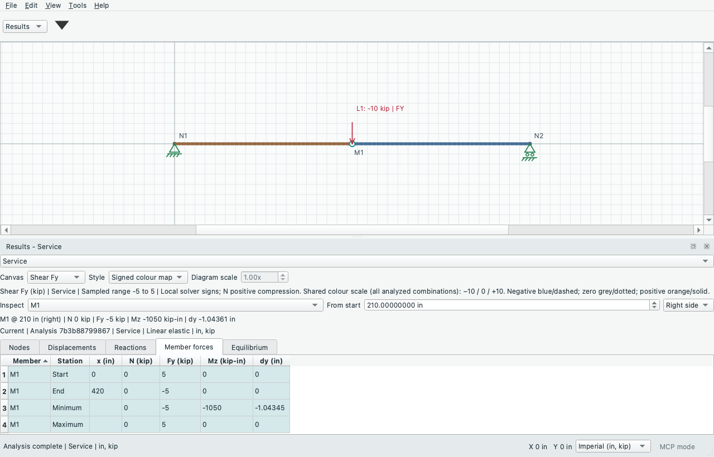](docs/assets/screenshots/canvas-colour-results.png)

[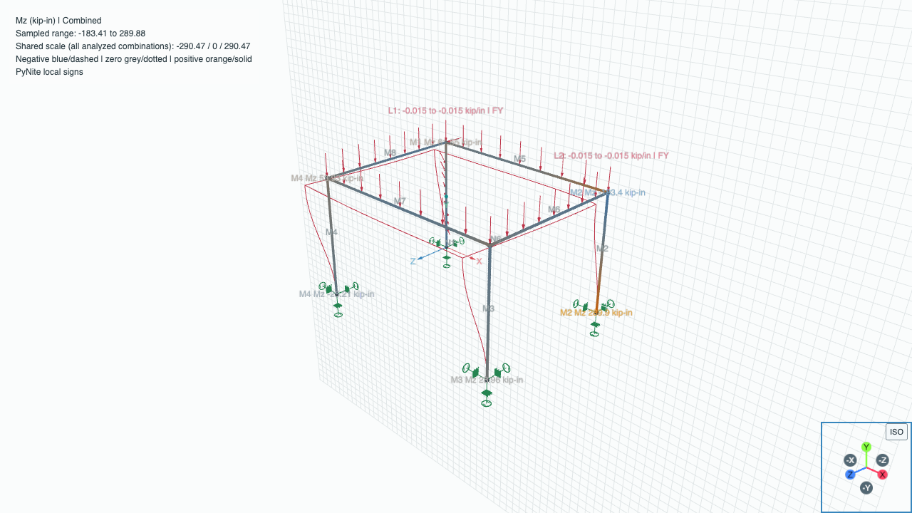](docs/assets/screenshots/spatial-colour-results.png)

**Static deformation animation**

After solving, choose **Tools > Animate Static Deformation…** or the animation
button in the Results toolbar group. The separate native window retains that
analysis snapshot and method, even if the editor is changed or reanalyzed.
The combination selector switches only among that snapshot's solved states.
Member paths are sampled once per combination with the existing recovery rules;
solved surfaces use nodal wireframes. No solver calls are made during playback.

Use **Play/Pause**, **Reset**, or set **Displacement fraction** from 0 to 1 to
inspect a frame. A smooth loop cycles from the reference to the fully amplified
shape and back. **Loop (display seconds)** is a display duration, not physical
response time. This is not a dynamic/modal result, and it does not depict
cross-section twisting. Dashed reference geometry stays fixed. Axis limits
include the full displayed excursion and remain fixed during playback; standard
plot pan/zoom and 3D rotation remain available. Auto scales peak motion to 15%
of the largest model extent; True scale uses 1x and Custom uses the entered
factor. The reported sampled/nodal peak is unamplified.

Changing combination or amplification pauses and resets the fraction. Changing
duration pauses; pause/resume retains phase. Unit/theme changes preserve the
fraction and cached canonical data. Hiding or closing the window, or changing
MCP control mode, pauses playback. Model/result edits never change the retained
field; the main animation action is disabled when current results are invalid.

The plot Save button pauses playback before opening the file dialog, freezing
the frame and its metadata together. It exports the current PNG/SVG frame with snapshot identity,
method, units, combination, amplification and fraction metadata. The visible
plot title records the fraction and amplification; its footer identifies the
analysis. This exports a still frame, not a movie. Playback and export do not
edit model definitions or numerical results.

[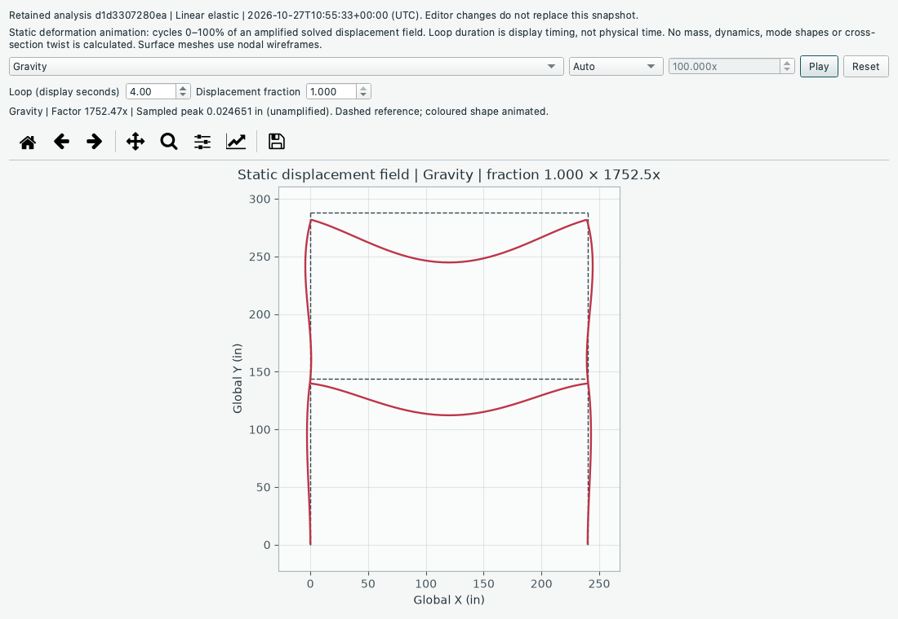](docs/assets/screenshots/static-deformation-animation.png)

### Combination Envelopes

**Compare Combinations** in the 2D and 3D diagram windows overlays two solved
combinations for a chosen member and local result component. A is solid and B
is dashed; both use the same numerical axes and scale. Choose a distance or
click the plot, then select Left side or Right side at a concentrated load.
The probe shows both signed values and the governing combination by largest
absolute value; A wins ties. This is a station comparison, not a solver-extrema
search. Selecting the same combination twice is allowed as an identity check.

Both selectors belong to the retained analysis snapshot and method. They are
independent of the window's single-combination selector, and changing the editor
or solving again cannot replace either curve. The snapshot status above the tabs
indicates when the retained result differs from the editor. Unit and theme
changes retain the comparison and physical probe distance. The plot toolbar
saves PNG/SVG with both combination names, snapshot identity, units and probe
context. The comparison does not rerun analysis or edit the model.

[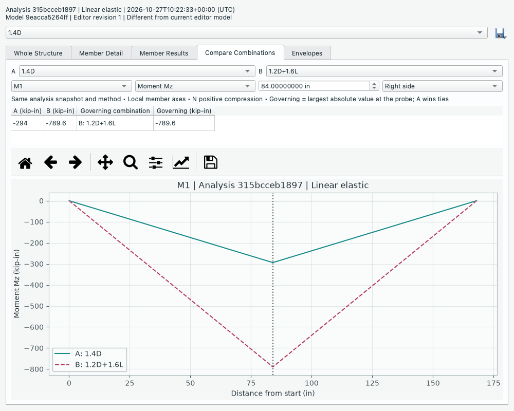](docs/assets/screenshots/combination-comparison.png)

The official point-loaded beam compares 1.4D with 1.2D + 1.6L. The probe reports
the signed moment for each; the larger absolute moment governs.


- Diagrams > Envelopes compares checked combinations from that analyzed
  snapshot without another solve. The main combination selector does not change
  the envelope selection. Nodes lists displacement/reaction bounds; Members
  lists solver-provided extrema for N, Fy, Mz, and dy over entire members. Each
  minimum and maximum identifies its governing combination. Ties use the first
  checked combination in list order; undefined truss-joint rotations remain n/a.
  These are independent bounds, not a simultaneous force/displacement state.
  Member Curves shows sampled min/max envelopes in local axes, including both
  sides of load jumps. Curve peaks are sampled, not exact extrema searches; use
  Members for solver extrema. Enter a distance or click a curve to inspect exact
  one-sided station bounds and their governing combinations. Left/Right side
  chooses the side at point-load jumps. Axial N remains positive compression;
  Whole Structure placement/sign controls do not change envelopes.
  The envelope export icon saves the visible summary rows as CSV with units, source,
  snapshot identity, selected combinations/factors, self-weight metadata and the
  active scope/component/threshold specification.
  Its export menu also offers Print all envelope summaries, opening report choices with an
  envelope-only selection and the currently checked combinations. General Print
  Results can include envelopes alongside model definitions, single-combination
  results, and force diagrams. Report combination checkboxes are independent
  copies: changing them does not change the diagram window's selection.
  Printed envelopes contain node/member summary bounds and governing
  combinations, not sampled curves. Selected factors, units, conventions, and
  analysis identity are included; undefined rotations remain n/a. In mixed
  reports, single-combination sections and envelope sections are labelled
  separately. Unit/theme changes retain the selection. Envelope choices are
  window-local, not saved in the project.

**Scoped envelope summaries (development after RC2)**

Use **Summary scope** for all entities, an explicit member ID, the editor's
node/member selection captured when the retained diagram window opens, or a
saved group captured at that time. The group and selection scopes remain fixed
if the editor later changes. Group scopes use explicit saved IDs, not the extra
end nodes shown as isolation context. **Component** distinguishes global node
results from local member results and displays the correct units.

Choose **Minimum ≤**, **Maximum ≥**, or **Absolute extreme ≥** and enter a
threshold for one component. Equality is included; the absolute filter considers
both signed bounds, without discarding their signs or governing combinations.
Switching display units preserves the physical threshold. Choosing All components
resets the value filter so unlike units cannot be compared. The count shows how
many summary rows remain, and CSV export is disabled for an empty filtered set.
Double-click a member row to open that member's existing envelope curves and
station probe. Filtering does not change plot zoom, checked combinations,
numerical results or the retained snapshot. Curves and printed summaries retain
their full scope; the CSV explicitly follows the visible summary filters.

These filters reuse the existing envelope extrema; they do not find a new global
critical station or return all threshold-crossing positions. In particular,
the locked PyNite deflection-extrema API samples the span, so deflection bounds
inherit that approximation. The separate Governing Stations view below searches the solver segments directly;
summary filtering does not replace that search.

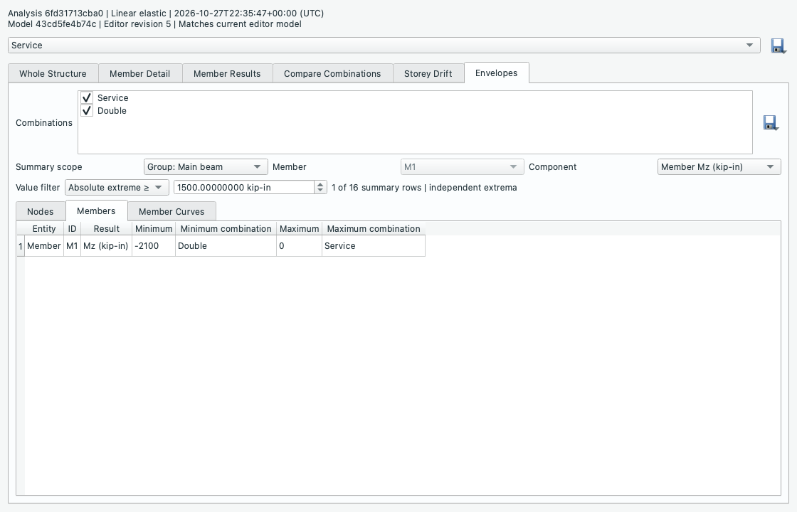

**Governing stations (development after RC2)**

In Envelopes, choose one **Member** component in the summary filters, then open
**Governing Stations > Find governing stations**. The scope and value filter
admit member IDs using the existing summary rows; the query then searches each
admitted member's full span across the checked combinations. It reports global
minimum, maximum and absolute extreme, retaining signed values, member ID,
governing combination, distance from member start and Left/Right/Interior side.
The threshold selects members, not threshold-crossing locations. Both sides of
point-load/moment jumps and physical-submember boundaries are evaluated directly.
Double-click a row to set the existing member curve, component, station and side;
the curve still displays all checked combinations, with governing combination
identified in the query row. Query CSV includes scope/member IDs, units,
combination factors, analysis method, snapshot identity and numerical query method.

The search obtains stationary points from derivatives of the engine's continuous
segment formulas, including the quadratic-denominator P-little-delta recovery.
It uses normalized polynomial/rational reconstruction with floating-point roots
and independent residual checks, rather than the plotted sampling grid or the
engine's 100-point deflection-extrema scan. Singular/non-finite segments and
formulas outside the verified contract fail with an explanation. Axial-only
truss forces/translations use their supported constant/straight fields. Ties
within numerical tolerance retain the first checked combination, then the first
member in model order and first candidate station. Queries are limited to 5,000
member/combination pairs. Filter, combination and unit changes clear query rows
and disable export until the search is repeated. No analysis is run or modified.

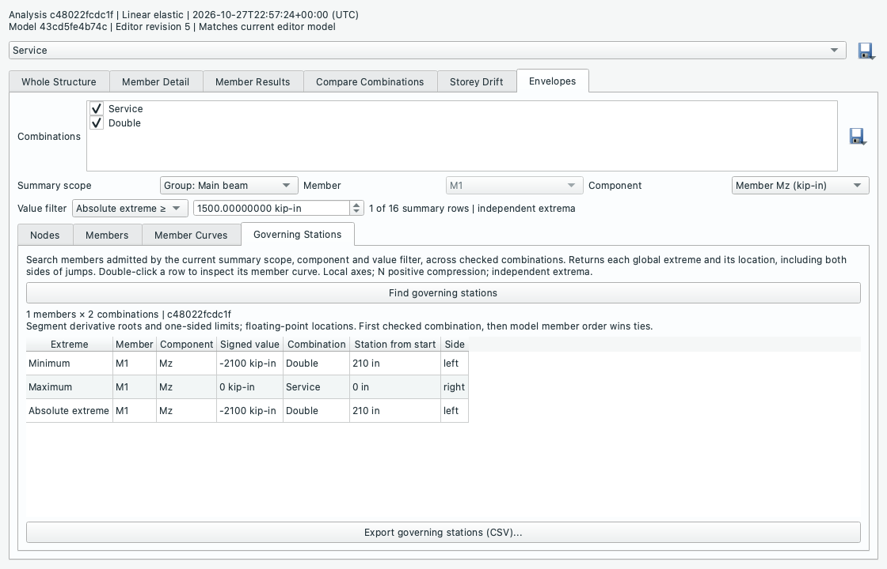

**Plain storey drift**

The **Storey Drift** tab in retained 2D/3D diagram windows starts empty. Choose a
lower node, upper node and horizontal global direction, then **Add pair**. Repeat
for each storey and column you want to check. Global Y defines elevation; the
upper node must have a strictly greater Y coordinate. Pairs may be offset in
plan and are never inferred to belong to a rigid floor. 2D supports X drift;
3D supports X or Z. Duplicate pair/direction entries and invalid heights are
rejected without losing existing pairs. Select any row and **Remove selected
pair** to remove that pair across all combinations.

For each pair and selected combination the table reports height h, the lower
and upper nodal translations, their signed difference Δ = u_upper − u_lower,
and the dimensionless signed ratio Δ/h. **Governing |ratio|** marks the largest
absolute ratio for that pair/direction; its row retains the actual signed value
and combination. The first analyzed combination wins ties. Select one solved
combination or all; this selector is independent of the window's main selector.
All values come from the same retained snapshot and method. Unit changes convert
lengths while leaving ratios and pairs unchanged. Pair selections belong to the
window and are not saved as model definitions or groups.

This is static displacement post-processing. It applies no seismic-code
amplification or limit, provides no pass/fail decision and adds no solver
constraints. **Export CSV** records exactly the current table, with source
basename, snapshot ID/time/signature, method, units and conventions. Exports are
atomic; a failed write preserves an existing destination.

[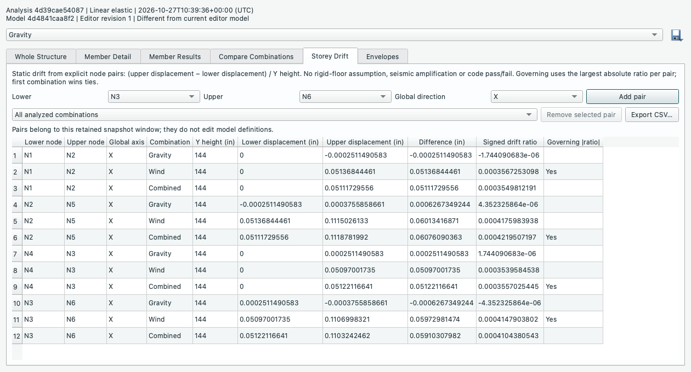](docs/assets/screenshots/storey-drift.png)

Each column has its own lower/upper pairs; the table makes no rigid-diaphragm
assumption.

### CSV and Printable Reports

The **Save** icon in each native plot's pan/zoom toolbar offers **PNG** or **SVG**
for the displayed figure: 2D Whole Structure/Member Detail, spatial Member Detail
and combination-envelope Member Curves. It exports the current view, including
display settings and inspection lines. PNG is raster; SVG is vector. Both add a
visible analysis-ID/method/combination/unit stamp. Embedded image metadata also
records the analysis time, model signature, plot/member/inspection context and
source project basename (not its full path). Envelope images identify the checked
combinations, independently of the single-combination selector. Select at least
one combination before saving an envelope.

[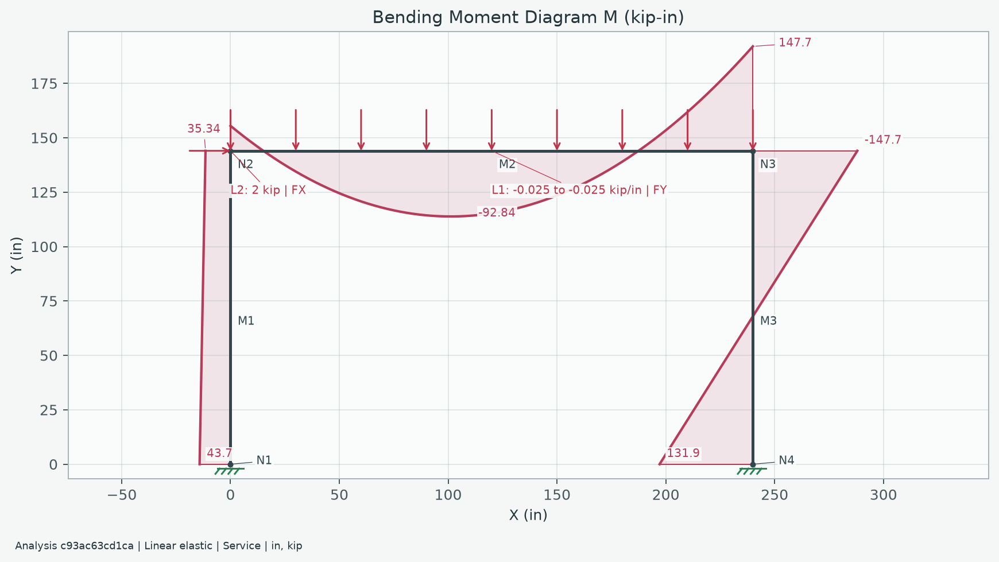](docs/assets/screenshots/snapshot-diagram.png)

*The footer belongs to the exported image; saving leaves the live figure's
zoom, inspection lines and layout intact.*

Retained diagram windows export their retained analysis, even if the editor has
changed. The stamp describes that snapshot and does not certify the current
editor model. Saving does not analyze or edit the model. Cancel writes nothing;
an unsuccessful save preserves an existing destination file. Choose a .png or
.svg filename; if no extension is entered, the selected format supplies it.
**Other Matplotlib formats** retains the backend's existing formats (enter their
extension, such as .pdf); these receive the visible stamp, while embedded analysis
metadata is provided for PNG/SVG.
The offline 3D viewport's separate PNG capture remains a viewport screenshot,
not this native Matplotlib plot-export workflow.

Print options include independent diagram IDs, end values and sampled extrema
for both 2D and spatial projections. Native diagram/view choices initialize the
report checkboxes when available; changes in the report dialog stay local to
that report. Default programmatic reports still show all three label groups.

- File > Export Results saves node reactions/displacements or member end/extrema
  values as CSV in the selected units and combination. Files include source,
  analysis ID, UTC timestamp, model signature, and unit system. Undefined joint
  rotations export as n/a; CSV/report metadata also identifies the self-weight
  case and multiplier when enabled. Extrema have no common station, so x is blank.
  Text identifiers that could be interpreted as spreadsheet formulas are
  prefixed with an apostrophe; numeric loads/results retain their signs.
  Print Results first opens content choices for model definitions, node/member
  results, and selected axial/SFD/BMD diagrams, then opens native print preview.
  Model definitions include nodes/effective supports, frame/truss assignments
  and local releases, spring stiffnesses, materials/section properties and provenance, manual and generated
  unfactored loads, defaults, and load combinations. Diagrams use the selected
  analyzed combination, snapshot ID, units, and explicitly labelled display
  side/sign/amplitude. Printing from a diagram window starts with its current
  diagram settings. Charts use a light print palette even in dark mode and have
  their own pages. Reports can be printed or saved to PDF through the print
  dialog. Cancelling content selection does not open preview or change the model.
### Result Snapshots

Snapshots also retain the solved analysis method. Switching units or combinations
preserves the method; changing the project method requires a new solve.

- Diagram windows show their analysis ID, analysis time, original editor revision,
  and whether their model matches the current editor. A new analysis of the same
  model is distinguished from the earlier snapshot. The export icon in a diagram
  window exports/prints that snapshot, even after editor results are invalidated.
  Unit and combination changes retain the snapshot ID; engineering changes
  require a new analysis before exporting from the main editor.
### Saving and History

**File > Recent Projects** refreshes when the File menu opens and shows up to ten
unique project paths. Full paths appear in tooltips/status text. Unavailable
files are labelled and disabled, retaining entries for temporarily disconnected
drives until you choose **Remove Unavailable Entries**. **Clear Recent Projects**
clears only the history list. Neither action deletes project/recovery files or
changes the open model, its dirty state or undo history. Recent-file opens still
use the normal unsaved-change prompt. A file that disappears after the menu opens
reports its unavailable location before prompting to discard work. Malformed
history preferences are ignored instead of preventing startup.

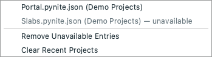

*Example history: Portal is available; Slabs is unavailable. Remove Unavailable
Entries removes the grey entry; Clear Recent Projects empties the list. Project
files remain on disk.*

- Save/Open uses versioned `.pynite.json` project files. Ctrl+Z and Ctrl+Shift+Z
  undo and redo model edits. Delete removes the selected entity and its dependent
  members/loads. Unsaved changes are marked in the title and checked on exit.
- File > Examples > 2D Frames > Simply Supported Beam loads a 420-inch beam with a 10-kip downward
  midspan load. Each support should react with 5 kip. In SI the same physical
  example displays a 10.668 m span, 44.4822 kN load, and 22.2411 kN reactions.

## Previewed Modelling Tools

These tools are development changes after RC2. They share the temporary
**Modelling Tools** dock and the existing model canvas; there is no new main
workspace. Open **Edit > Transform Selection**, **Tools > Beam / Frame
Generator**, or **Edit > Merge Two Nodes**. The tool selector switches forms
inside the dock. Length entries use the project's displayed units.

**Preview → Apply → Cancel**

Preview captures the current definition and selection, validates a separate
candidate and draws changed/new geometry as dashed accent lines with node
markers. Existing geometry remains visible; in 3D the ghost geometry cannot be
picked or box-selected. Use Fit to include the preview. Supports and loads are
listed in the preview summary rather than drawn as candidate symbols. Apply
commits the reviewed candidate as one undoable edit and invalidates numerical
results. Cancel, Escape or hiding the dock clears the preview without changing
the project. Editing inputs or the model clears it too; a candidate cannot be
applied to a changed definition. Reopen the tool after changing units or opening
another project to rebuild its inputs in the new context.

**Move, repeat, rotate and mirror**

Select nodes and/or members first. Members include their end nodes; moving a
shared node also changes incident unselected members, whose count is reported
before Apply. Move uses a global offset. **Repeat / linear array** makes 1–50
additional copies at successive multiples of a global XYZ step, like a CAD
linear pattern. Rotate uses a global axis and reference point; Mirror reflects
across the plane normal to the selected global axis through that point. Planar
models remain in XY: rotation about Z and reflection normal to X or Y. Rotate
and Mirror optionally retain the originals.

Separate switches copy manual loads and global supports/springs; both default
off. Copied member loads retain their normalized start/end stations, intensities,
cases and local/global direction definitions. End IDs/order, sections, materials,
member type and planar releases retain their meaning. Global forces, angled
loads and support/spring axes stay global; they are not rotated with geometry.
Local loads follow the transformed member axes. For 3D rigid transforms, local
y follows the transformation and local z is reconstructed by the right-hand
rule, including reflections. Self-weight remains global gravity on all included
members. Groups, named levels, surface recipes and surface pressures are not
copied. Moving existing frame joints in projects with surface recipes is blocked
because that needs a coordinated coupling edit; copying frame geometry is allowed.

Coincident-node reuse is **explicit and off by default**. Enabling it creates
shared joints within the canonical 1e-8 inch connection tolerance. Existing
supports remain when support copying is off; copying incompatible supports is
blocked. Copied nodal loads remain separate and add at reused joints. Duplicate
members, new overlaps, implicit crossings and new unsplit interior joints are
blocked; adjust the placement or split/connect geometry explicitly. Independent
copies may remain disconnected and require connection/supports before analysis.

**Beam and frame generators**

The generator creates ordinary editable **planar XY** nodes and frame members.
Enter comma-separated span/bay widths and storey heights (up to 40 each), an XY
insertion point, one material and separate beam/column sections. Continuous beams
have a pin at the first joint and vertical rollers at the other joints, with
unreleased connected spans. Frames have columns at each bay boundary, beams at
every elevated storey and explicitly chosen Free, Pin or Fixed base supports.
The preview reports counts, dimensions, properties and assumptions. Coincident
joint reuse requires matching supports. Operations are limited to 2,000 candidate
nodes plus members. No manual loads, diaphragms, automatic sizing or code design
are generated; enabled self-weight includes added members. A generator describes
a connected structural layout, whereas Repeat copies a selection at offsets.

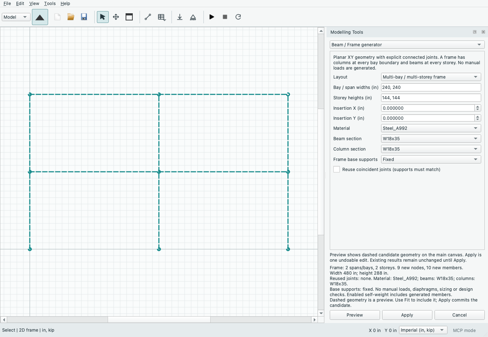

**Reviewable node merging**

Choose a retained node, a removed node and a maximum merge distance. The retained
node keeps its coordinates. Preview redirects all removed-node member endpoints,
nodal load targets and saved group references; it never deletes members or loads.
Conflicting supports/springs require a choice to keep either node's support.
When both nodes have manual loads, explicitly allow keeping both additive load
sets. Zero-length/duplicate members, new crossings, overlaps and implicit joints
are rejected. Merging with surface recipes is blocked pending coordinated coupling
support. **Model Findings > Review node merge** opens this same tool for findings
that reference at least two nodes; otherwise select nodes and use the Edit menu.
This is a controlled two-node repair, not a tolerance-based automatic cleanup.

## Construction Connections

**Edit > Perpendicular Connection** requires exactly one selected node and one
member. It projects the node onto the member's actual XY or XYZ line and adds a
frame to that foot. The foot must lie within the member span; an endpoint foot
reuses that endpoint, while an interior foot splits the target into explicit
segments. This uses full spatial geometry rather than the current 3D work plane.

**Edit > Connect Member Midpoints** requires exactly two selected members.
It splits both at their midpoints and adds a frame between the shared joints.
Coincident endpoints, duplicate or overlapping connectors, and additional
crossings/interior nodes requiring other shared joints are rejected. These
helpers only split the selected members; unrelated geometry needs explicit
split/connect operations.

Both commands open a native preview with solid existing geometry, a dashed
connector, endpoint IDs/coordinates in project units, length, node/split counts
and the new member's material/section. Spatial previews offer isometric, XY,
XZ and YZ projections. **Apply** makes one undoable engineering edit; **Cancel**
keeps the model and results. A changed model invalidates an open preview.

Original segments retain assignments, rolled axes and outer-end releases.
Existing coincident joints keep their supports, springs and nodal loads.
Manual load cases, physical stations and partial distributed intensity profiles
follow the existing split rules, including rolled local spatial loads at cuts.
The new connector is a frame using project defaults, without releases or manual
loads and with zero spatial roll. Enabled self-weight includes its added length.
Adding the connection changes stiffness and invalidates results; analyze again.

## Linked Results

The native Results dock contains **Nodes**, **Displacements**, **Reactions** and
**Member forces** tabs. Nodes retains the combined overview. Header clicks sort
numbers by their full values; six-significant-digit display does not determine
the order. Undefined released-joint rotations remain `n/a`.
Selecting rows highlights the corresponding geometry and structure-tree items;
Ctrl/Command/Shift selection supports multiple entities. Selecting geometry
reveals and scrolls to its result rows, switching between node and member tabs
when needed. These selection changes do not edit the model or invalidate results.

The member tab loads end values and independent minimum/maximum values on demand.
The extrema in a row can occur at different stations; they are not one combined
force state. Double-click a member row to open **Member Detail** for that member
and snapshot. Unit and combination changes refresh the tables while preserving
entity selection. Engineering edits clear all active result tables until another
analysis; retained diagram windows continue to identify their own snapshots.

The **Equilibrium** tab compares global applied loads and support reactions for
the selected combination, including generated self-weight and partial distributed
loads. Planar models show FX, FY and MZ; spatial models show all six components.
Moments are taken about the first project node, whose coordinates are displayed.
Residuals and tolerances use the selected units. Each tolerance is `1e-7` times
the sum of absolute component contributions, plus an absolute floor of `1e-8`
kip for forces or `1e-6` kip-in for moments. Balance alone does not verify
structural design or modelling assumptions.

The dock labels analysis as analyzing, cancelling, cancelled, failed, current or
outdated. If a previous snapshot is retained during a new attempt, its identity
and combination remain explicit. Engineering edits clear its tables. A failed
attempt leaves the previous valid snapshot available, with failure details in
the status tooltip.

## Units

Use **Edit > Units** to choose length (mm, cm, m, in, ft) and force
(N, kN, lbf, kip) independently. All 20 combinations also appear in the
bottom-right selector; the four original preset names remain unchanged.
The dialog previews derived units before applying a change. Apply is undoable;
Cancel leaves the project unchanged. These choices persist in 2D/3D projects,
recovery snapshots and 3D copies without changing canonical engineering values
or invalidating valid results.

For custom choices with mm/cm/m geometry, material stress uses MPa and section
properties use mm2/mm4. With in/ft geometry, sections use in2/in4; stress uses
kip/in2 for kip forces and psi for other force choices. Moments, distributed
loads, weight density and support stiffness use the chosen length/force units.
The dialog shows these conventions even for mixed metric/Imperial choices.
Files retain their current schema versions and store a deterministic unit key;
older application builds that lack the custom choices reject those unit keys.

| Quantity | Imperial (in, kip) | SI (m, kN) | SI (mm, N) | Imperial (ft, kip) |
| --- | --- | --- | --- | --- |
| Coordinates, lengths, grid, displacements | in | m | mm | ft |
| Forces | kip | kN | N | kip |
| Moments | kip-in | kN-m | N-mm | kip-ft |
| Distributed intensity | kip/in | kN/m | N/mm | kip/ft |
| E and G | kip/in2 | MPa | MPa | kip/in2 |
| Weight density | kip/in3 | kN/m3 | N/mm3 | kip/ft3 |
| Section area | in2 | mm2 | mm2 | in2 |
| Iy, Iz, J | in4 | mm4 | mm4 | in4 |
| Rotation | rad | rad | rad | rad |

Density is weight per volume, not mass density in kg/m3. Load fractions,
Poisson ratio, combination factors, and deformation amplification are
dimensionless and do not change with units. Switching preserves grid spacing;
enter a new value in Edit > Grid when a round metric spacing is wanted.
Section and material names are identifiers and are not renamed by conversion.

The model, saved engineering numbers, and solver use canonical inch-kip units.
Only input/output boundaries convert. This avoids repeated conversion drift and
keeps old projects physically unchanged. Unedited property fields retain their
full internal precision even when displayed with fewer decimals. Open diagram
windows retain their analyzed geometry and loading, but follow the active unit
selection. Unit changes alone do not require another analysis.
Conversions use exact inch and pound-force definitions from
[NIST SP 811](https://pml.nist.gov/cuu/pdf/sp811.pdf), with other factors derived
by their physical dimensions.

## Engineering Scope

Dimensional inputs and results use the selected system listed above.
The editor models frames in the global XY plane. Out-of-plane translation and
rotations are restrained at every node. A pin restrains X/Y translation, a
roller restrains Y translation, and a fixed support also restrains Z rotation.
Custom supports independently restrain global DX, DY, and RZ. Bilateral elastic
springs may resist any otherwise free global DX/DY/RZ direction. Spring reactions
are the opposing stiffness times displacement/rotation and are included in all
reaction tables, envelopes, and exports. Inclined supports, one-sided springs,
and semi-rigid member-end springs are not implemented. Point loads support global FX, FY,
MZ, and signed angled forces. Member point/distributed forces additionally
support local x/y and member-relative angles. Nodal forces use global axes only;
distributed moments are not implemented.
Loads belong to named cases. User-defined combinations apply finite case factors.
Linear elastic analysis uses superposition; P-Delta elastic solves each complete
combination independently with its own axial-load-dependent geometric stiffness. The initial project has
Case 1 and a Service combination at factor 1. No design-code factors or
envelopes are generated automatically.
### Automatic Self-Weight

Edit > Self-Weight opts into automatic gravity loading in a chosen load case,
with a positive multiplier and total unfactored weight in the current force
units. Frame members receive global downward FY uniform loads using their
own weight density times section area. Truss weight is lumped equally to the
two end nodes; it never creates transverse member bending. Zero-density members contribute no
weight. The case must appear in a combination to affect that combination;
combination factors apply normally. Existing manual loads are additional, so
do not also enter the same member self-weight manually. Generated loads appear
as read-only entries in the structure tree and respect case visibility filters.
They are recalculated after material/section changes and member splitting,
not duplicated as editable project loads. Disabling or changing self-weight is
undoable and invalidates results; case renaming follows the reference, and a
referenced case cannot be deleted. Density is weight per volume, not kg/m3;
do not multiply it by gravity again.
Member load positions are fractions measured from the start node.

### Release Formulation

Member moment releases act about local Z, normal to the XY frame. End releases
are independent: one member may hinge at a shared node while other members
retain a rigid connection. Releasing both ends supports pin-jointed frames with
nodal loads, but the member remains a beam and can still bend under transverse
member loads; it is not a separate axial-only truss element. Axial DX and shear DY
releases disconnect their corresponding member-end translations without changing
joint supports or other members at that node. Released member ends can therefore
move relative to the joint: node tables show joint displacement while member
deflections show the member side of the release. Out-of-plane and partial-stiffness
releases are not exposed in this editor.

PyNite 3.0.0 condenses translational releases correctly for forces but its member
deflection reconstruction otherwise uses joint translations at released ends.
The linear-analysis adapter recovers the eliminated end displacements from
PyNite's uncondensed stiffness and fixed-end vectors with zero released-end force,
then uses PyNite's own deflection/extrema routines. It does not alter the global
solve or nodal reactions. Analytical axial-release and fixed-guided bending
benchmarks cover this behavior, including split members and result transport.

### Axial-Only Trusses

Choose Type = truss in the member inspector, bulk inspector, or Model Tables
for an explicitly axial-only member. Truss ends are implicitly pinned; saved
frame hinge settings are retained but ignored until switched back to frame.
Dashed member lines and end circles distinguish trusses on the editing canvas.
Materials and section area determine EA stiffness; Iy/Iz/J remain stored for
switching back to a frame but do not affect the planar truss response.
The adapter uses [PyNite rotational end releases](https://pynite.readthedocs.io/en/latest/member.html)
with strict joint-only loading to enforce this behavior in the XY model.
Member point/distributed forces and moments are rejected on trusses, including
when changing a loaded frame to truss. Move loads to nodes explicitly; there is
no silent conversion. Splitting a straight truss bar creates a new joint that
must be properly restrained or braced: an unbraced intermediate joint generally
introduces a transverse mechanism. Mixed frame/truss structures are supported;
a rigid frame connection at a shared joint retains its rotational DOF.

When every connected member end at a node without an RZ restraint or spring is hinged, the shared
rotation has no stiffness. Analysis removes that unused rotation from the
unknowns without restraining translations or transferring connection moments.
Results show RZ as n/a for those joints, not a physical zero rotation. Individual
member end rotations and deformations remain governed by the released beam.
A net nodal MZ on such a joint is rejected for each analyzed combination unless
a moment-resisting connection, rotational support restraint, or RZ spring is provided. Real translational
mechanisms are not hidden by adding translational restraints.

### Stability Diagnostics

Analysis checks whether the actual supports prevent planar rigid-body motion
and lists affected global DX/DY/RZ directions when they do not. Solver
instability errors are translated into joint-level messages where possible.
A diagonally scaled stiffness check rejects singular/numerically ill-conditioned
results even when the solver returns finite values. Up to 600 free planar degrees
of freedom it uses a dense spectral check. Larger models retain sparse matrices
and inspect up to six near-zero modes with a shifted sparse eigensolver. This
targets mechanisms in the positive-semidefinite elastic stiffness, not buckling
modes. Zero-stiffness directions are detected directly, including in large
models. Diagnostics show up to 24 affected node/direction labels; these are hints,
not a unique identification of every defective member. Very large stiffness
contrasts can cause poor conditioning without a physical mechanism. An incomplete
sparse check does not certify the model: a found mechanism is reported, otherwise
results are rejected with a convergence message. Nonfinite-result checks remain
active. P-Delta additionally checks the actual effective stiffness used for each
combination before the second-order solve. For larger systems it targets the
smallest algebraic eigenvalue, since an indefinite stiffness can have modes far
from zero. Nonpositive effective stiffness rejects the result; this is not a
buckling load-factor calculation or a material-plastic stability assessment.
Sparse factorization can still consume substantial memory for large models.

### Material Library Reference

Each member references a reusable material definition. Editing that definition
updates every member assigned to it and invalidates results. Split member
segments inherit the original material. The default definition is Steel_A992;
E/G and weight density use the selected units. Materials remain linear elastic;
yield strength and nonlinear constitutive models are not represented. By default,
G is derived from E and nu for isotropic elasticity. The optional independent
`shear_modulus` supplies the frame/truss adapter's G directly, notably for GJ
in spatial torsion, while retaining E and nu. Axial-only trusses use EA, so
changing G does not alter their axial stiffness. This does not define general
anisotropic elasticity. Numerical edits, including independent G, clear library
provenance; a preset cannot claim unchanged library properties with an override.
MCP materials use canonical ksi: `shear_modulus: null` derives G, and a positive
finite number supplies it. This field is included in model/snapshot identity.
Plate and surface-recipe materials require derived G because the locked shell
formulations recompute it from E and nu; explicit overrides are rejected before
preview/analysis. Their existing recipe formats remain unchanged.

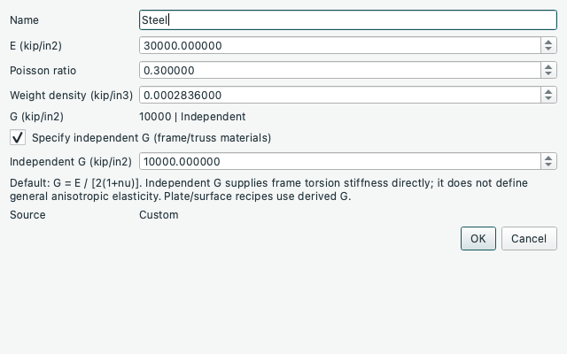

Material-library presets are reference starting points, not certified grades.
US steel uses the [PyNite Quickstart](https://pynite.readthedocs.io/en/latest/quickstart.html)
elastic constants and weight density. EU steel and C30/37 concrete use
[JRC Handbook 3](https://eurocodes.jrc.ec.europa.eu/sites/default/files/2021-12/handbook3.pdf)
(steel Annex Table 2; concrete Chapter VI and Annex Table 9). Aluminum uses
the [MIT material database](https://www.mit.edu/~6.777/matprops/aluminum.htm).
Mass densities for EU steel/aluminum are converted with standard gravity
9.80665 m/s2; the UI and PyNite receive weight density, not mass density.
Concrete presets assume uncracked, short-term stiffness. The RC-weight variant
changes density only, not reinforcement stiffness. No preset adds cracking,
creep, plasticity, yield strength, buckling, or a design-code check. Verify
properties for the actual grade, alloy, aggregate, and conditions of use.

### Section Library Reference

Each member also references a reusable section definition. Area uses in2 or mm2;
Iy, Iz, and J use in4 or mm4 in the member local axes. Iz governs in-plane bending
for the current XY frame model. Custom properties are entered directly;
definition names alone do not perform a section-catalog lookup. The initial
default uses W18x35 properties but is classified as custom, like older saved
definitions. Split segments inherit their original section.

The offline library contains 15 doubly symmetric wide-flange, square,
rectangular, and round HSS sections, not a complete catalog. Its numerical
properties come from the August 2023 [AISC Shapes Database v16.0](https://www.aisc.org/aisc/publications/steel-construction-manual/aisc-shapes-database-v160/),
consistent with the 16th Edition Manual, first printing. The source workbook was
retrieved from this [public mirror](https://github.com/OpenCivil-Project/Open-Structures/blob/f32abe5b162cb66aa590e3c2b107b7a726124713/app/resources/aisc-shapes-database-v16.0.xlsx)
because the official download returned HTTP 403. Its SHA-256 is
`82d0ceb96a0d938ae1a6bd9637cb10a1e269225b5d668dce5b0bdc8d86013496`.
Only designation, A/Iy/Ix/J and the 15 shapes' dimensional numerical facts are
bundled, not the workbook. The dimension excerpt and worksheet row references
are preserved in `tests/fixtures/aisc_v16_dimensions.json`. The mirror revision
used for these checks is `f32abe5b162cb66aa590e3c2b107b7a726124713`; its workbook
hash matches the original library source above.
Values use U.S. customary columns C, F, AQ, AM, AX; metric previews convert
these values rather than using the workbook's separately rounded metric columns.
Strong-axis bending maps catalog Ix to PyNite Iz and catalog Iy to PyNite Iy.
Weak-axis bending swaps those inertias; A and torsional J stay unchanged.
HSS design properties are taken directly from the database, not recalculated
from nominal wall thickness. Imported catalog properties and orientation are
validated on reopen; modified values must be classified as custom. Materials
remain a separate assignment, and imports do not change them. This is a stiffness
library, not a strength, buckling, or code-compliance check. Verify suitability
and section properties independently for engineering use.

The chooser includes a resizable **dimensioned section sketch** alongside the
numerical property table. Wide flanges show d (depth), bf (flange width), tw (web
thickness) and tf (flange thickness). Box HSS shows Ht/B; round HSS shows OD.
Both HSS families show nominal and design wall thickness separately, and draw
the design wall. Source US columns are G/L/Q/T for wide flanges, I/N/W/X for box
HSS, and K/W/X for round HSS. Dimensions convert to the current project's length
units. They use the published actual dimensions, not values inferred from the
section name: W18X35 depth is 17.7 in, while HSS6.625X0.280 has published OD
6.63 in. Select Weak axis to rotate the sketch 90 degrees within the fixed local
y/z axes, matching the table's Iy/Iz swap. Empty searches clear both previews.

The outline is idealized: fillets and HSS corner radii are omitted. It does not
recalculate A/I/J, supply stress recovery or perform code design. Browsing and
rotating do not edit the project; Add to Project uses the existing validated
catalog-property import and provenance workflow.

[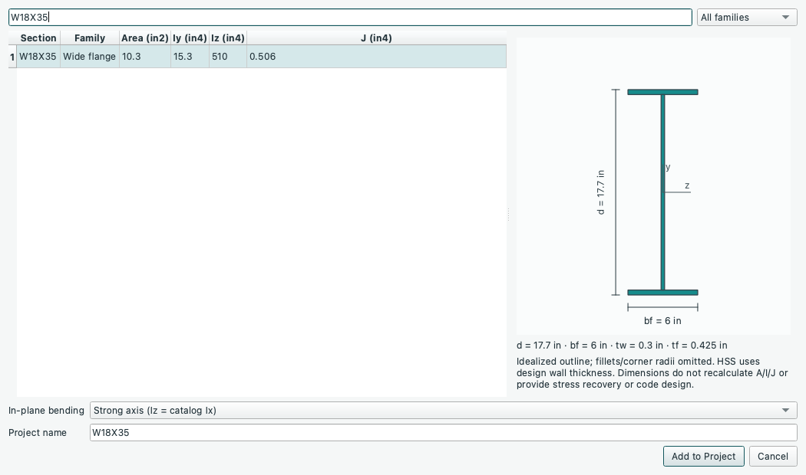](docs/assets/screenshots/section-dimensions.png)

### Project File Formats

Version 1 files migrate their shared material to a named Project material.
Version 1 and 2 files migrate their shared section to a named Project section.
Versions 1 through 4 migrate existing loads into Case 1 with the original
Service combination. Version 3 point loads and version 4 distributed loads
remain supported. Versions 1 through 5 migrate to rigid member ends.
Versions 1 through 6 open in Imperial, preserving their original inch-kip values.
New 2D saves use version 25 and retain material/section definitions, member
assignments, load cases, combination factors, the default load case, and each
member end moment release, plus the selected unit system, point-load angle,
and custom support restraints. Version 10 adds local force directions and
angled distributed loading; version 9 and older files retain their saved global
force directions and physical magnitudes.
Version 11 adds the optional self-weight case and factor. Versions 1 through 10
open with automatic self-weight off so existing reactions do not change.
Version 12 adds section catalog provenance and strong/weak-axis orientation.
Older files retain their exact numerical properties as custom definitions.
Version 13 adds material-library provenance; older materials remain custom.
Version 14 adds the frame/truss member type. Earlier files keep frame behavior,
including any existing end moment releases, without changing their response.
Version 15 adds global support-spring stiffnesses and member-local axial/shear
releases. Older files default to zero springs and connected translations.
Older project loads retain their original directions and magnitudes. The JSON units field
remains in-kip to identify the canonical storage units; unit_system controls
presentation and input conversion.
Malformed files are rejected before replacing the active project. Missing fields,
incorrect collection/entity shapes, unknown entity fields, invalid references,
boolean/string/nonfinite numerical values, and duplicate JSON keys produce
readable errors. JSON syntax errors include their line and column. Supported
planar versions 1 through 15, 21, 23 and 25 are supported; legacy files are migrated without modifying the input; spatial
versions 16/17/18/19/20/22/24/26/28 require an explicit `dimension: "3D"` marker and are validated separately.
Spatial version 17 adds global angular forces with azimuth (`angle`) and
`elevation`; version 16 axis-based loads migrate without changing their physics.
Unsupported future versions and angular fields in version 16 are rejected.
Spatial version 18 adds axial-only truss members; versions 16/17 remain frame-only
inputs and migrate without changing their geometry, supports or loads.
Spatial version 19 adds a required `surfaces` recipe map; versions 16/17/18
migrate to an empty map and cannot contain a surface field. Surface recipes keep
their own strict format/version metadata and are validated/generated before a
project replaces the active model.
Spatial version 20 adds required `surface_analysis_enabled` (boolean) and
`surface_pressures` (surface identifier to case-to-pressure map, canonical kip/in2).
Older spatial files migrate with coupled analysis disabled and empty pressures.
Surface rename/delete and load-case rename/delete preserve or guard these references.
Planar version 21 and spatial version 22 add required `analysis_method`
(`linear` or `p_delta`). Earlier files default to linear elastic and cannot silently
contain a second-order setting.
Planar version 23 and spatial version 24 add required editing-only `groups`
(name to `nodes`/`members` ID lists), `levels` (name to canonical inch global-Y
elevation) and `snap_levels` (boolean). Older files open with empty maps and
snapping off. Nonempty metadata in older formats is rejected rather than dropped.
Planar version 25 and spatial version 26 add optional material `shear_modulus`
(null for derived G, positive finite canonical ksi for an independent value).
Older files migrate with derived G and cannot contain an independent override.
New saves use 25/26; older applications reject these versions rather than lose
the input. Standalone plate/mesh recipe formats remain unchanged and derived-G only.
Spatial version 28 adds required `surface_supports`: surface identifier to outer
edge (`left`/`right`/`bottom`/`top`) to a nonempty list of unique global rigid DOFs.
Omit free edges. Legacy spatial versions migrate to an empty map; nonempty edge
assignments in older versions and a missing field in version 28 are rejected.
Assignments require rectangular Quad geometry and follow its current mesh.

Spatial files retain XYZ, all six restraints/springs, and roll. Unknown/future
versions are rejected rather than guessed. Node and member identifiers must be
distinct so load targets are unambiguous.
Editing a definition updates all members assigned to it and
invalidates analysis results.
No self-weight is applied automatically. Drawing an intersection alone does not
connect it: use Edit > Connect Intersections to create explicit shared endpoints.
Analysis requires one connected structure and rejects overlapping members or
nodes inside unsplit members, avoiding implicit solver connections. Geometry
connections use an absolute tolerance of 1e-8 inches. Distributed intensity is
force per unit member length, not projected length. The connection/splitting commands
in this section apply to 2D; spatial editing currently requires explicit segments.

Results are invalidated after engineering edits and belong to the analyzed project revision.
Unit selection changes presentation only and retains valid analysis results.
Result diagrams already open remain snapshots of that analysis.

### Diagram Sign Conventions

Whole-structure diagrams use a consistent cut orientation from the endpoint with
the smaller (X, Y) coordinate to the larger endpoint. Positive shear and moment
offsets lie on the left normal of that direction. This makes diagram geometry
independent of member drawing order; negative sagging moments appear below a
horizontal beam. Axial force N uses the PyNite convention: positive compression
and negative tension. Axial force is independent of member drawing direction;
compression offsets lie on the same canonical left normal, and tension offsets
lie on the opposite side. Each whole-structure quantity has a common amplitude
scale across all members. Member Detail retains PyNite local Fy/Mz signs. Point forces
and concentrated moments include both sides of each discontinuity.

## Architecture

- `src/pynitegui/qt/model.py`: validated, serializable project data.
- `src/pynitegui/qt/units.py`: canonical-to-display conversion factors and presets.
- `src/pynitegui/qt/annotations.py`: shared support/release symbols and factored load context.
- `src/pynitegui/qt/view_focus.py`: canonical geometry bounds for selection/finding camera navigation.
- `src/pynitegui/qt/recent_projects.py`: bounded recent-history display and preferences-only cleanup.
- `src/pynitegui/qt/help_menu.py`: native documentation links, searchable shortcuts, About and copyable version details.
- `src/pynitegui/qt/analysis_method.py`: saved elastic analysis choices, supported scope and native settings.
- `src/pynitegui/qt/released_member.py`: linear released-translation recovery using PyNite matrices.
- `src/pynitegui/qt/analysis.py`: project-to-PyNite adapter and analysis results.
- `src/pynitegui/qt/spatial_model.py`: separate six-DOF spatial definitions and format.
- `src/pynitegui/qt/spatial_surfaces.py`: project mesh ownership, immutable geometry
  cache, explicit analysis opt-in and mesh result payloads.
- `src/pynitegui/qt/surface_solver.py`: conforming rectangular Quad assembly,
  pressure/self-weight loading and shared solver-node ownership.
- `src/pynitegui/qt/spatial_analysis.py`: linear/P-Delta spatial solver and mechanism checks.
- `src/pynitegui/qt/spatial_view.py` and `viewport3d/`: native controls/bridge and Three.js.
- `src/pynitegui/qt/spatial_results.py`, `spatial_diagrams.py`: spatial sampling/exports/plots.
- `src/pynitegui/qt/analysis_jobs.py`: isolated solver processes, phase messages,
  thread-safe cancellation, and cleanup before publishing results.
- `src/pynitegui/qt/live_analysis.py`: optional debounce, cancellation and
  latest-revision scheduling around the existing background analysis lifecycle.
- `src/pynitegui/qt/toolbar_icons.py`: native vector tool icons following the theme.
- `src/pynitegui/qt/results_panel.py`: native sortable result tabs, entity links,
  lazy member tables, equilibrium display and analysis/snapshot status.
- `src/pynitegui/qt/equilibrium.py`: independent global load resultants and
  reaction balance with explicit force/moment tolerances.
- `src/pynitegui/qt/model_findings.py`: model/analysis finding review and
  conservative navigation for recognized geometry references.
- `src/pynitegui/qt/geometry_tools.py` and `geometry_panel.py`: atomic transform,
  generator and merge candidates with the shared native preview dock.
- `src/pynitegui/qt/station_queries.py` and `station_query_panel.py`: verified
  continuous-segment governing locations inside retained envelopes.
- `src/pynitegui/qt/construction.py`: validated connection candidates and native
  perpendicular/midpoint previews with explicit load-preserving member splits.
- `src/pynitegui/qt/app.py`: Qt graphics editor, inspector, undo commands,
  background analysis, and a consistent light application theme.
- `src/pynitegui/qt/diagrams.py`: whole-frame axial/SFD/BMD views, member detail plots,
  and sampling on both sides of force and moment discontinuities.
- `src/pynitegui/qt/envelopes.py`: combination bounds, governing combinations,
  envelope tables/curves, exact station inspection, and atomic CSV export.
- `src/pynitegui/qt/diagram_labels.py`: renderer-aware diagram label placement
  for interactive views and printed images.
- `src/pynitegui/qt/materials.py`: material definition manager and property editor.
- `src/pynitegui/qt/sections.py`: section definition manager and property editor.
- `src/pynitegui/qt/section_library.py`: offline catalog facts and axis mapping.
- `src/pynitegui/qt/material_library.py`: reference elastic and weight-density presets.
- `src/pynitegui/qt/load_cases.py`: load-case manager and combination factor editor.
- `src/pynitegui/qt/recovery.py`: per-window atomic recovery snapshots and validation.
- `src/pynitegui/qt/reports.py`: unit-aware CSV exports and native printable reports.
- `src/pynitegui/qt/examples.py`: fresh, canonical-unit example beam/frame models.
- `src/pynitegui/qt/theme.py`: shared light/dark widget, canvas, and plot styling.
- `src/pynitegui/qt/self_weight.py`: opt-in case/factor editor and weight preview.
- `src/pynitegui/qt/model_tables.py`: atomic numerical geometry/load editing.
- `src/pynitegui/qt/spatial_conversion.py`: explicit, independently validated
  2D-to-3D definitions and support/force convention mapping.
- `src/pynitegui/qt/spatial_reports.py`: snapshot-based, WebGL-independent spatial
  diagram projections, rolled-axis ribbons and print-friendly report images.
- `src/pynitegui/qt/bulk_edit.py`: explicit multi-entity property assignments.
- `tests/`: project, solver, diagram, and Qt interaction regression tests.

## Development

Use the focused runner during development. With no group it runs three smoke
checks; it does not default to the full suite:

```sh
uv run --locked python -B scripts/test.py
uv run --locked python -B scripts/test.py smoke ui
uv run --locked python -B scripts/test.py --list
uv run --locked python -B scripts/test.py ui --dry-run
```

| Change | Focused checks |
| --- | --- |
| Label, spacing, palette or generic native widget interaction | `smoke ui`, plus the affected feature class/module |
| Geometry, assignments, material/section editors, persistence or unit editors | `model`, plus `engineering` when definitions, conversions or solver input change |
| Structural calculations, stability, loads, supports or shared solver logic | `engineering` and affected `model`/`surfaces` checks; full suite for shared contracts |
| Mesh recipes, slab/plate workspaces, coupling or surface topology | `surfaces`; add `mcp` for remote editing and `viewport-surfaces` for rendering/selection changes |
| MCP schemas, permissions, edits or control mode | `mcp` with `--extra mcp`; add affected model/surface/engineering groups |
| Analysis workers, live recalculation, recovery or shutdown | `integration` and affected feature groups |
| 3D frame drawing, picking, orbit or rendering | `viewport-frame`; both viewer suites with `viewport` when shared renderer code changes |
| Documentation | `docs tooling`, followed by the strict docs build/link check below |
| Packaging/version metadata | `release`; complete the release validation checklist for distributions |
| Test runner/group definitions | `tooling` and `--check`; verify full selection and the full suite when changing shared test infrastructure |

Groups select existing modules or complete test classes; files with mixed
responsibilities can be split between groups without moving code or breaking
fixture imports. Some UI/model integration tests perform small example solves to
check displayed results or editing behaviour. The dedicated engineering and
surface benchmark suites are excluded from `ui`.

Combine groups or target one module, class or method; overlapping selections run
each test once:

```sh
uv run --locked --extra mcp python -B scripts/test.py mcp surfaces
uv run --locked python -B scripts/test.py test_qt_materials.MaterialEditorTests
uv run --locked python -B scripts/test.py test_qt_theme.ThemeTests.test_multiple_editors_sync_theme_actions
uv run --locked python -B scripts/test.py --check
```

`tests/groups.toml` assigns every test class to exactly one primary group. New
classes or modules without ownership, unknown selectors and duplicate primary
ownership fail validation. The smoke profile selects a few methods across groups.
Listing, dry runs and coverage checks use only Python's standard library and do
not import unrelated tests, Qt, PyNite or optional SDKs. `--collect-only` imports
only the selected Python tests and lists their IDs without executing them.
`-v` prints individual results; `--failfast` stops after a failure. Failures and
missing viewport tools return a nonzero status. This runner installs nothing.

The viewport groups invoke the existing offline scripts, using the separately
installed Node/Playwright/Chromium tools described below and the same
`PLAYWRIGHT_MODULE` / `PLAYWRIGHT_BROWSERS_PATH` environment settings. The `docs`
group runs documentation unit checks; the strict site build remains a separate
command so normal tests do not require Zensical. `mcp` needs the optional extra to
include wire tests; otherwise those tests retain their existing skip behaviour.

Run the complete Python suite for changes to shared infrastructure/model/solver
contracts and before releases. A passing focused group is not permission to
ignore a known failure elsewhere. `all` includes every Python group, including
smoke cases through their primary classes, but does not start browser checks,
performance benchmarks or a documentation build automatically. An explicit `all`
run compares actual test IDs with ordinary unittest discovery before execution,
including inherited or dynamically supplied cases:

```sh
uv run --locked --extra mcp python -B scripts/test.py all
# Original unittest discovery remains supported:
uv run --locked --extra mcp python -B -m unittest discover -s tests
```

The Qt interaction tests run offscreen. The suite covers project persistence,
undo/redo, result invalidation, analytical beam checks, portal-frame diagrams,
inclined/reversed members, point-force/moment jumps, explicit member connections,
load preservation during splitting, rejection of invalid model topology,
mixed-material/section stiffness, legacy-file migration, and material/section
assignment with undo.

Spatial regressions cover all six cantilever DOFs, biaxial tip moments, torsion,
roll/inertia changes, oblique local/global transformations, uniform/varying loads,
springs, missing out-of-plane restraints, self-weight, spatial combinations,
version dispatch, units, editing history, snapshots and reports. Widget tests use
`PYNITEGUI_NO_WEBENGINE=1` to avoid initializing Chromium; this is a test-only switch.
Visible installed-wheel checks are separate. Install the MCP wheel into a fresh
environment outside the checkout, use its Python in an active desktop session,
and leave `QT_QPA_PLATFORM` and `PYNITEGUI_NO_WEBENGINE` unset:

```sh
cd /tmp
/tmp/pynitegui-rc-mcp/bin/python /absolute/path/to/PyniteGUI/scripts/smoke_desktop.py --output /tmp/pynitegui-desktop-qa --hold
```

The script rejects editable imports and offscreen mode. It uses disposable
settings/projects, QtTest clicks and application commands for generators,
arrays, undo/redo, save/reopen, background analysis, governing stations, CSV/PDF,
both official space frames, actual WebEngine rendering and MCP lock/unlock on
an ephemeral local port. It records screenshots, dependency/renderer diagnostics
and a check list in the output directory; a timeout trace helps diagnose stalls.
The `--hold` option leaves the verified window open for human checks. File paths
are supplied programmatically, so real OS file pickers, keyboard shortcuts and
the interactive print dialog still require human verification. It does not
certify physical printing or any platform on which it was not run. See
[RELEASE.md](RELEASE.md) for exact observed versions and outstanding gates.

For real viewport checks, install Playwright in a separate developer environment
with its Chromium browser, then run `node tests/viewport3d.spec.cjs` with Playwright
available to Node (or set `PLAYWRIGHT_MODULE` to its installed package directory).
The script serves local assets temporarily and closes both browser/server after
testing desktop canvas pixels, framing, six signed gizmo views, keyboard reset,
zoom/selection preservation, orbit, node picking, all three work-plane drawing
modes, six force/moment overlays with rolled members, PNG capture and dark
appearance. Screenshots go to `/tmp/pynite-3d-qa`
by default, configurable with `VIEWPORT_QA_OUTPUT`. It does not launch the user's GUI.
`PLAYWRIGHT_EXECUTABLE_PATH` optionally selects an installed Chromium-compatible
test browser; otherwise Playwright uses its downloaded Chromium.

### Documentation Site

Zensical is an optional **docs dependency group**, not an application dependency
or an MCP extra. From the repository root:

```sh
uv run --locked --group docs python scripts/docs.py build
uv run --locked --group docs python scripts/docs.py serve --port 8000
```

The preview binds to `127.0.0.1` only. Choose another port if 8000 is occupied.
Preparation runs once at startup; restart the preview after editing the GUIDE,
project records or authored `docs/` sources to regenerate the topic pages.
The build performs a clean strict Zensical build, then checks local HTML links,
anchors, images and assets. `python scripts/docs.py check` repeats that check
without rebuilding. `prepare` only regenerates the documentation input tree.
No Qt, PyNite, server or application module is imported by the docs tooling.
CI uses `--only-group docs` so it need not install the desktop/scientific stack.

The GUIDE remains the maintained detailed reference. `scripts/docs.py` maps every
GUIDE heading into a topic page and copies the roadmaps, changelog and release
record, rewriting repository-document links. Unmapped or duplicate headings and
navigation omissions fail preparation. `docs/` contains authored entry pages,
the first-model tutorial, feature index, custom styles and screenshot assets. Add or update detailed
workflows here in GUIDE.md, not in generated topic files. Update the topic map and
`zensical.toml` navigation if you add a heading. Keep the feature index and tutorial
accurate when workflows change. This avoids two competing copies of the manual.

Generated Markdown/assets live under `.docs-build/docs`; built HTML lives under
`site`. Both are ignored. The existing logo and screenshots are copied from
`assets/`; current workflow screenshots live in `docs/assets/screenshots/` and
are copied with the authored pages. GUIDE image links use `docs/assets/...` so
they resolve in the repository; generation rebases them for each site topic.
Search and light/dark appearance
are provided by Zensical; system fonts avoid runtime Google Fonts requests.
The documentation describes the current checkout and explicitly distinguishes
experimental surface geometry/coupled slabs from established frame and separate
plate-only workflows.

Refresh the native screenshots from the desktop development environment with
`python -B scripts/capture_docs.py` (or use `--output` for a review directory).
The script captures real widgets with temporary example files and settings,
including a genuine topology finding and solved P-Delta result. It does not
open web links or use personal project history. It defaults to Qt's offscreen
platform; platform fonts can change the resulting pixels. Inspect every image
before committing it. The three-storey image comes from the real offline 3D
viewport check: run `node tests/mesh_viewport.spec.cjs` with Playwright configured,
then copy `/tmp/pynite-mesh-qa/multistorey.png` to
`docs/assets/screenshots/three-storey-slabs.png`. See the mesh viewport QA setup
above. Capturing images requires the desktop/viewport dependencies; building
the manual still requires only the docs dependency group.
The 3D readability screenshot comes from `node tests/viewport3d.spec.cjs`:
copy `/tmp/pynite-3d-qa/desktop-diagram-readability.png` to
`docs/assets/screenshots/spatial-diagram-readability.png` after inspecting it.

`.github/workflows/docs.yml` builds/checks pull requests, uploads the generated
site and deploys only trusted pushes to `master` or manual runs on that branch.
It does not publish Python packages or alter release tags. To enable the planned
site at `https://praksharma.github.io/PyniteGUI/`, the repository owner must select
**Settings > Pages > Build and deployment > Source: GitHub Actions**, then push
the documentation commit or run the Documentation workflow on master. The website
URL is a deployment target, not a claim that the site is already live.

For standalone documentation tests:

```sh
uv run --locked --group docs python -B -m unittest discover -s tests -p 'test_docs.py'
```

Optional desktop browser QA: after building, run `node tests/docs_site.spec.cjs`
with Playwright/Chromium installed separately (or set `PLAYWRIGHT_MODULE` as in
the viewport checks). It serves `site/` under the existing GitHub Pages `/PyniteGUI/` prefix
and checks images, search navigation, dark mode, key topics and desktop overflow.
It closes its temporary server/browser and writes screenshots to
`/tmp/pynite-docs-qa` (override with `DOCS_QA_OUTPUT`).

### Spatial Performance Checks

Spatial member sampling is cached in canonical model units, shared by the
viewport, Member Detail, envelopes and report diagrams. Each solver snapshot
owns a least-recently-used cache with a 32 MiB sample-array budget. Keys separate
snapshots, combinations, members, geometry/roll/type and load-boundary stations;
unit, selection and display-only changes reuse read-only arrays. Fresh analyses
use fresh caches, and solver serialization drops cached arrays. There is no
change to numerical sampling density, one-sided load jumps or solver signs.

Run the optional analytical benchmark from the repository root:

```sh
uv run --locked python -B tests/benchmark_spatial.py
```

It solves 10-, 50- and 100-segment spatial cantilevers and emits JSON with solve,
cold sampling, five warm reads, station counts and cache bytes. On this Linux
Python 3.12.15 run (2026-10-09), the 100-member cold read took 0.85 seconds and
warm reads took 0.15-0.21 milliseconds, retaining 585,600 sample-array bytes.
These are sampling-only measurements, not complete UI redraw or solver speedups.

For optional large-model desktop rendering checks, use the same separate
Playwright installation as above:

```sh
VIEWPORT_BENCHMARK=1 node tests/viewport3d.spec.cjs
```

The ordinary interaction suite still runs. The benchmark additionally draws
144-, 616- and 1,580-member lattices at 1280x720 with labels on/off, checks canvas
pixels, framing, orbit interaction and graphics-resource counts after model
replacement, and records scene rebuild and frame timings. Screenshots and
`desktop-benchmark.json` use the same output directory. Synthetic lattice data
benchmarks rendering only, not structural analysis. The harness uses Chromium's
SwiftShader software renderer; record the reported driver when comparing runs.
Timings are observations, not hardware-independent pass/fail thresholds.
The pre-batching baseline rebuilt the 1,580-member geometry in about 152 ms,
or 520 ms with labels enabled, with roughly 2,600 draw calls. Base frame rendering
now uses two instanced meshes (one unit cylinder shape for members and one unit
sphere shape for nodes) with per-instance transforms/colours/IDs, and the grid
uses one line-segment batch. Picking, node-dragging and drawing snaps resolve
instance IDs back to model IDs. Disposal releases instance buffers and deduplicates
geometry/material/texture disposal. Supports, labels, loads and analytical
overlays remain independent objects; their rebuilding and JSON/payload costs
are not removed by geometry batching or the analytical cache. The benchmark
enforces fewer than 30 unlabelled draw calls and 20 geometries for the lattices,
in addition to visible model pixels and resource-replacement checks.
The post-batching run recorded 18 unlabelled draw calls and seven geometries at
all three sizes. The 1,580-member unlabelled rebuild took about 14 ms (12 ms on
replacement), while labels still brought rebuilds into the hundreds of
milliseconds. SwiftShader frame timings remained variable; these measurements
demonstrate lower allocation/submission costs, not a guaranteed frame-rate gain.

Selection and tool-mode changes now recolour the two base instance buffers and
update interaction settings without rebuilding supports, loads, deformation or
force overlays. The complete remaining payload is compared, so geometry,
work-plane, units, theme, visibility and result changes still rebuild. When local
axes are shown, selection also rebuilds because it changes the displayed axes.
JSON serialization and native payload construction still scale with model size.

Label textures are shared by exact text/colour through a least-recently-used
cache capped at 512 entries and an 8 MiB estimated RGBA texture budget (including
a mipmap allowance). Active sprites pin their entries. Labels beyond the budget
use transient textures that are disposed with their sprites. Hiding ordinary
labels clears unused entries; required diagram values remain independent.
Context loss and page teardown clear retained entries and dispose scene objects;
browser history suspension retains its scene for restoration. The cache bounds
retained resources, not the memory required by all live labels in a large scene.

The interaction harness includes real-canvas cache lifetime/eviction checks,
selection colours, all six force-overlay refreshes, support-anchor preservation,
geometry/theme/visibility/local-axis rebuilds, and context-loss cleanup.
Large-model benchmarks also record selection/tool refresh times and enforce no
scene rebuilds, additional graphics resources or cache-budget overruns for those
display-only updates.

A hardware comparison on 2026-10-09 used the Codex in-app Chromium browser,
WebGL 2 / ANGLE Metal on Apple M4 Max, a 552x853 viewport, the same 144/616/1,580
member lattices and five selection/tool updates per case. Median labelled
selection refreshes changed from 5.8/22.3/76.9 ms to 0.6/0.9/1.3 ms; tool changes
changed from 5.7/24.6/71.7 ms to 0.5/0.8/1.0 ms. Unlabelled refresh times stayed
around 0.4-1.5 ms. Resource counts stayed constant across the new refreshes;
the largest scenes retained 512 label entries with an estimated 6,856,128 bytes.
These are payload-to-scene update observations, not complete native GUI latency,
solver timings, full-rebuild speedups or guaranteed frame rates. The targeted
browser contracts and context-loss check passed on this hardware. The standalone
Playwright interaction suite could not launch here because the macOS sandbox
denied Chromium's Mach bootstrap registration; the recorded hardware comparison
does not substitute for that suite's gesture coverage.

### Additional Regression Coverage

Distributed-load checks cover analytical uniform/triangular beam responses,
partial-span resultants, inclined global loading, orientation-independent
diagrams, interpolated split loads, persistence, and editor creation/undo.
Load-case checks cover independent results, linear superposition, negative/zero
factors, reference-safe renaming/deletion, persistence/migration, default case
assignment, result/diagram switching, deformation, and analyzed snapshots.
Hinge checks cover analytical released beams, pin-jointed frames, mixed rigid
and hinged connections, real mechanisms, unsupported nodal moments, inactive
rotation reporting, split/intersection preservation, persistence, and undo.
Axial-force checks cover tension/compression signs, inclined and reversed members,
point-force jumps, distributed axial loading, pin-jointed frames, common scaling,
combination switching, snapshot preservation, and compact plot-label layout.
Unit checks cover known conversion factors, SI analytical beam responses,
precision-preserving input, grid snapping, all dimensional editors/result columns,
live diagram switching, persistence/migration, undo, and repeated unit changes.
Additional-preset checks cover known mm/N and ft/kip conversion factors and
preservation of model data, analysis identity, result exports, and persistence.
Editing checks cover drag preview/commit/cancel, snapping, collision rejection,
and non-destructive load visibility. Custom support checks cover preset
equivalence, independent restraints, hinged joints, persistence, and undo.
Member-result checks cover extrema, exact-distance queries, one-sided jumps,
click inspection, combination switching, and SI conversion. Recovery checks
cover atomic write failures, untouched project files, multiple windows,
malformed snapshots, recovery dirtiness, cancelled closing, and recent projects.
Local-loading checks cover inclined/vertical/reversed axes, angled triangular
resultants, manual component equivalence, sign-changing ramps, split/node
conversion, SI input, persistence, and unedited angle/intensity precision.
Export checks cover SI/imperial values, combination identity, undefined rotations,
CSV quoting/formula safety, atomic failures, cancellation, stale-model rejection,
retained snapshot exports, report escaping, and native PDF rendering.
File-validation checks cover malformed shapes and values, duplicate keys,
versions 1 through 15, future-version rejection, non-mutating migrations, and
preservation of the active project and source file after a failed open.
Stability checks cover inadequate pins/rollers, custom restraints, translated
coordinates, zero-stiffness and internal sway mechanisms, valid released beams,
uniformly soft materials, nonfinite results in any combination, unrelated solver
errors, and the dense-localization size limit.
Larger-model benchmarks compare a twenty-segment mixed-material/section column
against independently integrated bending/axial formulas. Four-storey, two-bay
frames check global force/moment equilibrium, combination superposition,
triangular beam loads, lateral floor loads and nodal moments, fixed/pinned/mixed
supports, partial end releases, and endpoint reversal. These are numerical
regression benchmarks, not wall-clock performance targets or design certification.
Example checks solve every supplied model/combination, verify a cantilever's
analytical reactions, and cover fresh copies, SI equivalence, menu loading,
unsaved-state handling, and cancellation. Theme checks cover preference restore,
live recoloring, multi-window synchronization, contrast, toolbar icons, compact
inspector scrolling, pending input, and preservation of results/plot inspection.
Self-weight checks cover analytical beam deflection/reactions, per-member
materials/sections, inclined/reversed axes, case omission/factors/renaming,
zero density, splitting, old-file migration, validation, preview precision,
manual-load superposition, repeated analysis without duplication, undo/filtering,
snapshot invalidation, and export metadata.
Model-table checks cover all unit presets, unchanged-value precision, force/moment/
intensity interpretation, custom restraints, assignments/releases, new references,
dependent deletion, invalid drafts, the active numeric editor, cancellation,
self-weight separation, and one-step undo/redo.
Bulk-edit checks cover tree/canvas modifier selection, rectangle intersections,
cancellation, selection synchronization, mixed entity types, preserved properties,
all load quantities, atomic failure, cascading deletion, filtering, history,
selected-load highlighting, and result preservation/invalidation.
Section-library checks cover all entries, strong/weak-axis stiffness, all unit
presets, source metadata validation, legacy custom definitions, save/reopen,
search/family filters, duplicate-name protection, cancellation, one-step import
undo/redo, rename provenance, and custom classification after property edits.
Material-library checks cover reference conversions, mass/weight distinction,
all unit presets, source validation, old-file preservation, safe imports,
search, cancellation, conflicts, undo/redo, and property-edit classification.
Truss checks cover triangle joint equilibrium and virtual-work displacement,
zero shear/moment, inertia independence, reversed endpoints, mixed joints,
joint moments, lumped/mixed self-weight and combinations, split mechanisms,
migration, type validation, inspector/bulk/table edits, generated force units,
load rejection, and undo.
Presentation/report checks cover placement and sign independence, unchanged
solver probes, unit/combination updates, model definition conversions and HTML
escaping, selected sections, embedded light-palette images, inherited diagram
settings, invalid/empty choices, snapshot validation, and cancellation.
Elastic-support/release checks cover parallel axial stiffness, a spring-only
cantilever base, hinged-joint rotational springs, opposing reactions, weak-support
rejection, all 64 planar release patterns, released axial/bending deflection,
split/combination equivalence, isolated-result transport, all unit presets,
legacy migration, atomic editor failures, glyphs, reports, and undo/redo.
Annotation checks cover distinct support/spring geometry, signed moment arrows,
factored loads/self-weight, partial spans, unchanged force diagrams under
visibility changes, collision-free text/symbols, member context, and report choices.

Keep workflow and engineering-scope changes documented here. Track remaining
features and known limitations in [TODO.md](TODO.md), updating it as work lands.
Commit completed, verified changes in coherent groups; keep implementation and
its regression tests together.
