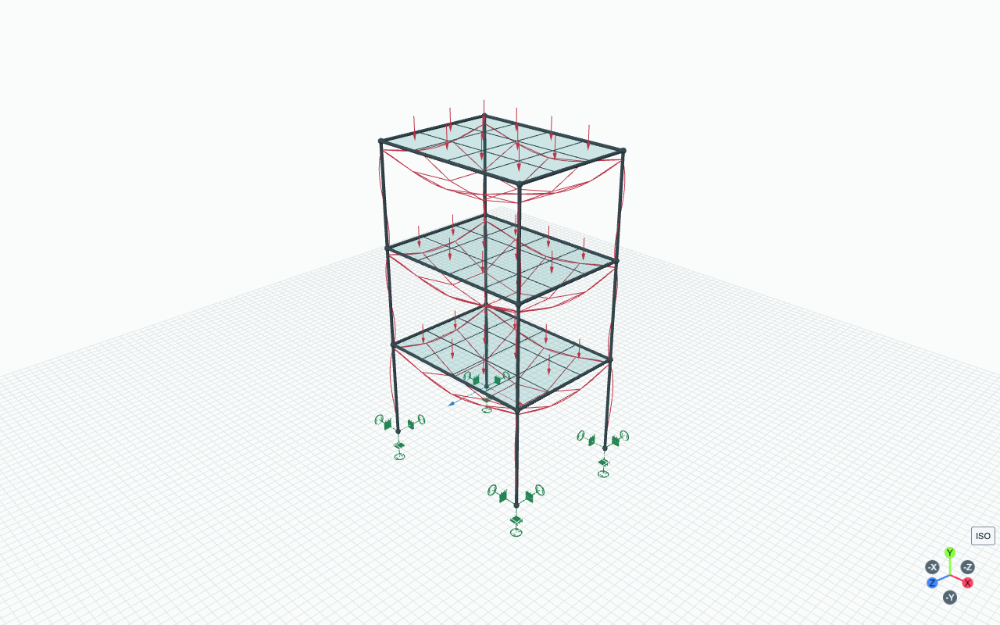
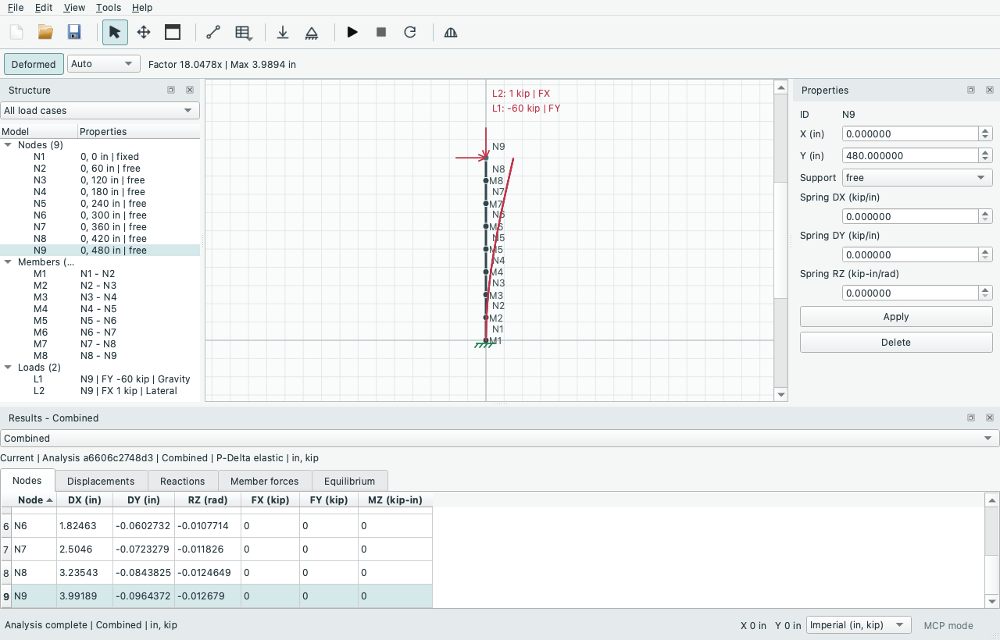

# Your First Model

Use a supplied example first. It gives you a known result to check before
building your own structure.

## Open and Solve a Beam

1. Launch PyniteGUI and choose **File > Examples > 2D Frames > Simply Supported Beam**.
2. Check the unit selector at the bottom-right. In the inch/kip preset, the beam
   spans **420 in** and has a **10 kip downward midspan load**.
3. Inspect the two support nodes: one pin and one roller. They constrain the
   beam without fixing its end rotations.
4. Press the Analyze triangle or **F5**. Wait for a completed result snapshot.
5. Check vertical support reactions: **5 kip at each end**. In SI (m, kN), the
   same physical example has a 10.668 m span, 44.4822 kN load and 22.2411 kN reactions.
6. Turn on **Deformed**. Choose Auto, True Scale or Custom; amplification changes
   only the displayed shape, not the numerical answer.
7. Open **Diagrams** to inspect axial force, shear and bending moment, then use
   Member Detail to inspect a station. Read the [sign conventions](../results/conventions.md).
8. Save under a new project filename. Examples start as unsaved models and do
   not overwrite an example file.

## Try the Official PyNite Beams

Under **File > Examples > 2D Frames**, choose one of the three **Official PyNite**
beam entries. These use a 168-inch span and custom section properties from the
upstream scripts, rather than the 420-inch starter beam above. Analyze with **F5**.

| Example | Combination | Vertical reaction at each end | Midspan dy |
| --- | --- | --- | --- |
| Beam with Point Loads | 1.2D+1.6L | 9.4 kip | -0.42692855 in |
| Beam with Uniform Load | Combo 1 | 1.4 kip | -0.03974069 in |

Select the named combination in Results. The support-node displacements are zero;
open **Diagrams > Member Detail** for M1 and inspect distance **84 in** to check
midspan deflection. A negative dy is downward. The model is unchanged when you
switch display units; use the inch/kip preset to compare these numbers directly.

For **Beam with Factored Envelope**, open **Diagrams > Envelopes**, select all
three combinations and inspect the Members summary for M1. Local Mz runs from
**-222.17142857 kip-in** (**1.2D+1.6L**) to **+596.57142857 kip-in**
(**1.2D+1.6S**). These extrema occur in different load combinations. D and S act
upward in the official script; the example preserves those executable load signs.

Read the [example reference](examples.md) for the pinned upstream revision,
material/support assumptions and differences from the original scripts. Each
opens as a fresh editable project; save it under your own filename.

## Make One Change

Select the load in the structure tree and edit its signed magnitude, then Apply.
The previous editor results become outdated because the engineering model changed.
Analyze again, or use [opt-in live recalculation](../analysis/live.md).
Undo restores model definitions; it does not certify an earlier result as current.

Changing display units is different: it preserves the physical model and valid
results. Learn the four [unit presets](../reference/units.md) before entering data.

## Try a Spatial Model

Open **File > Examples > 3D Frames > 3D Space Frame - Gravity and Wind**. Orbit the viewport,
use the signed-axis gizmo, and inspect the load cases and combinations.
The [3D workflow](../modeling/3d.md) explains work planes, XYZ nodes, member roll,
six-direction supports, spatial loads and result components.

To add a rectangular surface in a source checkout, open **Tools > Surface Meshing**.
The rectangle defaults to the highest detected complete frame level. Check the
reference frame in the preview and choose **Apply to 3D Model**.

To try combined slab/frame analysis, open **File > Examples > Slabs > 3D Frame and Slab -
Coupled Pressure (Experimental)**. Analyze the Gravity combination: each base's
vertical reaction should be **10.8 kip**, balancing **43.2 kip** slab pressure.
Enable Deformed to see the slab and beams together.

!!! warning "Coupling must be explicit and conforming"
    On your own model, select the rectangular Quad surface, enable **Coupled
    analysis (experimental)** and apply pressure by load case. Merely touching
    does not establish a connection: shared mesh vertices and valid beam/grid
    alignment are required. Other surface families remain geometry-only.
    See [coupled slab limits](../surfaces/main-model.md) before using this workflow.

For multiple storeys, create a complete frame perimeter at each floor elevation
and explicitly choose the matching placement level for each slab. New rectangles
default to the highest valid level. Box selection can include several projected
slabs; use the Surfaces tree for an exact floor selection when they overlap.
Frame/surface/pressure changes can also be submitted as one guarded
[MCP batch](../automation/mcp.md); coupled interfaces validate before committing.

## Try Three Floors and Slabs

Open **File > Examples > Slabs > Three-Storey Frame and Slabs (Experimental)**.
This model already enables coupled linear analysis. Analyze **Gravity** and check
**45.9 kip** vertical reaction at each of the four bases, balancing **183.6 kip**
total slab pressure. **Factored** gives **60.48 kip** per base. Automatic self-weight
is off; the prescribed Dead/Live pressures are the applied loads.

Select Floor1, Floor2 or Floor3 in the Surfaces tree to inspect its pressure map
and placement. Turn on Deformed to see all three slabs and their supporting
frames. Keep the method Linear elastic: coupled slabs are outside the P-Delta
workflow. The example uses elastic concrete slabs and steel frame members.

*The actual 3D viewport after a Gravity analysis, with labels hidden for clarity.
The red overlay exaggerates slab and frame displacement; use the result tables
for numerical values. All three floors transfer their prescribed pressures to
the supporting frame.*

## Choose a Frame Analysis Method

Open **File > Examples > P-Delta > Slender Column - Gravity and Lateral Load**
for a ready-to-run second-order example. Analyze its default **Combined** result:
tip DX is approximately **3.9919 in**. Switch to **Lateral** for **2.4925 in**.
The larger combined displacement comes from the compressive Gravity load.
Changing the method to Linear elastic makes Combined give 2.4925 in as well.
The strict equilibrium tab can flag small force residuals from PyNite's
approximate second-order recovery; see the [method limits](../analysis/solve.md).

*Open the image for full-size text. Select N9 to see the Combined tip DX of about
3.9919 in in the Nodes table.
The red deformed shape is visually amplified. Its sampled maximum label can
differ slightly from the nodal tip value; compare table values when checking
the example.*

Use **Edit > Analysis Method** to switch a frame-only project from **Linear elastic**
to **P-Delta elastic**, then analyze again. The result label records the method.
P-Delta solves each load combination independently; compare lateral response under
combined gravity/wind with wind alone. Add intermediate joints along slender
columns and check refinement. Keep coupled slab examples on Linear elastic.
P-Delta keeps materials elastic. Steel plastic pushover and reinforced-concrete
plastic behaviour are separate pending workflows; read the
[analysis scope](../analysis/solve.md) before using a method.

## Build Your Own

Select an item and press **Shift+F** to frame it; **F** fits the whole model.
Double-click a recognized Model Findings row to select and zoom to the problem.

*Here an extra node lies inside a column without a shared member connection.
The finding explains the repair; double-clicking it brings the affected geometry
into view. Follow the [model-check example](../modeling/topology.md) to reproduce it.*

Press **F1** for the documentation website, or use **Help > Keyboard Shortcuts**
for an offline command reference. **View > Restore Default Layout** brings back
misplaced panels without changing your model or unapplied property edits. See
[Help and workspace](help.md).

Continue with [drawing and selection](../modeling/drawing.md),
[materials and sections](../modeling/properties.md),
[supports](../modeling/supports.md), and [loads](../analysis/loads.md).
Use [model checks](../modeling/topology.md) before analysis; a crossing on screen
is not automatically a shared joint.
