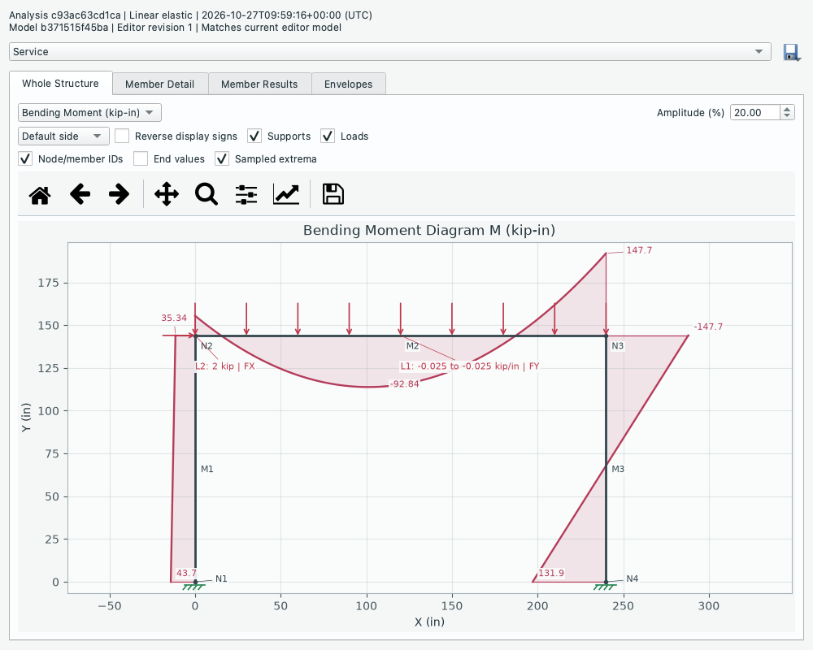
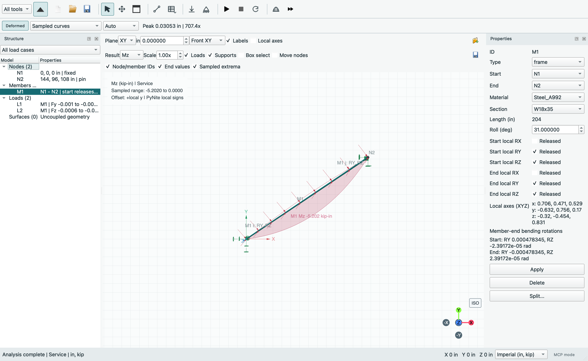
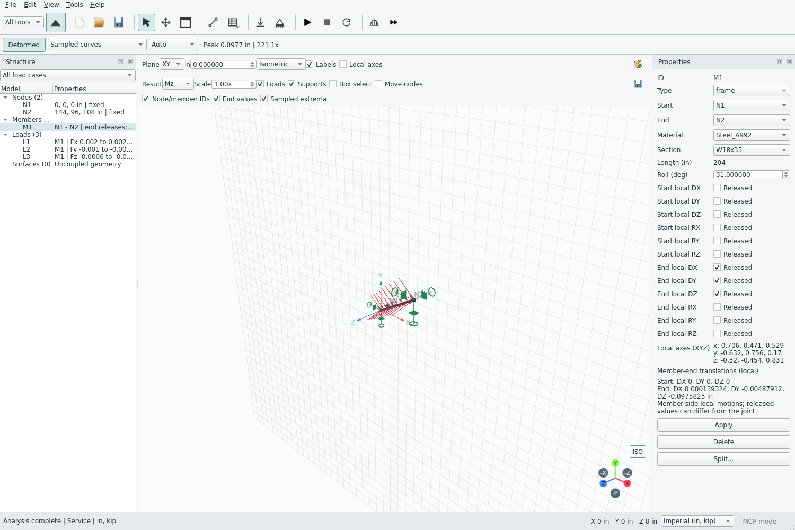

# Tutorial: Continuous Beams, Gerber Hinges & Member End Releases

This tutorial walks through modeling multi-span continuous beams, partial-span and trapezoidal
distributed loads, internal moment hinges (Gerber beams and three-hinged arches), and explicit
translational and rotational member end releases in 2D and 3D.

---

## 1. Multi-Span Continuous Beam with Partial Distributed Loads

1. Open **File > Examples > 2D Frames > Continuous Beam - Partial Loads** (or build a two-span
   beam from `x = 0` to `x = 240 in` and `x = 240` to `x = 480 in` with `pin` / `roller` supports).
2. Select a span and click **Add Load** to apply a partial-span or linearly varying distributed load:
   - **Type:** `Distributed`
   - **Direction:** `FY` (or `Local y` for inclined members)
   - **Start / End intensity:** Enter signed force/length values (e.g. `-0.10` to `-0.25 kip/in`).
   - **Start / End fraction:** Enter normalized member stations $0 \le a < b \le 1$ (e.g. `0.25` to `0.75`).
3. Press **F5** to solve, then open **Diagrams > Member Detail**:
   - Enter an exact **Distance** from the member start (or click directly on the plot) to inspect
     $N$, $F_y$, $M_z$, and $d_y$.
   - At a concentrated point load or moment jump, switch between **Left side** and **Right side**
     to read the exact one-sided solver values on either side of the discontinuity.

[](../assets/screenshots/diagram-controls.png)

### Headless Python Snippet: Two-Span Continuous Beam & Station Probe
```python
from pynitegui.qt.analysis import analyze
from pynitegui.qt.diagrams import member_values
from pynitegui.qt.model import Load, Project

project = Project(unit_system="imperial")
project.add_member((0.0, 0.0), (240.0, 0.0))    # M1: Span 1
project.add_member((240.0, 0.0), (480.0, 0.0))  # M2: Span 2
project.nodes["N1"].support = "pin"
project.nodes["N2"].support = "roller"
project.nodes["N3"].support = "roller"

# Partial trapezoidal load on M1 (20% to 80% of span) and midspan point load on M2
project.loads["L1"] = Load("L1", "M1", "FY", -0.05, 0.2, "distributed", -0.15, 0.8)
project.loads["L2"] = Load("L2", "M2", "FY", -12.0, 0.5, "point")
project.validate()

result = analyze(project)
# Compare left-side and right-side shear at the M2 midspan point load (x = 120 in)
left_n, left_fy, left_mz, left_dy = member_values(project, result, "M2", 120.0, "left")
right_n, right_fy, right_mz, right_dy = member_values(project, result, "M2", 120.0, "right")
print(f"M2 midspan shear jump: left Fy = {left_fy:.4f} kip, right Fy = {right_fy:.4f} kip")
print(f"Interior pier N2 vertical reaction = {result.reactions['N2'][1]:.4f} kip")
```

---

## 2. Internal Moment Hinges: Gerber Beam & Three-Hinged Arch

In Brecon, an internal hinge between two frame members is modeled by releasing the bending
moment on **one** of the two member ends meeting at a shared two-member joint (or by releasing
relevant member ends so at least one member retains rotational continuity if a nodal moment is applied,
or leaving the joint rotation free when all incident ends are hinged).

1. Open **File > Examples > 2D Frames > Gerber Beam - Internal Hinge**:
   - The beam has fixed/roller supports at `N1`, `N2`, and `N4`, and an internal moment hinge at `N3`.
   - Press **F5** and verify vertical reactions: `N1 FY = 0.15 kip`, `N2 FY = 2.25 kip`, `N4 FY = 0.6 kip`.
   - Open **Diagrams** and verify that the bending moment $M_z$ passes through zero at the hinge node `N3`.
2. Open **File > Examples > 2D Frames > Three-Hinged Polygonal Arch**:
   - Two pinned base supports (`N1`, `N5`) and a crown hinge at `N3` make the arch statically determinate.
   - Because both members meeting at crown node `N3` release their moment at `N3`, the nodal rotation
     `RZ` at `N3` is unattached to any rotational stiffness and is reported as `n/a` in the displacement
     table (while each member end has its own independent rotation).

### Headless Python Snippet: Gerber Beam with Internal Hinge
```python
from pynitegui.qt.analysis import analyze
from pynitegui.qt.examples import example_project

gerber = example_project("gerber")
res_gerber = analyze(gerber)
for node_name in ("N1", "N2", "N4"):
    print(node_name, "FY =", round(res_gerber.reactions[node_name][1], 4), "kip")
```

---

## 3. Translational & Spatial End Releases

Beyond planar moment hinges (`release_start`, `release_end`), frame members can release local
axial (`DX`) and transverse shear (`DY`, and `DZ` in 3D) or 3D torsion/bending (`RX`, `RY`, `RZ`):

1. **2D Shear Release:** Open **File > Examples > 2D Frames > Fixed-Guided Beam - Shear Release**
   (`shear_release`). Releasing local shear `DY` at a member end enforces $F_y = 0$ at that end while
   still transmitting bending moment $M_z$ and axial force $N$.
2. **3D Rotational & Translational Releases:**
   - Open **File > Examples > 3D Frames > 3D Inclined Beam - Rotational End Releases** (`3d_released_beam`)
     or **3D Fixed-Guided Beam - Translational End Releases** (`3d_sliding_beam`).
   - Select the member and inspect the twelve local end-release checkboxes in **Properties** (or **Edit > Model Tables…**):
     `Start/End axial DX`, `shear DY`, `shear DZ`, `torsion RX`, `bending RY`, and `bending RZ`.

[](../assets/screenshots/spatial-rotational-releases.png)

[](../assets/screenshots/spatial-translational-releases.png)

### Headless Python Snippet: 2D and 3D Released Beams
```python
from pynitegui.qt.analysis import analyze
from pynitegui.qt.examples import example_project
from pynitegui.qt.spatial_results import inspect_member

for key in ("shear_release", "3d_released_beam", "3d_sliding_beam"):
    proj = example_project(key)
    res = analyze(proj)
    print(key, "solved combinations:", list(res.solver.load_combos))

# Inspect local 3D member actions at the start of the sliding beam
sliding = example_project("3d_sliding_beam")
res_sliding = analyze(sliding)
values = inspect_member(sliding, res_sliding, "M1", 0.0, "right")
print("3D sliding beam start local (N, Vy, Vz, T, My, Mz, dy, dz):", [round(v, 5) for v in values])
```

See [Member end releases](../modeling/releases.md) and [Release formulation](../reference/releases.md).
