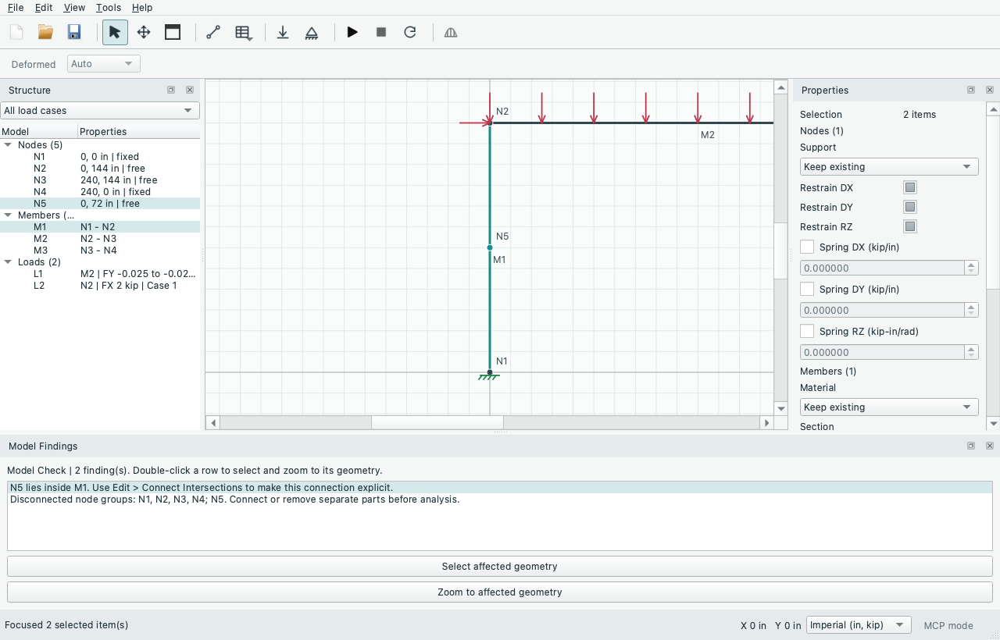

# Tutorial: Geometry Transforms, Arrays, Merging & Construction Connections

This tutorial walks through Brecon's previewed geometry tools and topology repair workflows:

1. **Move / Copy, Linear Repeat (Arrays), Rotate & Mirror** (`Geometry Tools` dock).
2. **Controlled Two-Node Merging** (`Merge Two Nodes`).
3. **Splitting, Equal Subdivision, Intersections & Model Findings** (`Split Member`, `Subdivide Members`, `Connect Intersections`, `Check Model`).
4. **Perpendicular & Midpoint Construction Connections** (`Perpendicular Connection`, `Connect Member Midpoints`).

---

## 1. Move, Copy, Linear Repeat (Arrays), Rotate & Mirror

Open **Tools > Move / Copy / Array / Rotate / Mirror…** to open the **Transform** tab in the
**Geometry Tools** dock:

1. Select one or more nodes and/or members in the canvas or Structure tree (selected members
   automatically include their endpoint joints).
2. Choose an operation:
   - **Move / Copy:** Translate by $(\Delta X, \Delta Y)$ in 2D or $(\Delta X, \Delta Y, \Delta Z)$ in 3D.
     Check **Copy** to duplicate instead of moving in place.
   - **Linear repeat:** Create $1 \dots 50$ equally spaced copies at steps of $(\Delta X, \Delta Y, \Delta Z)$.
   - **Rotate:** Rotate by a signed angle about a reference point (about global $Z$ in 2D; about global $X$, $Y$, or $Z$ in 3D).
   - **Mirror:** Reflect across a plane through the reference point normal to $X$ or $Y$ (or $Z$ in 3D).
3. Optional checkboxes when copying or repeating:
   - **Reuse coincident nodes:** Connect newly copied members into existing joints within `1e-8 in`
     (ideal for repeating portal bays or storeys).
   - **Copy supports / springs** and **Copy loads:** Duplicate boundary conditions and loads onto the new geometry.
   - Note: Any **Joint Springs** whose start and end joints are both included in the selection are automatically copied as well.
4. Click **Preview** to inspect the candidate overlay and summary, then **Apply** to commit as one undo step.

### Headless Python Snippet: Generate a 2D Bay & Repeat It into a 3D Multi-Bay Frame
```python
from pynitegui.qt.geometry_tools import plan_generator, plan_transform
from pynitegui.qt.model import Project
from pynitegui.qt.spatial_conversion import to_spatial

# 1. Generate a 2-bay, 2-storey planar frame
planar = Project()
gen_plan = plan_generator(planar, "frame", bays=[240.0, 240.0], heights=[144.0, 144.0], support="fixed")
planar = gen_plan.definition

# 2. Convert to 3D and repeat 2 bays along Z (spacing 180 in)
spatial = to_spatial(planar)
all_items = [("members", m) for m in spatial.members]
array_plan = plan_transform(
    spatial,
    all_items,
    "repeat",
    offset=(0.0, 0.0, 180.0),
    copies=2,
    copy_supports=True,
    reuse=True,
)
print(array_plan.summary.splitlines()[0])
print("3D nodes:", len(array_plan.definition.nodes), "| 3D members:", len(array_plan.definition.members))
```

---

## 2. Controlled Two-Node Merging

When importing or drawing geometry leaves two distinct joints slightly separated, open
**Tools > Merge Two Nodes…**:

1. Select the **Target node** (whose coordinates are kept) and the **Source node** (which will be
   merged into the target and removed).
2. Set the **Maximum merge distance** tolerance (must be at least the distance between the two nodes).
3. Choose a **Support conflict policy** (`Reject if different`, `Keep target support`, or `Use source support`)
   and check **Combine loads if both nodes are loaded** when both joints carry nodal loads.
4. Click **Preview** and **Apply**. Member endpoints, joint springs, nodal loads, and saved groups
   referencing the source node are rewritten atomically to the target node.

### Headless Python Snippet: Merge Two Nodes
```python
from pynitegui.qt.geometry_tools import plan_merge
from pynitegui.qt.model import Project

project = Project()
project.add_member((0.0, 0.0), (120.0, 0.0))      # M1: N1 -> N2
project.add_member((120.05, 0.0), (240.0, 0.0))   # M2: N3 -> N4 (0.05 in gap between N2 and N3)
project.nodes["N1"].support = "pin"
project.nodes["N4"].support = "roller"

merged_plan = plan_merge(project, target="N2", source="N3", tolerance=0.1)
merged = merged_plan.definition
print("Remaining nodes:", list(merged.nodes), "| M2 endpoints:", (merged.members["M2"].start, merged.members["M2"].end))
```

---

## 3. Splitting, Equal Subdivision, Intersections & Model Findings

- **Split Member (`Edit > Split Member…`):** Splits a selected member at a fractional distance $0 < t < 1$,
  preserving point loads, interpolating partial/trapezoidal distributed loads, keeping outer end
  releases, and updating all saved groups containing the member.
- **Equal Subdivision (`Edit > Subdivide Members…`):** Splits one or more selected `frame` members into
  $2 \dots 100$ equal physical segments (useful for P-Delta column refinement).
- **Connect Intersections (`Edit > Connect Intersections`):** Finds all crossing members and interior
  nodes lying on unsplit members in 2D or 3D and splits them at shared joints in one transactional edit.
- **Model Check (`Tools > Check Model`):** Inspects geometry, connectivity, overlapping members,
  unconnected interior nodes, and invalid releases. Double-clicking any row in the **Model Findings**
  dock selects and frames (`Shift+F`) the offending entities.

[](../assets/screenshots/model-findings.png)

### Headless Python Snippet: Split, Subdivide & Connect Intersections
```python
from pynitegui.qt.model import Load, Project

project = Project()
project.add_member((0.0, 60.0), (120.0, 60.0))  # M1: Horizontal
project.add_member((60.0, 0.0), (60.0, 120.0))  # M2: Vertical crossing M1 at (60, 60)
project.loads["L1"] = Load("L1", "M1", "FY", -0.1, 0.0, "distributed", -0.3, 1.0)

# Before connecting intersections, Check Model reports that M1 and M2 cross without a shared node
print("Issues before connect:", project.analysis_topology_issues())
project.connect_intersections()
print("Issues after connect:", project.analysis_topology_issues())

# Subdivide segment M1 into 2 equal pieces
segments = project.subdivide_members(["M1"], 2)
print("Subdivided M1 into:", segments["M1"])
```

---

## 4. Perpendicular & Midpoint Construction Connections

- **Edit > Perpendicular Connection…:** Select **one node** and **one member**. Projects the node
  orthogonally onto the member's 2D or 3D line, splits the member at the perpendicular foot (if
  interior), and adds a connecting frame member.
- **Edit > Connect Member Midpoints…:** Select **two members**. Splits both members at $t = 0.5$
  and adds a connecting frame member between their midpoints.

Both tools open a projection preview dialog before committing and preserve all load stations,
distributed load ramps, rolled local axes, and saved group memberships.

See [Topology and model checks](../modeling/topology.md),
[Construction connections](../modeling/construction.md), and
[Transforms, generators and merging](../modeling/tools.md).
