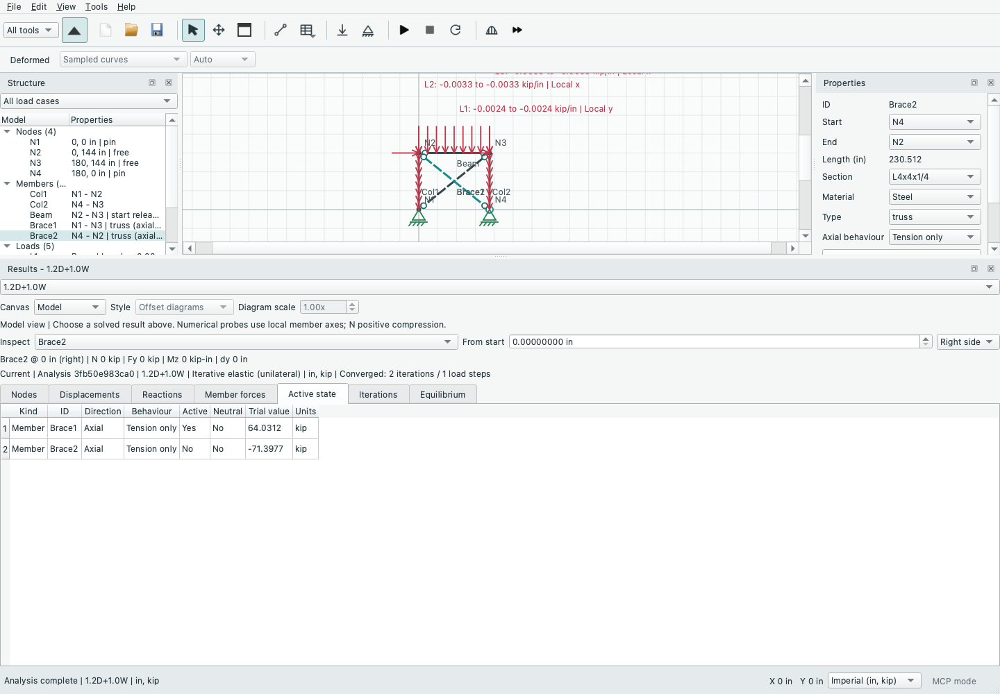
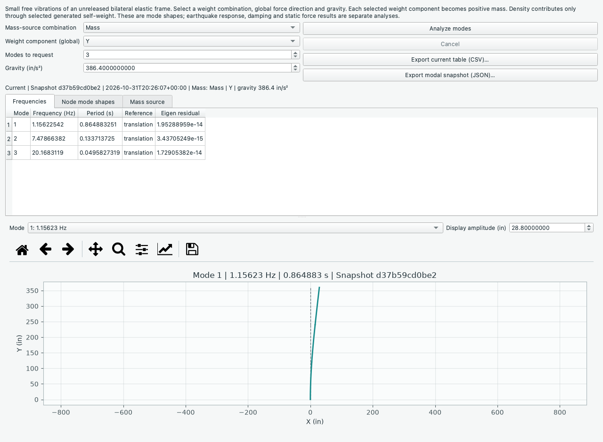
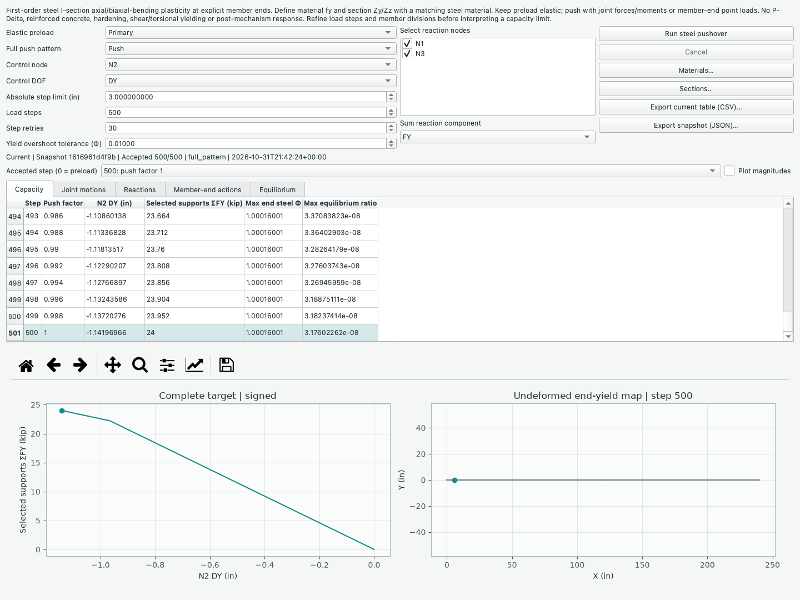

# Tutorial: Iterative Elastic, Vibration Modes & Steel Pushover

This tutorial walks through Brecon's three specialized structural analysis workflows beyond
ordinary linear statics:

1. **Iterative Elastic** (unilateral tension-only / compression-only bars, one-way soil springs,
   and one-way joint springs).
2. **Vibration Modes** (physical mass-source eigenvalue analysis for unreleased bilateral 2D/3D frames).
3. **Steel Pushover** (first-order I-section axial/biaxial-bending plastic capacity and end-yield histories).

---

## 1. Iterative Elastic: Tension-Only Bracing & Compression-Only Foundations

When a model contains one-way axial trusses, one-way support springs, or one-way joint springs,
each load combination must be solved independently without superposing individual load cases.

### Walkthrough
1. Open **File > Examples > Iterative elastic > Tension-Only Cross-Braced Frame**
   (or **Beam on Compression-Only Springs**).
2. Inspect the method in **Edit > Analysis Method…**:
   - **Method:** `Iterative elastic`
   - **Max active-set iterations:** `30` (1–200)
   - **Load steps:** `10` (1–100)
   - **Contact tolerance:** `1e-9`
3. Select diagonal brace `Brace1` or `Brace2` to see **Axial behaviour**: `Tension only` (on a truss member).
   On the foundation beam example, select any foundation node to see **DY spring action**: `Negative displacement only (compression)`.
4. Press **F5** to solve.
5. In the **Results** dock, inspect the two additional tabs created for Iterative elastic snapshots:
   - **Active state:** Lists every unilateral member, support spring, and joint spring, its trial
     quantity, neutral flag, and whether it is **Active** (`Yes`/`No`) in the selected combination.
   - **Iterations:** Shows the load-step and active-set convergence history per combination.

[](../assets/screenshots/iterative-braced.png)

### Headless Python Snippet
```python
from pynitegui.qt.analysis import analyze
from pynitegui.qt.examples import example_project
from pynitegui.qt.unilateral import active_state_table

project = example_project("official_tension_braced")
result = analyze(project)
combo = result.for_combination("1.2D+1.0W")
headers, rows = active_state_table(project, combo)
for row in rows:
    print(dict(zip(headers, row)))
```

See [Supports and springs](../modeling/supports.md), [Axial-only trusses](../modeling/trusses.md),
and [Solve and force diagrams](../analysis/solve.md).

---

## 2. Vibration Modes: Frequencies, Mass Sources & Mode Shapes

**Tools > Vibration Modes** opens an independent native workspace for small free vibrations of
unreleased bilateral 2D or 3D elastic frames. Running a modal analysis never overwrites your
main window's static result snapshot.

### Walkthrough
1. Open **File > Examples > Vibration modes > Cantilever Column - Vibration Modes** (or any
   unreleased bilateral 2D/3D frame with positive weight in a load combination).
2. Open **Tools > Vibration Modes**:
   - **Mass-source combination:** Choose the combination whose downward/directional forces define
     translational mass (for example `Mass`).
   - **Weight component (global):** Choose `X`, `Y`, or `Z` (default `Y`).
   - **Modes to request:** Enter `3` (1–50).
   - **Gravity:** Defaults to standard gravity in the active display units (`386.0885827 in/s²`,
     `9.80665 m/s²`, or `9806.65 mm/s²`). Switching project display units in the main window
     automatically converts the displayed gravity, amplitude, tables, and mode-shape plot axes.
3. Click **Analyze modes**.
4. Inspect the three tabs (**Frequencies**, **Node mode shapes**, **Mass source**) and click any
   row in **Frequencies** to plot that mode shape. Use **Export current table (CSV)…**,
   **Export modal snapshot (JSON)…**, or the plot toolbar's **Save** button for stamped PNG/SVG figures.

[](../assets/screenshots/modal-column.png)

### Headless Python Snippet
```python
from pynitegui.qt.examples import example_project
from pynitegui.qt.modal import ModalSettings, analyze_modal

project = example_project("official_modal")
settings = ModalSettings(combination="Mass", modes=3, direction="Y", gravity=386.4)
modal_result = analyze_modal(project, settings)
for mode_idx, (freq, period) in enumerate(zip(modal_result.frequencies, modal_result.periods), 1):
    print(f"Mode {mode_idx}: f = {freq:.4f} Hz, T = {period:.4f} s")
```

See [Vibration modes](../analysis/modal.md).

---

## 3. Steel Pushover: First-Order Capacity & End-Yield Histories

**Tools > Steel Pushover** provides a checked first-order plastic pushover workspace for 2D/3D
steel I-section frames with explicit member-end axial/biaxial-bending interaction.

### Walkthrough
1. Open **File > Examples > Steel pushover > Propped Beam - Plastic Redistribution**
   (which opens the model and configures the **Steel Pushover** workspace automatically).
2. To configure a custom model for Steel Pushover:
   - In **Edit > Materials…**, check **Assign steel yield stress for I-section pushover** and enter $f_y$ (e.g. `50 ksi`).
   - In **Edit > Sections…**, check the steel plastic profile, enter plastic moduli $Z_y$ and $Z_z$ (e.g. `20 in³`),
     and bind the section to the steel material.
3. In **Tools > Steel Pushover**:
   - **Elastic preload:** Combination applied at step 0 (must remain strictly elastic).
   - **Full push pattern:** Nodal or member-end point-load combination ramped via $\text{preload} + \lambda \times \text{push}$ for $\lambda \in [0, 1]$.
   - **Control node / Control DOF / Absolute stop limit:** Monitored displacement or rotation limit.
   - **Select reaction nodes / Sum reaction component:** Base nodes summed on the capacity curve.
4. Click **Run steel pushover**.
5. Use the **Accepted step (0 = preload)** selector or click rows in the **Capacity** table to
   inspect **Joint motions**, **Reactions**, **Member-end actions** (including dimensionless yield
   index $\Phi$), and **Equilibrium** at every step, alongside the capacity curve and undeformed
   end-yield map ($\Phi \ge 1$).

[](../assets/screenshots/steel-pushover.png)

### Headless Python Snippet
```python
from pynitegui.qt.examples import example_project
from pynitegui.qt.pushover import analyze_pushover
from pynitegui.qt.steel_examples import example_settings

project = example_project("steel_redistribution")
settings = example_settings("steel_redistribution")
history = analyze_pushover(project, settings)
print("Complete:", history.complete, "| Termination:", history.termination)
print("Final factor:", history.factors[-1], "| Control displacement:", history.curve[-1, 0], "in")
```

See [Steel pushover](../analysis/pushover.md).
