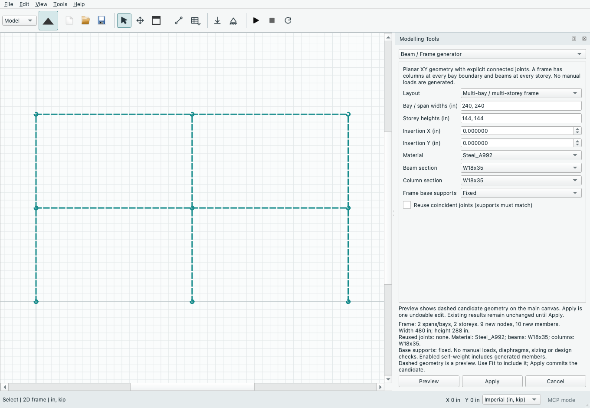
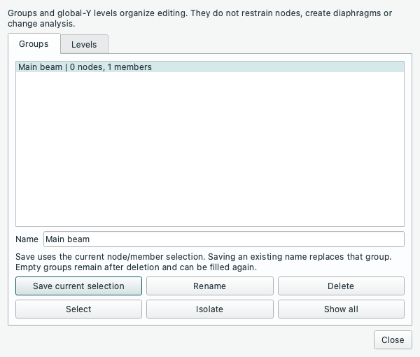
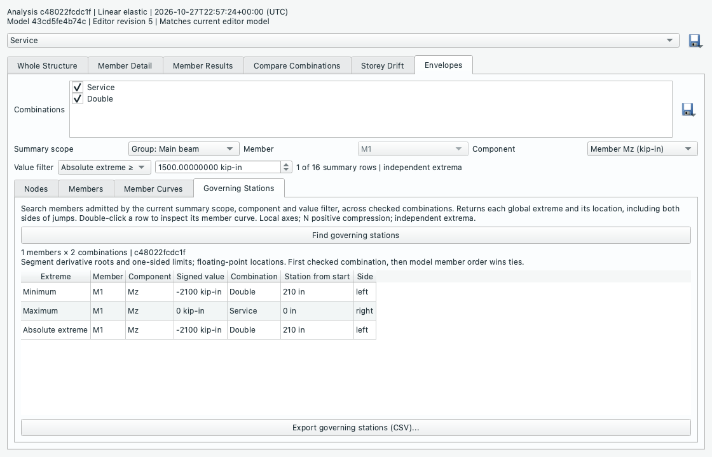
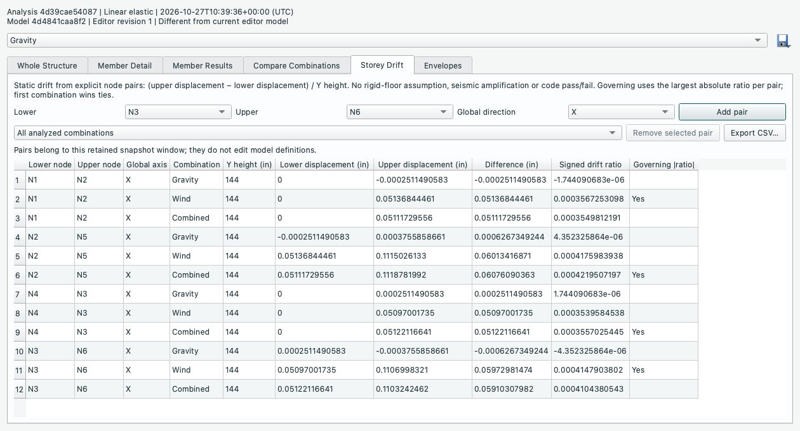

# Tutorial: 2D Portal Frame from Scratch to Envelopes & Reports

This tutorial walks through building a planar steel portal frame, configuring
gravity and lateral load cases, comparing **Linear elastic** and **P-Delta elastic**
analyses, inspecting member diagrams and governing envelopes, checking storey
drift, and exporting results—both in the desktop UI and via headless Python / JSON
snippets.

---

## 1. Create or Generate the Portal Geometry

You can build a single-bay portal frame (span **240 in**, height **144 in**) in three ways:

### Option A: Previewed Frame Generator (Fastest in GUI)
1. Choose **Tools > Frame / Beam Generator…** (or open the **Geometry Tools** dock on the **Generate** tab).
2. Select **2D Portal / Multi-Storey Frame**.
3. Enter **1 bay** at **240 in**, **1 storey** at **144 in**, and choose **Fixed** or **Pinned** base supports.
4. Inspect the live schematic preview and click **Replace / Insert** to commit the generated frame as one undo step.

[](../assets/screenshots/frame-generator.png)

### Option B: Model Tables or Canvas Drawing
1. Choose **Edit > Model Tables…** (or press **Ctrl+T**).
2. Add four nodes:
   - `N1`: `(0, 0)` — support `fixed`
   - `N2`: `(0, 144)` — support `free`
   - `N3`: `(240, 144)` — support `free`
   - `N4`: `(240, 0)` — support `fixed`
3. Add three frame members connecting `N1 → N2` (`M1`, left column), `N2 → N3` (`M2`, roof beam), and `N4 → N3` (`M3`, right column).
4. Click **OK** to validate and commit all table rows in one transaction.

### Option C: Headless Python Snippet
```python
from pynitegui.qt.model import Load, Project

project = Project(unit_system="imperial")
project.add_member((0.0, 0.0), (0.0, 144.0))      # M1: N1 -> N2 (left column)
project.add_member((0.0, 144.0), (240.0, 144.0))  # M2: N2 -> N3 (roof girder)
project.add_member((240.0, 0.0), (240.0, 144.0))  # M3: N4 -> N3 (right column)
project.nodes["N1"].support = "fixed"
project.nodes["N4"].support = "fixed"
project.validate()
```

See [Drawing and selection](../modeling/drawing.md), [Model tables](../modeling/tables.md),
and [Transforms, generators and merging](../modeling/tools.md).

---

## 2. Assign Materials, Sections, Groups and Levels

1. Open **Edit > Materials…** and **Edit > Sections…** to review or import catalog profiles
   (for example `Steel_A992` and `W18x35` for the roof beam, `W14x30` for the columns).
2. To assign a column section to both columns at once, hold **Ctrl** and click `M1` and `M3`
   (or drag a selection box), choose `W14x30` in the bulk **Properties** inspector, and click **Apply**.
3. Open **Edit > Groups and Levels…** to save named selection groups (such as `Columns` for `M1, M3`
   and `Girder` for `M2`) and a named elevation level `Roof` at `Y = 144 in`.
   - Note: If you later split a grouped member or use **Tools > Perpendicular Connection…** /
     **Connect Member Midpoints…**, both resulting member segments automatically remain in `Columns` or `Girder`.

[](../assets/screenshots/groups-levels.png)

See [Materials and sections](../modeling/properties.md) and [Construction connections](../modeling/construction.md).

---

## 3. Configure Load Cases, Self-Weight and Combinations

1. Open **Edit > Load Cases / Combinations…**:
   - Rename `Case 1` to `Dead` and add `Live` and `Wind`.
   - Define three combinations:
     - `Service`: `1.0 Dead + 1.0 Live`
     - `Gravity`: `1.2 Dead + 1.6 Live`
     - `Lateral`: `1.2 Dead + 0.5 Live + 1.0 Wind`
2. Open **Edit > Self-Weight…**, assign automatic member self-weight to `Dead` with factor `1.0`,
   and verify the previewed total member weight.
3. Add applied loads:
   - Select roof girder `M2`, click **Add Load**, choose **Distributed**, case `Dead`, direction `FY`,
     and enter `-0.08 kip/in` from fraction `0` to `1`.
   - Add a second distributed load on `M2` in case `Live` with `-0.12 kip/in`.
   - Select joint `N2`, click **Add Load**, choose **Point**, case `Wind`, direction `FX`, and enter `+15 kip`.

### Headless Python Snippet for Cases, Combinations & Loads
```python
project.set_load_case("Dead", "Case 1")
project.set_load_case("Live")
project.set_load_case("Wind")
project.self_weight_case = "Dead"
project.self_weight_factor = 1.0

project.loads["L1"] = Load("L1", "M2", "FY", -0.08, 0.0, "distributed", -0.08, 1.0, case="Dead")
project.loads["L2"] = Load("L2", "M2", "FY", -0.12, 0.0, "distributed", -0.12, 1.0, case="Live")
project.loads["L3"] = Load("L3", "N2", "FX", 15.0, case="Wind")

project.combinations = {
    "Service": {"Dead": 1.0, "Live": 1.0},
    "Gravity": {"Dead": 1.2, "Live": 1.6},
    "Lateral": {"Dead": 1.2, "Live": 0.5, "Wind": 1.0},
}
project.validate()
```

See [Point and distributed loads](../analysis/loads.md), [Cases and combinations](../analysis/combinations.md),
and [Automatic self-weight](../analysis/self-weight.md).

---

## 4. Solve, Compare Combinations and Check Equilibrium

1. Press **F5** (or click **Analyze**).
2. In the **Results** dock:
   - Select **Service**, **Gravity**, or **Lateral** from the combination dropdown.
   - Open the **Equilibrium** tab to confirm that $\sum F_X$, $\sum F_Y$, and $\sum M_Z$ residuals
     pass independent statics checks.
   - Switch the **Canvas** result selector from `Model` to `Moment Mz` or `Shear Fy`, and toggle
     **Signed colour map** to inspect force distributions directly on the main canvas.
3. To compare second-order sway amplification under combined gravity and wind:
   - Subdivide the columns into 4 equal segments via **Tools > Subdivide Members…** so intermediate
     stations capture column curvature.
   - Choose **Edit > Analysis Method > P-Delta elastic** and press **F5** again.

### Headless Python Snippet for Solving & Checking Equilibrium
```python
from pynitegui.qt.analysis import analyze
from pynitegui.qt.equilibrium import check_equilibrium

result = analyze(project)
for combo_name in ("Service", "Gravity", "Lateral"):
    combo_result = result.for_combination(combo_name)
    eq = check_equilibrium(project, combo_result)
    assert eq.passed, f"Equilibrium failed for {combo_name}"
    print(combo_name, "N2 DX =", combo_result.displacements["N2"][0], "in")
```

See [Solve and force diagrams](../analysis/solve.md) and [Linked tables and equilibrium](../results/linked.md).

---

## 5. Envelopes, Governing Stations, Storey Drift and Reports

1. Click **Diagrams** in the top toolbar:
   - **Whole Structure** and **Member Detail** plot axial force $N$, shear $F_y$, bending moment $M_z$,
     and local deflection $d_y$ for the active combination.
   - **Compare Combinations** overlays any two combinations on shared axes with a difference readout.
   - **Combination Envelopes** computes the max/min bounds across selected combinations. Use the
     **Governing Stations** sub-panel to locate the exact member, combination, and station ($x$, left/right side)
     producing the peak positive, negative, or absolute internal action.
   - **Storey Drift** evaluates lateral drift between base node `N1` and roof node `N2` across all
     selected combinations and identifies the governing combination.

[](../assets/screenshots/governing-stations.png)

[](../assets/screenshots/storey-drift.png)

2. Use the **Export / Print** button in the top-right of the Diagrams dialog (or **File > Export Results CSV** /
   **File > Print Results…**) to export unit-labelled CSV tables, stamped PNG/SVG plots, or a printable PDF report.

See [Combination envelopes](../results/envelopes.md) and [CSV and printable reports](../results/reports.md).
