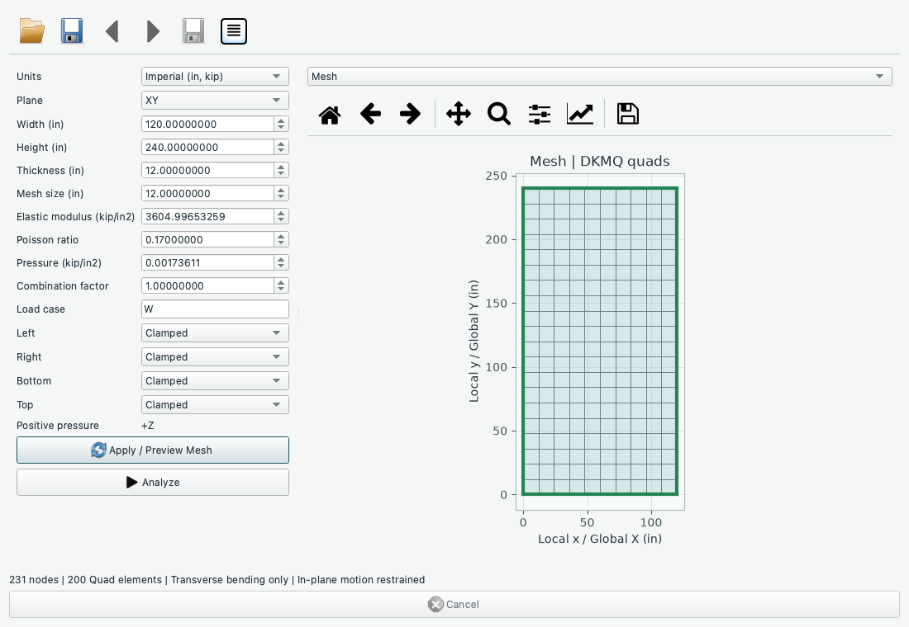
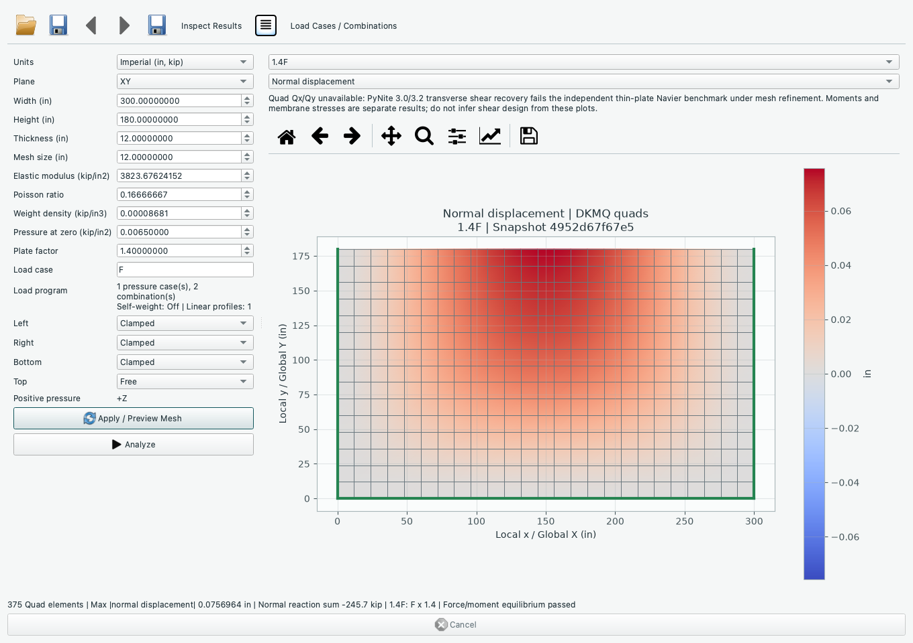
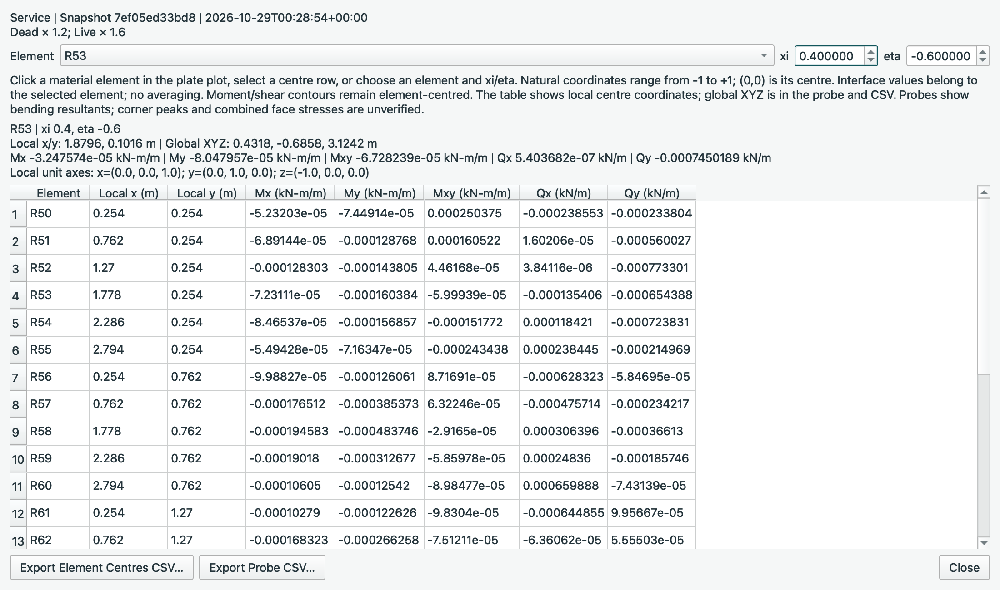
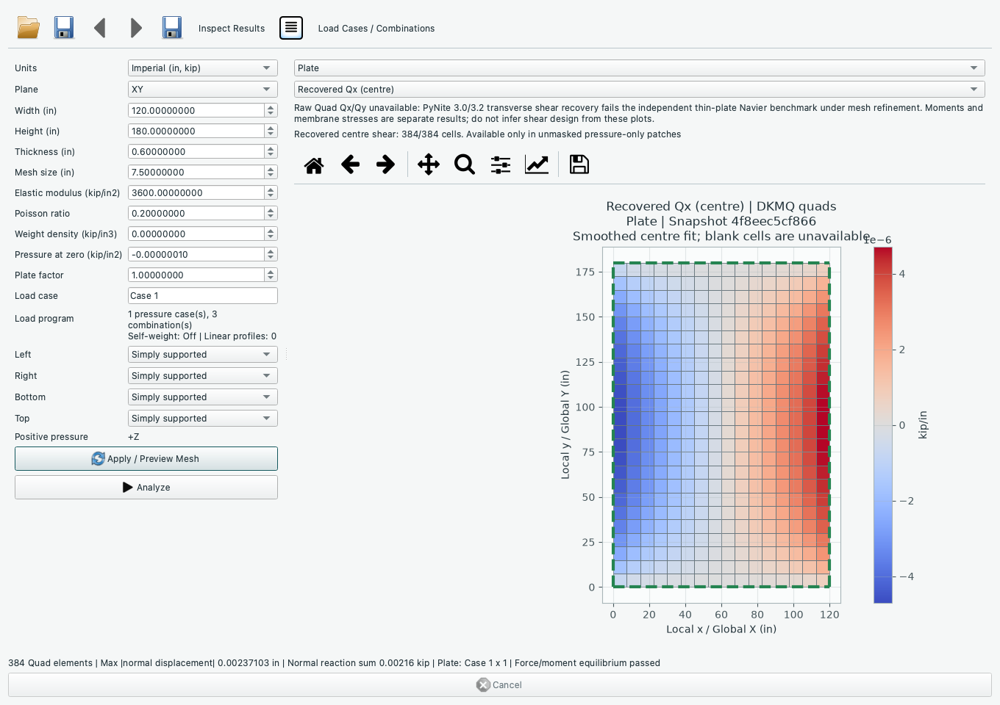
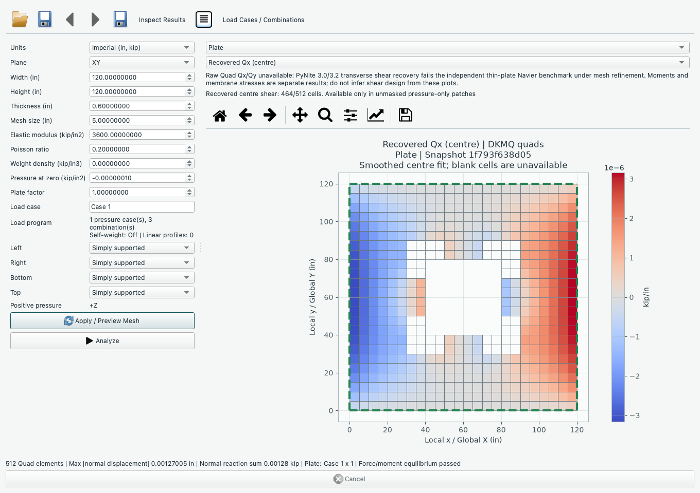

# Tutorial: Rectangular Plate Analysis, Linear Pressure Profiles & Recovered Shear

This tutorial walks through Brecon's standalone transverse rectangular plate workspace
(**Tools > Rectangular Plate (Experimental)**), covering:

1. **Clamped and simply supported plates** using `Quad` (DKMQ) or `Rect` (polynomial) elements.
2. **Linear / hydrostatic pressure profiles**, multiple pressure cases, named combinations, and horizontal `XZ` self-weight.
3. **Rectangular openings, control-line mesh grading, and natural-coordinate probes** $(\xi, \eta)$.
4. **Guarded Recovered Centre Shear** (`Recovered Qx (centre)` / `Recovered Qy (centre)`) and corner/stencil masking.
5. **Mat Foundations, Winkler Soil Subgrade Springs & Concentrated Point Loads** (`Official PyNite - Mat Foundation`).
6. **In-Plane Shear Walls, Membrane Stresses & Pier / Coupling-Beam Forces** (`Official PyNite - Masonry Shear Wall with Openings` and `Official PyNite - Concrete Coupled Shear Wall`).

---

## 1. Open and Solve the Official Clamped Quad Plate

1. Choose **File > Examples > Plates (Experimental) > Official PyNite - Clamped Rectangular Quad Plate**
   (or open **Tools > Rectangular Plate (Experimental)** directly).
2. Inspect the plate parameters:
   - **Width:** `120 in` (10 ft), **Height:** `240 in` (20 ft), **Thickness:** `12 in` (1 ft)
   - **Mesh size:** `12 in` (`200` `Quad` elements)
   - **Edges:** `Left`, `Right`, `Bottom`, `Top` all set to `Clamped`
   - **Pressure at zero:** `+250 psf` (`0.00173611 kip/in²`) in case `W`
3. Click **Analyze**:
   - The applied normal load is `+50 kip`, and the sum of normal support reactions is `-50 kip`.
   - Use the **Component** dropdown to switch between **Mesh**, **Normal displacement**,
     **Moment Mx**, **Moment My**, **Twisting Mxy**, and **Applied pressure**.

[](../assets/screenshots/official-quad-plate.png)

---

## 2. Linear / Hydrostatic Pressure Profiles & Load Combinations

1. Choose **File > Examples > Plates (Experimental) > Official PyNite - Hydrostatic Tank Wall**
   (`official_wall_hydrostatic`).
2. Click **Load Cases / Combinations…** to open the staged **Plate Load Cases and Combinations** dialog:
   - On the **Pressure cases** tab, each case can be **Uniform**, **Linear local x** (varying across width),
     or **Linear local y** (varying across height from `Pressure at zero` at $y = 0$ to `End pressure` at $y = \text{height}$).
   - On the hydrostatic tank wall (`300 × 180 in`, clamped on `Left`, `Right`, and `Bottom`, `Free` on `Top`),
     case `F` varies linearly along local $y$ from maximum water pressure at the base ($y = 0$) to `0` at the top ($y = 180\text{ in}$).
   - If **Self-weight case** is enabled on a horizontal `XZ` plate and you later change **Plane** to `XY` or `YZ`,
     opening **Load Cases / Combinations…** keeps the **Self-weight case** selector enabled so you can switch it to
     **Off** and commit the plane change in one undo step.
3. Select **Applied pressure** in the **Component** selector to preview the centroid pressure per element
   even before running the solver, then click **Analyze** to inspect the `1.4F` combination (`+245.7 kip` total load,
   `-245.7 kip` total reaction).

[](../assets/screenshots/hydrostatic-wall.png)

### Headless Python Snippet: Hydrostatic Tank Wall Analysis
```python
from pynitegui.qt.official_plate import example_definition
from pynitegui.qt.plate_model import analyze_plate, select_plate_combination

wall = example_definition("official_wall_hydrostatic")
snapshot = analyze_plate(wall)
factored = select_plate_combination(snapshot, "1.4F")
print("Applied load (1.4F):", round(factored["applied"], 4), "kip")
print("Reaction sum (1.4F):", round(float(factored["reactions"].sum()), 4), "kip")
print("Peak displacement:", round(float(max(abs(factored["displacement"]))), 6), "in")
```

---

## 3. Openings, Control Lines & Natural-Coordinate Probes

1. In the **Rectangular Plate** workspace, click **Mesh Options…** to open the rectangular mesh
   editor where you can add **X / Y control lines** and **Rectangular openings**.
   - Control lines subdivide a rectangle along exact internal coordinates; element count and cell
     aspect-ratio validation automatically account for all control-line and opening intervals.
2. After solving any `Quad` or `Rect` plate, click **Inspect Results…** (or click any element cell
   directly on the contour plot):
   - Select an element or enter natural coordinates $\xi, \eta \in [-1, 1]$ (`0, 0` is the element centre).
   - For `Rect` elements, polynomial shear recovery (`Qx`, `Qy`) is also reported alongside `Mx`, `My`, `Mxy`.
   - Export either the single probe or all element centres with full provenance metadata via **Export CSV**.

[](../assets/screenshots/plate-local-inspection.png)

---

## 4. Guarded Recovered Centre Shear for Eligible Thin Quad Plates

Raw `Quad` (DKMQ) transverse shear is disabled because unsmoothed element-level shear derivatives
do not converge reliably on general boundaries. For eligible thin standalone `Quad` plates, Brecon
provides **Guarded Recovered Centre Shear** (`Recovered Qx (centre)` and `Recovered Qy (centre)`),
computed from a compatible, pressure-equilibrated moment-potential fit over complete $3 \times 3$
Cartesian cell patches:

1. Open **File > Examples > Plates (Experimental) > Thin Plate - Recovered Centre Shear**
   (`thin_plate_recovered_shear`) or **Thin Plate Opening - Masked Recovered Shear**
   (`opening_plate_recovered_shear`).
2. Click **Analyze**, then choose **Recovered Qx (centre)** or **Recovered Qy (centre)** in the
   **Component** dropdown.
3. On the opening example (`120 × 120 in` plate with a centred `40 × 40 in` free opening at `5 in`
   mesh size), `464` of `512` cells have valid recovery stencils, while cells near re-entrant opening
   corners are explicitly masked (left blank as **unavailable**, never fabricated as zero).

[](../assets/screenshots/plate-recovered-shear.png)

[](../assets/screenshots/plate-recovered-shear-masks.png)

### Headless Python Snippet: Guarded Recovered Centre Shear
```python
from pynitegui.qt.official_plate import example_definition
from pynitegui.qt.plate_model import analyze_plate

for key in ("thin_plate_recovered_shear", "opening_plate_recovered_shear"):
    plate = example_definition(key)
    result = analyze_plate(plate)
    rec = result["recovered_shear"]
    print(f"{key}: available={rec['available']}/{rec['total']} cells | reason={rec['reason']}")
```

---

## 5. Mat Foundations, Winkler Soil Subgrade Springs & Concentrated Point Loads

1. Choose **File > Examples > Plates (Experimental) > Official PyNite - Mat Foundation**
   (`official_mat_foundation`).
2. Inspect the mat foundation setup in the main controls:
   - **Plane:** `XZ` (`600 × 300 in` = `50 × 25 ft`), **Thickness:** `12 in` (`1 ft`), **Mesh size:** `12 in` (`1,200` `Quad` elements, `1,290` nodes after removing the `60 × 120 in` opening `OPNG1`).
   - **Edges:** `Left`, `Right`, `Bottom`, `Top` all set to `Free`.
   - **Subgrade modulus:** `0.1 kip/in3` (`100 pci` = `172.8 kcf`), **Subgrade action:** `Compression only (-normal)` (or switch to `Bilateral` to compare linear bilateral soil springs).
3. Click **Load Cases / Combinations…** and switch to the **Point loads** tab:
   - Two concentrated loads in case `D` are applied at local `(120, 120) in` (`(10, 10) ft`):
     downward column load `FY = -10 kip` and overturning moment `MZ = +180 kip-in` (`+15 kip-ft`).
   - Any interior point-load coordinate is automatically merged into the mesh control lines so a mesh node is guaranteed at `(x, y)`.
4. Click **Analyze**:
   - In the **Component** selector, choose **Soil bearing pressure** to view the element-average compressive bearing pressure contour.
   - Click **Inspect Results…** (or click any element on the plot) to probe the bilinearly interpolated soil bearing pressure $p(\xi, \eta)$ at any natural coordinate $(\xi, \eta) \in [-1, 1]^2$, and export nodal tributary areas, bearing pressures, and active spring flags via **Export CSV**.

### Headless Python Snippet: Mat Foundation on Compression-Only Winkler Soil Springs
```python
from pynitegui.qt.official_plate import example_definition
from pynitegui.qt.plate_inspection import inspect_plate
from pynitegui.qt.plate_model import analyze_plate, select_plate_combination

mat = example_definition("official_mat_foundation")
result = select_plate_combination(analyze_plate(mat), "D")
print("Active soil springs:", f"{result['active_soil_springs']}/{result['total_soil_springs']}")
print("Uplifted nodes:", len(result["uplift_nodes"]))
print("Peak nodal bearing pressure:", round(float(result["nodal_bearing_pressure"].max()), 6), "kip/in2")
probe = inspect_plate(result, result["element_names"][0], xi=0.0, eta=0.0)
print("Element 0 centre bearing pressure:", round(probe["soil_bearing_pressure"], 6), "kip/in2")
```

---

## 6. In-Plane Shear Walls, Membrane Stresses & Pier / Coupling-Beam Forces

1. Choose **File > Examples > Plates (Experimental) > Official PyNite - Masonry Shear Wall with Openings**
   (`official_shear_wall_basic`) or **Official PyNite - Concrete Coupled Shear Wall**
   (`official_shear_wall_advanced`).
2. Inspect the shear wall configuration:
   - **Mode:** `In-plane shear wall (membrane)` on `Quad` elements (out-of-plane translation and all three nodal rotations are restrained everywhere; support segments pin in-plane `u, v` translations).
   - **Load Cases / Combinations…** exposes dedicated **Wall stories**, **Wall story loads** (`Shear (+local x)` and `Axial (-local y)` distributed evenly to all generated nodes on the story line), and **Wall supports** tabs.
   - On `official_shear_wall_advanced` (`50 × 25 ft` concrete wall, `1 ft` thick, `ky_mod = 0.35`, `40 × 20 ft` opening `Opng 1`, `150 kip` roof seismic shear in `1.2D+1.0E`):
     - Roof story lateral stiffness is `291.171 kip/in` (`3,494.05 kip/ft`).
     - Piers `P1` and `P3` each carry `V = -75.0 kip`, `M = -888.753 kip-ft` (`-10,665.0 kip-in`), and overturning axial force `P = ±43.833 kip` (`M/(VL) = 2.370`).
     - Coupling beam `B1` carries `V = -43.833 kip`, `M = -733.281 kip-ft` (`-8,799.38 kip-in`), and `P = +57.353 kip` (`M/(VH) = 3.346`).
3. Click **Analyze**, switch **Component** between **Normal displacement** (lateral `u` in shear-wall mode), **In-plane vertical displacement**, and **Membrane Sx / Sy / Txy (element centre)**, then open **Inspect Results…** to view the **Wall Piers & Coupling Beams** table, probe $(\xi, \eta)$ membrane stresses, and export **Export Piers / Beams CSV…**.

### Headless Python Snippet: Coupled Concrete Shear Wall Analysis
```python
from pynitegui.qt.official_plate import example_definition
from pynitegui.qt.plate_inspection import inspect_plate
from pynitegui.qt.plate_model import analyze_plate, select_plate_combination

wall = example_definition("official_shear_wall_advanced")
res = select_plate_combination(analyze_plate(wall), "1.2D+1.0E")
print("Roof stiffness:", round(res["story_stiffnesses"]["Roof"], 3), "kip/in")
for pier in res["piers"]:
    print(f"Pier {pier['name']}: V={pier['V']:.2f} kip, M={pier['M']/12:.2f} kip-ft, P={pier['P']:.2f} kip, M/(VL)={pier['M_VL']:.3f}")
for beam in res["coupling_beams"]:
    print(f"Beam {beam['name']}: V={beam['V']:.2f} kip, M={beam['M']/12:.2f} kip-ft, P={beam['P']:.2f} kip, M/(VH)={beam['M_VH']:.3f}")
probe = inspect_plate(res, res["element_names"][0], xi=0.0, eta=0.0)
print("Element 0 membrane stress (Sx, Sy, Txy):", round(probe["Sx"], 5), round(probe["Sy"], 5), round(probe["Txy"], 5), "ksi")
```

See [Rectangular plate analysis](../surfaces/plates.md).
