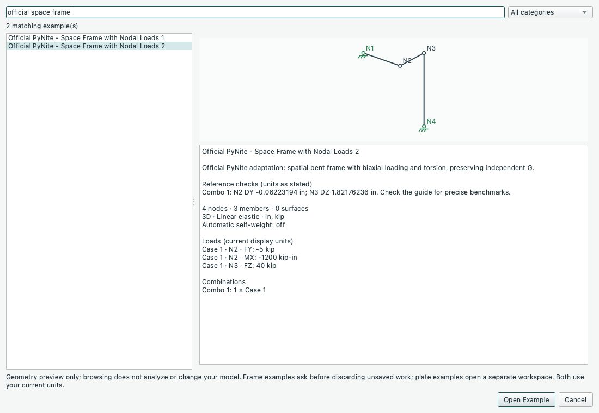
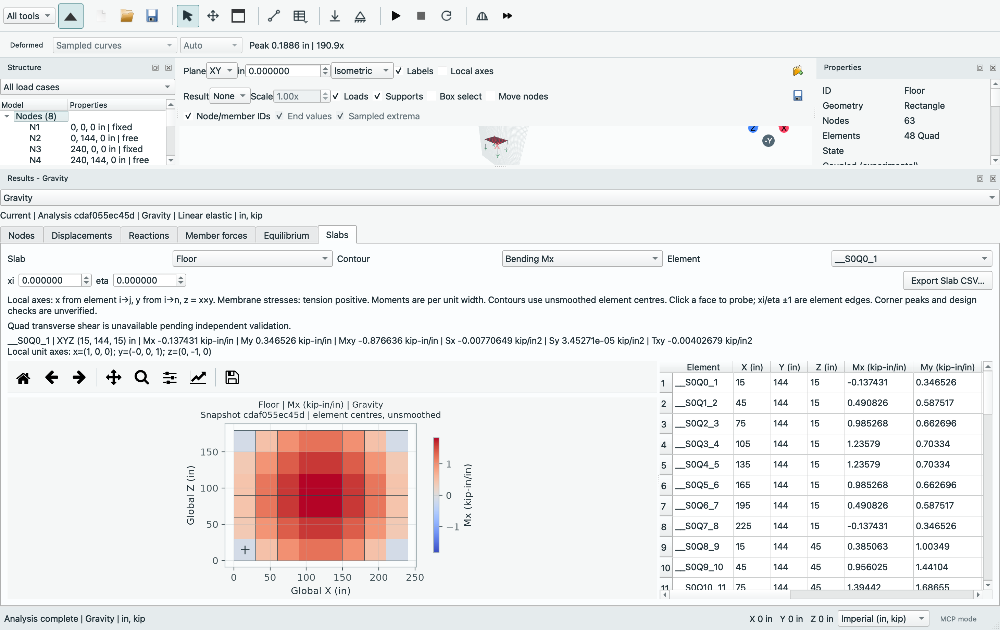
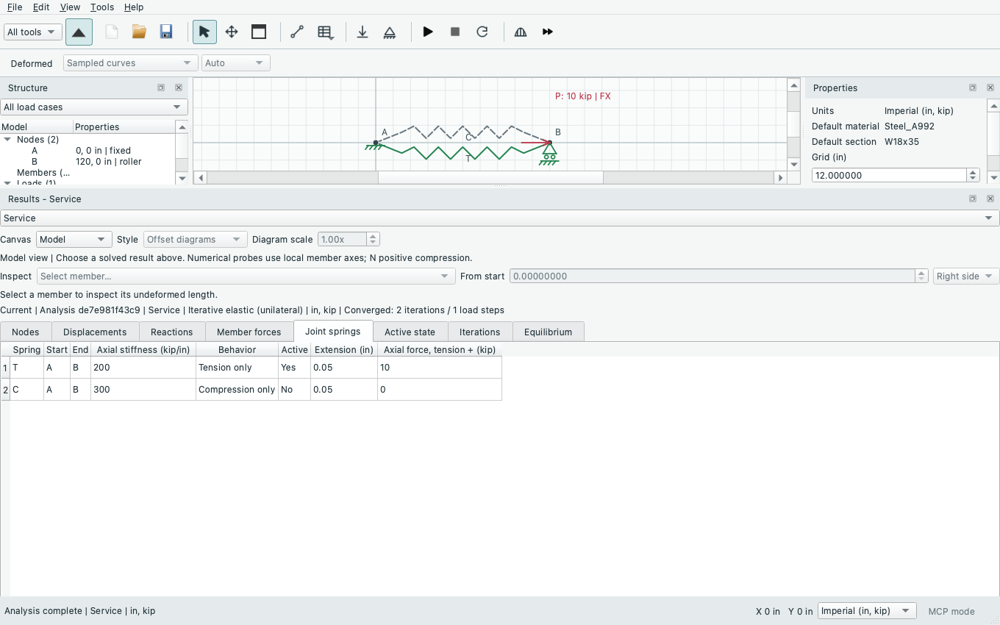

# Tutorial: 3D Space Frame, Coupled Slab & Joint Springs

This tutorial covers three spatial workflows in Brecon:

1. Building a 3D frame using work planes, XYZ coordinates, member roll, and six-DOF supports.
2. Placing a rectangular `Quad` floor slab onto a 3D frame level, enabling experimental coupled
   slab/frame analysis, and probing local slab bending moments and membrane stresses.
3. Solving a memberless 3D joint-spring network and playing its static deformation animation.

---

## 1. Build a 3D Frame Bay

1. Choose **File > New 3D Frame** (or convert an existing 2D project with **Tools > Create 3D Copy**).
2. In the top 3D toolbar, select a work plane (`XY`, `XZ`, or `YZ`) and plane offset, or open
   **Edit > Model Tables…** to enter exact `X, Y, Z` coordinates (global `+Y` is vertical).
3. For rapid generation of a single-bay 3D frame (`240 in` along X, `180 in` along Z, `144 in` height along Y),
   you can either open **File > Examples > Slabs > 3D Frame and Slab - Coupled Pressure (Experimental)**
   or construct the bay in Python:

```python
from pynitegui.qt.spatial_model import SpatialProject

project = SpatialProject(unit_system="imperial")
# Four base nodes at Y = 0 and four roof nodes at Y = 144 in
corners = [(0.0, 0.0), (240.0, 0.0), (240.0, 180.0), (0.0, 180.0)]
for x, z in corners:
    base = project.node_at(x, 0.0, z)
    project.nodes[base].support = "fixed"
    project.add_member((x, 0.0, z), (x, 144.0, z))  # Columns M1..M4

# Perimeter roof beams at Y = 144 in (M5..M8)
for i, (x1, z1) in enumerate(corners):
    x2, z2 = corners[(i + 1) % 4]
    project.add_member((x1, 144.0, z1), (x2, 144.0, z2))

project.validate()
```

4. Select any 3D member to inspect or change its **Roll (deg)** and local end releases
   (local axial `DX`, shears `DY`/`DZ`, torsion `RX`, and bendings `RY`/`RZ`).

[](../assets/screenshots/official-space-frame.png)

See [3D frames and trusses](../modeling/3d.md) and [Member end releases](../modeling/releases.md).

---

## 2. Fit and Couple a Rectangular Floor Slab (Experimental)

1. In a 3D project, choose **Tools > Surface Meshing (Experimental)** (or click **Add Surface**
   in the inspector when nothing is selected).
2. With the **Rectangle** generator selected, use **Fit rectangle to > Frame level** and choose
   the `Y = 144 in` elevation (or select the four corner nodes / four perimeter beams first and
   choose **Selected boundary**).
   - If the frame has intermediate beams or split perimeter segments, their stations are
     automatically added as `x_control` / `y_control` lines so the slab mesh vertices conform to the frame joints.
3. Click **Apply to 3D Model**. The surface identifier (e.g., `S1`) is reserved across nodes,
   members, loads, and joint springs so subsequent geometry additions never collide with it.
4. Select the surface in the **Surfaces** tree and in **Properties**:
   - Check **Coupled analysis (experimental)**.
   - Choose a load case under **Pressure case**, enter `0.001 kip/in²` (positive XZ pressure acts in global `-Y`),
     and click **Apply Pressure**.
   - Optionally click **Edge Supports…** to assign outer-edge restraints (`Free`, `Normal roller`,
     `Bending clamp`, `Translations fixed`, or `Fixed`).

### Headless Python Snippet for Coupled Slab Setup & Analysis
```python
from pynitegui.qt.analysis import analyze
from pynitegui.qt.mesh_model import MeshDefinition
from pynitegui.qt.spatial_surfaces import put_surface

slab = MeshDefinition(
    name="Floor1",
    generator="rectangle",
    parameters={"width": 240.0, "height": 180.0},
    mesh_size=60.0,
    thickness=6.0,
    plane="XZ",
    origin=[0.0, 144.0, 0.0],
    element_type="Quad",
)
put_surface(project, slab)
project.surface_analysis_enabled = True
project.surface_pressures["Floor1"] = {"Case 1": 0.001}
project.validate()

result = analyze(project)
# Total downward pressure = 240 * 180 * 0.001 = 43.2 kip (10.8 kip per column base)
for base_node in ("N1", "N3", "N5", "N7"):
    print(base_node, "RY =", round(result.reactions[base_node][1], 4), "kip")
```

5. After analysis, open **Results > Slabs** (or click **Inspect Slab Results**):
   - Switch between local bending moments (`Mx`, `My`, `Mxy` in moment per unit width) and
     membrane stresses (`Sx`, `Sy`, `Txy`).
   - Click any element face or enter natural coordinates $\xi, \eta \in [-1, 1]$ to probe exact
     within-element values and local unit vectors.

[](../assets/screenshots/coupled-slab-results.png)

See [Slab placement and main-model surfaces](../surfaces/main-model.md) and
[Rectangular plate analysis](../surfaces/plates.md).

---

## 3. Memberless 3D Joint-Spring Networks

Brecon also supports structures connected entirely by axial **Joint Springs** (`S1`, `S2`, ...)
between existing joints—either in 2D (`joint_spring_series`, `joint_spring_one_way`) or 3D
(`3d_joint_spring_network`).

1. Open **File > Examples > Joint Springs > 3D Joint Spring Network** (or open **Edit > Joint Springs…**
   in any model with at least two nodes).
2. Each spring defines an explicit axial stiffness $k$ (in force/length units, e.g. `kip/in` or `N/mm`)
   and an action mode (`Bilateral`, `Tension only`, or `Compression only`). One-way springs use
   **Edit > Analysis Method > Iterative elastic**.
3. Press **F5** to solve:
   - The **Results > Joint Springs** tab lists each spring's active state, chord extension, and
     axial force (tension positive).
   - **Tools > Animate Static Deformation…** animates the displaced spring links in 2D or 3D.
   - **Diagrams** and **Print Results…** remain safe to open on memberless spring networks for
     combination comparisons, storey drift, equilibrium, and orthographic report generation.

[](../assets/screenshots/joint-springs-results.png)

See [Joint springs](../modeling/joint-springs.md).
