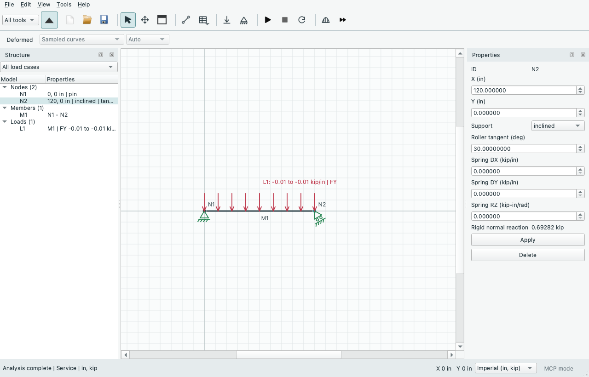
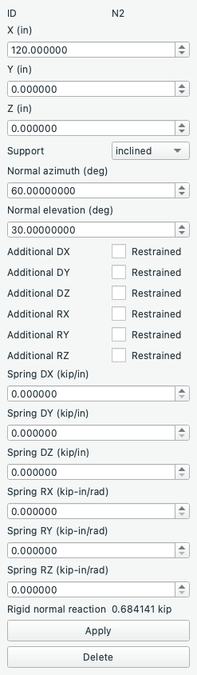
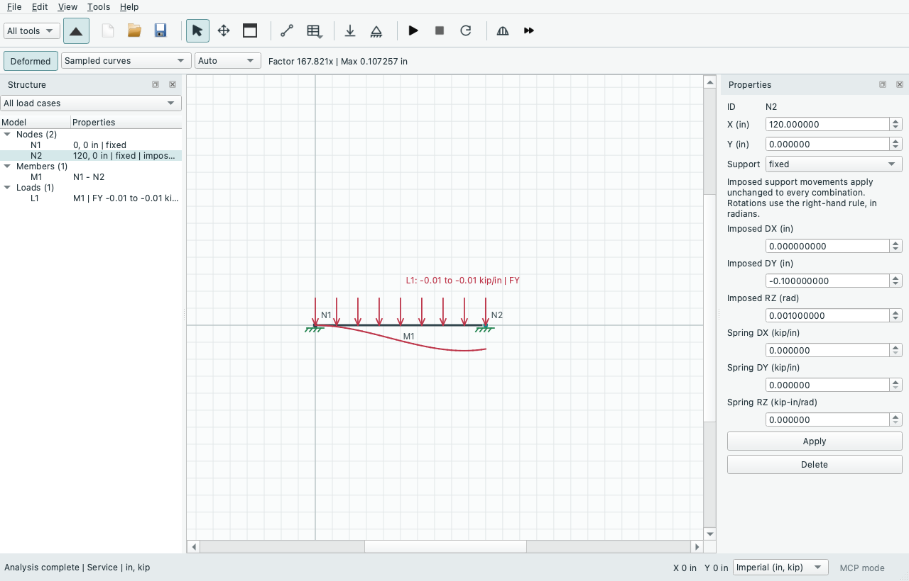
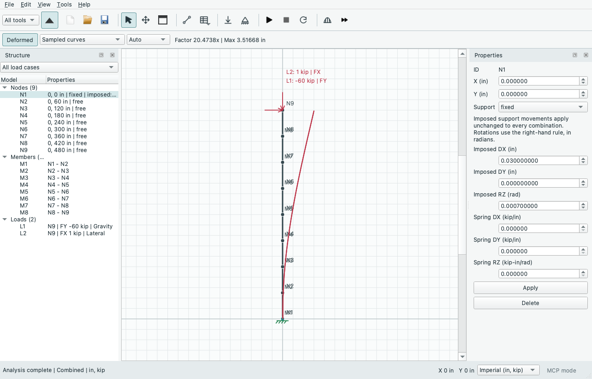

# Tutorial: Inclined Rollers, Support Settlements & Ground Springs

This tutorial covers advanced boundary conditions in 2D and 3D:

1. **Inclined rollers** with custom tangent angles (2D) or oblique normal azimuth/elevation (3D).
2. **Imposed support movements** (prescribed translations and rotations) in both linear elastic
   and second-order P-Delta analyses.
3. **Bilateral and one-way global support springs** (elastic base stiffness and uplift-releasing ground contacts).

---

## 1. Inclined Rollers in 2D and 3D

An inclined support constrains motion perpendicular to a sliding plane (2D) or along/orthogonal
to an oblique normal vector (3D) while allowing tangential motion:

### 2D Inclined Roller
1. Open **File > Examples > 2D Frames > Beam - Inclined Roller** (`inclined_roller`).
2. Select the right support node `N2` and inspect **Properties**:
   - **Support:** `inclined`
   - **Roller tangent (deg):** Angle measured counterclockwise from global $+X$ (`-180°` to `+180°`).
     Motion is free along the tangent and restrained perpendicular to it; check **Restrain RZ** if
     rotation is also fixed.
3. Press **F5** to solve. The reaction vector `(RX, RY)` at `N2` is strictly perpendicular to the
   configured roller tangent, and global equilibrium closes exactly.

[](../assets/screenshots/inclined-roller.png)

### 3D Oblique Support Normal
1. Open **File > Examples > 3D Frames > 3D Cantilever - Oblique Roller Normal** (`3d_inclined_roller`).
2. Select the inclined node and inspect:
   - **Support:** `inclined`
   - **Normal azimuth (deg)** (`-180°` to `+180°`, from $+X$ toward $+Z$) and **Normal elevation (deg)** (`-90°` to `+90°`, toward $+Y$).
   - **Local restraint checkboxes:** Restrain normal translation, tangential translations, or global rotations.

[](../assets/screenshots/spatial-inclined-properties.png)

### Headless Python Snippet: 2D and 3D Inclined Rollers
```python
from pynitegui.qt.analysis import analyze
from pynitegui.qt.equilibrium import check_equilibrium
from pynitegui.qt.examples import example_project

for key in ("inclined_roller", "3d_inclined_roller"):
    proj = example_project(key)
    res = analyze(proj)
    assert check_equilibrium(proj, res).passed
    print(key, "reactions:", {k: [round(v, 4) for v in rxn] for k, rxn in res.reactions.items()})
```

---

## 2. Imposed Support Settlements & Rotations

Prescribed support motions (`settlement_dx`, `settlement_dy`, `settlement_rz` in 2D; plus
`settlement_dz`, `settlement_rx`, `settlement_ry` in 3D) apply a fixed physical displacement or
rotation (in length units or radians) at a rigidly restrained DOF across every load combination.

1. Open **File > Examples > 2D Frames > Beam - Support Settlement and Rotation** (`support_settlement`).
   - Select the restrained support node to inspect its prescribed vertical settlement and end rotation.
   - Press **F5** and inspect induced shear forces, bending moments, and support reactions.
2. Open **File > Examples > P-Delta > Column - Imposed Base Motion** (`p_delta_support_motion`).
   - This model combines a compressive axial load with a prescribed base translation/rotation under
     **P-Delta elastic**, capturing the second-order $P\text{-}\Delta$ moment amplification induced
     by support movement.

[](../assets/screenshots/support-settlement.png)

[](../assets/screenshots/pdelta-support-motion.png)

### Headless Python Snippet: Prescribed Support Settlement
```python
from pynitegui.qt.analysis import analyze
from pynitegui.qt.model import Project

project = Project(unit_system="imperial")
project.add_member((0.0, 0.0), (120.0, 0.0))  # M1
project.nodes["N1"].support = "fixed"
project.nodes["N2"].support = "fixed"
# Impose a 0.5-inch downward settlement at N2 with zero applied external loads
project.nodes["N2"].settlement_dy = -0.5
project.validate()

result = analyze(project)
print("Induced vertical reactions (RY) at N1, N2:",
      round(result.reactions["N1"][1], 4), round(result.reactions["N2"][1], 4), "kip")
```

---

## 3. Bilateral & One-Way Global Support Springs

Any node can define translational (`Spring DX`, `Spring DY`, `Spring DZ`) and rotational
(`Spring RX`, `Spring RY`, `Spring RZ`) ground springs:

- **Rule:** A single DOF cannot have both a rigid restraint and a nonzero ground spring at the same time.
  Free that DOF (using `free` or `custom` support) before entering a spring stiffness.
- **Bilateral vs. One-Way Action:** Under **Linear elastic** or **P-Delta elastic**, support springs are
  bilateral. Under **Iterative elastic**, each translational or rotational spring can be set to
  **Bilateral**, **Positive displacement only**, or **Negative displacement only** (for example,
  a soil foundation that resists downward $-Y$ compression but releases on upward $+Y$ uplift).

1. Open **File > Examples > 2D Frames > Cantilever - Elastic Base** (`elastic`) for a bilateral rotational
   and translational spring check.
2. Open **File > Examples > Iterative elastic > Official PyNite - Braced Frame with One-Way Ground Springs**
   (`official_ground_braced`) to see one-way vertical ground anchors under wind uplift and compression.

### Bulk Restraint Editing Tip
When you select multiple nodes that already use `custom` (or 3D `inclined`) supports, the bulk
**Properties** inspector keeps the **Restrain DX / DY / RZ** checkboxes enabled even while
**Support** is left at **Keep existing**, allowing you to toggle a single restraint DOF across all
selected nodes in one click.

See [Supports and springs](../modeling/supports.md).
